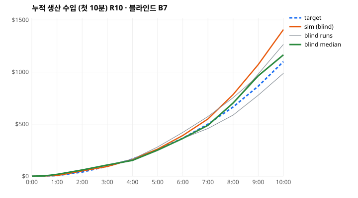
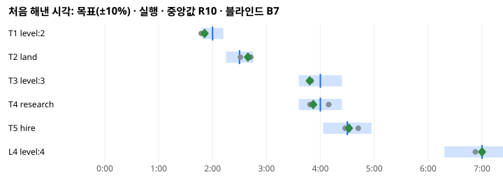

# 증분 밸런스 보고서 (Step 50)

목표와 합격 기준은 `design/INCREMENTAL_PACING.md`에 있다. 커밋 361a6213에서 튜닝 전에 고정했다.

이 문서는 라운드마다 무엇을 바꿨고 무엇을 쟀는지 적는다.

## 시뮬레이터 라운드 (블라인드형 봇, 결정적)

| 라운드 | 바꾼 것 (전 → 후) | 이유 | 결과(가중 집계 오차) |
|---|---|---|---|
| R0 | 규칙: 즉시 수입·밭 5초·광산 10초·익은 밭으로 시작·모모 ×1.0·새 건물 자동 담당. 첫 숫자: 작물 $3, 고용 $60, 땅 $35→$30, Lv2 100→70 EXP | 가설(§5) | 34.2%. 첫 연구가 30분 안에 없음: 모모가 연구소에서 쉬지 않고 노트를 써서 밭이 멈춤(4분대 수입 $3/분) |
| (규칙) | 오래 기다린 건물 먼저(`starve_seconds` 8) | 가까운 밭이 늘 준비돼 있어 연구소가 굶음 | — |
| R1 | 연구 노트 4초 → 3초 + 실험 대기 9초 | 연구소가 하나뿐인 모모를 삼키지 않게 | 34.0%. 첫 연구 4:10(목표 4:00) 통과, 수입 −33%/−40% |
| R2 | 작물 $3→$4, 고용 $60→$35, 땅 $30→$25, Lv2 70→60, Lv3 200→160, 모모 걷기 0.7→1.0 | 수입 부족, 고용 7:20, 땅 4:10 | 26.1%. 고용 2:40(너무 이름), 10분 수입 +32% |
| (규칙) | 자동 담당은 이미 일하는 모모만(처음 모모는 플레이어가 맡김) | 튜토리얼의 '손으로 심기'가 사라짐 | — |
| R3 | 고용 $35→$50 | 고용이 땅·연구보다 먼저 옴 | 11.6%. 땅 +13%, 고용 +15%, 10분 수입 +29% → **블라인드 B1** |
| (봇) | 블라인드형 봇 다시 보정: 10초→8초에 한 번, 넷에 하나 둘러보기, 새 종류 건물을 위해 저축 | B1의 실제 탭 간격 6–9초, 모모 첫 수입 0:45(봇 1:21), 연구소를 위한 저축 | 예측 도구일 뿐(합격은 블라인드) |
| R4 | Lv 2 60→77, Lv 3 160→143, Lv 4 550→430 + 화면 고침 6가지(§B2) | B1: Lv 2 −22%, Lv 4 +28%, 혼란 목록 | → **블라인드 B2** |
| R5 | Lv 2 77→90, Lv 3 143→130, 고용 $50→$60 + 바다 팁 시점, 'Hire', 거절 이유 | B2: Lv 2 −14%, 고용 −24%, 땅이 두 무리 | → **블라인드 B3** |
| R6 | 땅 초대 Lv 2부터(`land.invite_level`), 연구소 대기 9→6초, 첫 연구 30→20초 + 저장 현황 줄, 튜토리얼 모모 탭 여유 | B3: 땅 +149%, 연구 +15% | → **블라인드 B4**. 시도 후 버림: 연구 레벨 비용 성장 1.8→2.4(두 번째 섬이 첫 섬보다 느려짐: Lv 5까지 13.9분 대 8.5분) |
| R7 | 첫 땅 $25→$65(팁과 빛나는 칸은 땅값이 생기는 순간: `invite_level` 1), 고용 $60→$100 + 다음 단계 버튼('다음: 도시 2/4'), 연구 패널의 '연구소 짓기'가 실제로 건설 선택을 연다, 모모 상태 '맡은 칸을 돌보는 중' | B4: 땅 +153%(Lv 2의 다른 해금과 경쟁), 고용 −36%('Hire'), 수입 +33%/+25% | → **블라인드 B5** |
| R8 | 수입 ×0.75(작물 $3, 광산 6, 벌목 5), 바다는 섬이 거의 찼을 때(`invite_level` 3) 튜토리얼 고리로·첫 땅 $40, Lv 3 EXP 130→180, Lv 4 430→400 + 튜토리얼이 그때까지 조용히 기다림 | B5: 수입 +31%/+34%, 땅 +167%(연구소와 경쟁), Lv 3 −15%, 고용 −22% | → **블라인드 B6** |
| R9 | 첫 땅 $40→$30, 고용 $100→$90, Lv 2 EXP 90→95 + 고용된 모모가 가장 바쁜 모모의 일 절반을 나눠 받음, 배정이 '순회 중' 모모를 이김, 건설 가격이 열린 채 갱신 | B6: 땅 +15.9%, 고용 +10.4%(나머지 통과, 집계 7.3%) | → **블라인드 B7: 통과(집계 4.0%)** |
| (봇) | 블라인드형 봇을 B6에 다시 보정: 첫 바다는 튜토리얼이 가리킬 때, 고용을 위해 저축, 이후 땅은 지을 자리가 필요할 때만 | R8 데이터에서 B6 중앙값과 ±12% 이내(Lv 2 +7%, 땅 −8%, Lv 3 +3%, 연구 −12%, 고용 +3%, 수입 +2%/+10%) | 10분 뒤의 목표(LP·L5·L6·LS)를 재는 도구 |
| R10 | 매각 레벨 6→7, Lv 6 EXP 2400→4800, Lv 7 4000→4900, 국가의 연구 레벨 10→35 + 새 건물은 놀고 있는 모모가 먼저 받음 | 보정된 봇: Lv 6 15:50·매각 15:56(목표 20:00·24:00), 48시간 달력에서 국가 4.0시간(하한 24시간) | 10분 안은 바뀌지 않음(B7이 그대로 유효). L6 19:15(−3.7%), LP 24:56(+3.9%), 국가 27.9시간 → **홀드아웃 블라인드** |

## 블라인드 라운드

모든 라운드는 같은 방법이다.

- 로컬 빌드(후보)를 `docs/`에서 서빙하고, 새 컨텍스트의 AI 3명이 각자 새 브라우저 프로필로 실제 10분을 플레이한다.
- 프롬프트는 Step 45 원문 그대로다. 코치 없음, 코드·문서·목표 없음, 이전 실행 정보 없음.
- 컨트롤러는 실행이 끝난 뒤 게임 저장(여정·수입)과 명령 로그만 읽는다(`score_blind.mjs`).
- 실행별 원자료는 `design/incremental50/<라운드>/run1–3/`에 있다: 명령 로그, 게임 저장 요약, 플레이어 보고 원문.
- 화면 띠는 `screens.jpg`(실행 × 0:10·1:00·2:30·5:00·7:30·9:50)다.

### B1 — R3 (커밋 전 로컬 빌드 game-016dacc18423)

| | 실행 1 | 실행 2 | 실행 3 | 중앙값 | 목표 | 오차 |
|---|---|---|---|---|---|---|
| 첫 수입 | 0:07 | 0:06 | 0:07 | 0:07 | ≤ 0:15 | 통과 |
| 첫 탭 → 첫 보상 | 0:01 | 0:01 | 0:01 | 0:01 | ≤ 0:05 | 통과 |
| 모모 첫 수입 | 0:34 | 0:58 | 0:45 | 0:45 | ≤ 1:30 | 통과 |
| 수입 사이 최장 공백 | 16 s | 27 s | 29 s | 27 s | ≤ 30 s | 통과 |
| 10분까지 의미 있는 것 | 21 | 19 | 20 | 20 | ≥ 15 | 통과 |
| 10분 모모 작업 비율 | 99% | 99% | 99% | 99% | ≥ 60% | 통과 |
| Lv 2 | 1:24 | 1:34 | 1:35 | 1:34 | 2:00 | **22.0%** |
| 첫 땅 | 3:49 | 1:29 | 8:11 | 3:49 | 2:30 | **52.9%** |
| Lv 3 | 3:11 | 3:59 | 3:54 | 3:54 | 4:00 | 2.5% |
| 첫 연구 완료 | 3:46 | 4:28 | 3:47 | 3:47 | 4:00 | 5.3% |
| 첫 고용 | 5:16 | 4:18 | 3:38 | 4:18 | 4:30 | 4.6% |
| 수입 5:00 | $309 | $213 | $271 | $271 | $255 | 6.3% |
| 수입 10:00 | $1,443 | $886 | $1,202 | $1,202 | $1,100 | 9.3% |

가중 집계 15.8%, primary 실패 2(Lv 2, 땅). 페이지 오류 0.

- **땅이 갈린 이유**: 실행 2는 바다를 살 수 있다는 팁(약 1:00)을 보고 바로 샀다. 실행 1은 섬이 꽉 찬 뒤 빛나는 칸을 보고 샀다. 실행 3은 8분까지 사지 않았다.
- **AI 관찰(감상)**
  - 셋 다 모모의 편지를 가장 좋아했다.
  - 땅이 솟는 순간과 분당 수입이 오르는 것을 즐거운 점으로 꼽았다.
- **혼란**
  - 가격표와 실제 빠진 돈이 다름: 둘이 지적했다. $80 고용이 같은 순간의 $8 수확과 합쳐 −$72로 떴다.
  - 나무를 베어도 나무가 보이지 않음: 한 명이 지적했다. 같은 건물 위 +$와 +나무 팝이 겹쳤다.
  - 편지 말풍선 탭이 뒤의 바다를 산 일: 한 명이 겪었다.
  - 배치 직후 'Free time': 둘이 지적했다.
  - 'Comparing: a few days…': 셋 모두 지적했다.

### B2 — R4 (로컬 빌드 game-52fb741bbd91)

R3에서 바꾼 것:

- EXP 문턱을 Lv 2 60→77, Lv 3 160→143(합계 유지), Lv 4 550→430으로 바꿨다.
- 남은 빈 칸이 하나일 때부터 다음 땅이 빛난다.
- 들어온 돈과 나간 돈을 따로 띄우고, 같은 건물 위 팝은 쌓는다.
- 편지 말풍선을 누르면 편지가 열린다.
- 모모 패널이 '돌아보는 중'·'가는 중'을 말하고, 배치 버튼은 '건물을 눌러요'를 말한다.
- 비교할 것이 없으면 비교 줄을 숨긴다.
- 땅 가격표를 건물 위에 그린다.

결과는 아래와 같다.

| | 실행 1 | 실행 2 | 실행 3 | 중앙값 | 목표 | 오차 |
|---|---|---|---|---|---|---|
| 첫 수입 / 첫 보상 / 모모 첫 수입 | 0:07 / 0:01 / 0:37 | 0:07 / 0:01 / 0:38 | 0:06 / 0:01 / 0:45 | — | — | 통과 |
| 공백 / 의미 있는 것 / 모모 비율 | 18 s / 22 / 99% | 21 s / 19 / 99% | 17 s / 21 / 99% | — | — | 통과 |
| Lv 2 | 1:44 | 1:35 | 1:43 | 1:43 | 2:00 | **14.3%** |
| 첫 땅 | 7:19 | 1:07 | 1:16 | 1:16 | 2:30 | **49.3%** |
| Lv 3 | 3:49 | 3:36 | 3:46 | 3:46 | 4:00 | 5.8% |
| 첫 연구 완료 | 3:29 | 3:48 | 5:04 | 3:48 | 4:00 | 5.0% |
| 첫 고용 | 3:19 | 6:52 | 3:26 | 3:26 | 4:30 | **23.8%** |
| 수입 5:00 | $273 | $256 | $202 | $256 | $255 | 0.4% |
| 수입 10:00 | $1,406 | $854 | $1,038 | $1,038 | $1,100 | 5.6% |

가중 집계 16.9%, primary 실패 3. 페이지 오류 0.

- **땅은 이번에는 너무 일렀다.** 둘이 1분대에 팁을 보고 바로 샀고, 한 명은 7:19였다. 팁은 땅값이 생기는 순간 떴다. 빛나는 칸은 남은 빈 칸이 하나일 때 뜬다. 같은 단서가 두 시각에 따로 나와 플레이어가 두 무리로 갈렸다.
- **고용**: 둘은 3:20대였다. 한 명은 'Shop'을 실제 돈 상점으로 여겨 6분 넘게 열지 않았다.
- **AI 관찰**
  - 셋 다 편지와 '도시 되기' 체크리스트(상태 화면)를 좋아했다.
  - 체크리스트는 7분쯤에야 찾았다.

### B3 — R5 (로컬 빌드 game-78e3e409b487)

R4에서 바꾼 것:

- 데이터
  - EXP 문턱을 Lv 2 77→90, Lv 3 143→130(합계 유지)으로 바꿨다.
  - 고용 $50→$60.
- 규칙·화면
  - 바다 팁은 빛나는 칸과 같은 때에만 나온다(빈 칸 하나 + 땅값).
  - 고용 버튼 이름을 'Shop'에서 'Hire'로 바꿨다.
  - 거절된 배치가 이유를 말한다("다른 모모가 일하고 있어요").

결과는 아래와 같다.

| | 실행 1 | 실행 2 | 실행 3 | 중앙값 | 목표 | 오차 |
|---|---|---|---|---|---|---|
| 첫 수입 / 첫 보상 / 모모 첫 수입 | 0:08 / 0:01 / 0:46 | 0:08 / 0:01 / 1:01 | 0:07 / 0:01 / 1:20 | — | — | 통과 |
| 공백 / 의미 있는 것 / 모모 비율 | 24 s / 21 / 99% | 27 s / 20 / 99% | 26 s / 19 / 99% | — | — | 통과 |
| Lv 2 | 2:03 | 2:12 | 2:33 | 2:12 | 2:00 | 9.9% |
| 첫 땅 | 6:14 | 3:05 | 6:25 | 6:14 | 2:30 | **149%** |
| Lv 3 | 3:47 | 3:32 | 4:26 | 3:47 | 4:00 | 5.3% |
| 첫 연구 완료 | 4:37 | 4:37 | 4:27 | 4:37 | 4:00 | **15.5%** |
| 첫 고용 | 4:29 | 3:25 | 4:39 | 4:29 | 4:30 | 0.5% |
| 수입 5:00 | $224 | $310 | $202 | $224 | $255 | **12.2%** |
| 수입 10:00 | $1,354 | $1,236 | $1,310 | $1,310 | $1,100 | **19.1%** |

가중 집계 35.7%, primary 실패 4. 페이지 오류 0.

- Lv 2와 고용은 맞았다. 하지만 이제는 땅이 늦었다. 빈 칸 하나라는 조건이 플레이어의 두 번째 건물을 기다렸다. 연구소 다음 건물을 지은 시각은 5:51, 2:46, 5:39였다.
- Lv 2가 늦어지면서 연구소가 늦어졌고, 그만큼 첫 연구도 늦어졌다.
- 세 라운드 모두에서 같은 혼란이 나왔다.
  - 걷는 모모를 튜토리얼에서 잡기 어렵다.
  - 나무와 플라스크 수를 화면에서 볼 수 없다.
  - '도시 되기' 체크리스트를 늦게 찾는다(6–9분).

### B4 — R6 (로컬 빌드 game-bdccb92b5fec)

R5에서 바꾼 것:

- 땅
  - 빛나는 칸과 바다 팁이 Lv 2부터 나온다(또는 빈 칸 하나일 때, 땅값이 있으면).
- 연구
  - 연구소 실험 대기 9→6초.
  - 첫 연구 30→20초.
- 화면
  - 낮 패널 아래에 창고 현황 줄을 추가했다(나무·플라스크 수).
  - 튜토리얼이 모모를 가리킬 때는 걷는 모모를 조금 빗나가게 눌러도 잡힌다.

결과는 아래와 같다.

| | 실행 1 | 실행 2 | 실행 3 | 중앙값 | 목표 | 오차 |
|---|---|---|---|---|---|---|
| 첫 수입 / 첫 보상 / 모모 첫 수입 | 0:08 / 0:02 / 0:41 | 0:08 / 0:02 / 0:42 | 0:15 / 0:09 / 0:50 | — | — | 통과(중앙값) |
| 공백 / 의미 있는 것 / 모모 비율 | 30 s / 21 / 99% | 16 s / 21 / 99% | 26 s / 21 / 99% | — | — | 통과 |
| Lv 2 | 1:53 | 1:55 | 2:04 | 1:55 | 2:00 | 3.8% |
| 첫 땅 | 6:05 | 6:24 | 6:19 | 6:19 | 2:30 | **153%** |
| Lv 3 | 3:17 | 3:23 | 3:34 | 3:23 | 4:00 | **15.3%** |
| 첫 연구 완료 | 3:40 | 4:15 | 4:04 | 4:04 | 4:00 | 1.8% |
| 첫 고용 | 2:43 | 2:53 | 3:03 | 2:53 | 4:30 | **35.8%** |
| 수입 5:00 | $393 | $320 | $340 | $340 | $255 | **33.3%** |
| 수입 10:00 | $1,136 | $1,560 | $1,370 | $1,370 | $1,100 | **24.5%** |

가중 집계 44.3%, primary 실패 5. 페이지 오류 0.

- **땅**: 셋 다 Lv 2(2:00 전후)에 팁을 봤지만, 새로 열린 연구소와 고용을 먼저 했다. 땅은 6분대에 샀다.
- **고용**: 버튼 이름이 'Hire'가 되자 셋 다 3분 전에 고용했다. 이른 고용이 수입(5분 +33%)과 EXP(Lv 3 −15%)를 앞당겼다.
- **배운 것**: 단서를 언제 보여 주는지보다, 그때 무엇과 경쟁하는지가 시각을 정한다. B2처럼 경쟁할 것이 없는 순간에 팁이 나오면 15초 안에 산다. 그래서 R7은 시각을 **가격**으로 정한다. 땅값이 생기는 순간 팁과 빛나는 칸이 나오고, 첫 땅값으로 그 순간을 옮긴다.
- **AI 관찰**: 셋 다 같은 것을 지적했다.
  - 누가 어디서 일하는지 모른다.
  - '도시 되기'를 늦게 찾았다.
  - "Build a research lab"이 버튼처럼 보이는데 눌리지 않는다.

### B5 — R7 (로컬 빌드 game-e41a43ed5ab5)

R6에서 바꾼 것:

- 데이터
  - 첫 땅 $25→$65. 팁과 빛나는 칸은 땅값이 생기는 순간 나온다.
  - 고용 $60→$100.
- 화면
  - 낮 패널 아래에 '다음: 도시 2/4' 버튼을 추가했다(누르면 Status).
  - 연구 패널의 '연구소 짓기'를 누르면 빈 칸에 건설 선택이 열린다.
  - 모모 상태를 '맡은 칸을 돌보는 중'으로 바꿨다.

결과는 아래와 같다.

| | 실행 1 | 실행 2 | 실행 3 | 중앙값 | 목표 | 오차 |
|---|---|---|---|---|---|---|
| 첫 수입 / 첫 보상 / 모모 첫 수입 | 0:06 / 0:01 / 0:39 | 0:07 / 0:01 / 0:42 | 0:08 / 0:01 / 0:48 | — | — | 통과 |
| 공백 / 의미 있는 것 / 모모 비율 | 17 s / 21 / 99% | 18 s / 21 / 99% | 30 s / 18 / 99% | — | — | 통과 |
| Lv 2 | 1:50 | 1:54 | 2:01 | 1:54 | 2:00 | 4.8% |
| 첫 땅 | 4:53 | 6:41 | 6:50 | 6:41 | 2:30 | **167%** |
| Lv 3 | 3:18 | 3:24 | 3:25 | 3:24 | 4:00 | **14.9%** |
| 첫 연구 완료 | 3:54 | 4:13 | 5:10 | 4:13 | 4:00 | 5.2% |
| 첫 고용 | 3:50 | 3:16 | 3:30 | 3:30 | 4:30 | **22.2%** |
| 수입 5:00 | $350 | $334 | $266 | $334 | $255 | **31.0%** |
| 수입 10:00 | $1,610 | $1,468 | $1,294 | $1,468 | $1,100 | **33.5%** |
| Lv 4 (보조) | 6:42 | 6:47 | 6:52 | 6:47 | 7:00 | 3.1% |

가중 집계 46.0%, primary 실패 5. 페이지 오류 0. 실행 1은 9:59에 도시가 됐다.

- **다음 단계 버튼**: 효과가 컸다. 실행 1은 4:21에 눌렀고, 그 뒤 "무엇을 하는지 알았다"고 했다. 실행 3은 6:10, 실행 2는 8:50에 눌렀다. 실행 2는 "그것이 체크리스트인 줄 몰랐다"고 했다.
- **땅**: 땅값 $65가 생긴 1:31에 팁이 나왔지만, 셋 다 Lv 2(1:54)에 열린 연구소를 먼저 지었다. 땅은 연구소 뒤 고용과 연구에 밀려 4:53~6:50에 샀다.
- **B4와 B5의 공통 결론**: 여섯 명 모두 Lv 2가 되자마자 연구소를 지었다. 같은 순간에 내민 땅은 매번 졌다. 반대로 튜토리얼 고리는 다섯 라운드 내내 몇 초 안에 따라왔다. R8은 그래서 순서를 정한다. 바다는 섬이 거의 찼을 때(대개 연구소가 마지막 칸을 채운다) 튜토리얼 고리로 내민다. 값은 그 순간의 돈에 맞춘다.
- **돈의 척도**: 수입 곡선 전체가 목표보다 약 30% 앞서 있다. 튜토리얼과 'Hire' 버튼이 시간을 덜 쓰게 되면서 생긴 차이다. 그래서 모든 수입을 ×0.75로 한 번에 줄였다(작물 $4→$3, 광산 8→6, 벌목 6→5).
- **Lv 3**: 돈과 무관하게 EXP로 정해진다. Lv 2→3 구간의 EXP 속도(약 1.45/s)로 계산해 필요량을 130→180으로 올렸다.
- **AI 관찰**: 아래를 지적했다.
  - 모모가 서 있는 건물을 누르면 모모가 잡힌다.
  - 배정 모드에서 다른 모모가 선택된다.
  - 가격표가 실험 버튼을 가린다.
  - 30초 하루가 정신없다.

### B6 — R8 (로컬 빌드 game-0fbd441442e4)

| | 실행 1 | 실행 2 | 실행 3 | 중앙값 | 목표 | 오차 |
|---|---|---|---|---|---|---|
| 첫 수입 / 첫 보상 / 모모 첫 수입 | 0:07 / 0:01 / 0:40 | 0:07 / 0:01 / 0:38 | 0:07 / 0:01 / 0:47 | — | — | 통과 |
| 공백 / 의미 있는 것 / 모모 비율 | 16 s / 19 / 99% | 21 s / 19 / 99% | 16 s / 16 / 98% | — | — | 통과 |
| Lv 2 | 1:51 | 1:48 | 1:55 | 1:51 | 2:00 | 7.6% |
| 첫 땅 | 2:54 | 2:45 | 2:54 | 2:54 | 2:30 | **15.9%** |
| Lv 3 | 3:49 | 3:43 | 3:54 | 3:49 | 4:00 | 4.7% |
| 첫 연구 완료 | 4:04 | 4:09 | 3:50 | 4:04 | 4:00 | 1.5% |
| 첫 고용 | 4:49 | 5:09 | 4:58 | 4:58 | 4:30 | **10.4%** |
| 수입 5:00 | $238 | $226 | $242 | $238 | $255 | 6.7% |
| 수입 10:00 | $1,123 | $1,085 | $642 | $1,085 | $1,100 | 1.4% |
| Lv 4 (보조) | 7:11 | 7:09 | 8:40 | 7:11 | 7:00 | 2.7% |

가중 집계는 **7.3%**다(B5 46.0%). primary 실패는 둘인데, 둘 다 경계에 걸쳤다. 페이지 오류는 0이다.

- **바다**: 셋 다 연구소를 2:10~2:19에 지었다. 그 직후 튜토리얼이 바다를 가리켰다. 돈이 $29~41이라 $40 땅은 30초를 기다려 2:45~2:54에 샀다. 순서를 정하자 땅이 6분대에서 2분대로 왔다.
- **실행 3의 고용 모모**: 5분 동안 놀았다.
  - 첫 모모가 튜토리얼에서 맡은 밭과, 저절로 맡은 새 건물을 모두 돌고 있었다.
  - 그래서 '배정'은 매번 "다른 모모가 일하는 곳"으로 거절됐다.
  - 10분 수입은 $642로, 다른 둘($1,085·$1,123)의 60%였다.
  - R9의 처리:
    - 고용된 모모는 가장 많이 맡은 모모의 새 건물 절반을 넘겨받는다.
    - 플레이어의 배정은, 그 건물을 여러 건물 중 하나로만 돌던 모모를 이긴다.
- **건설 가격 표시**: 실행 3은 $97과 $115를 갖고도 $80 벌목장이 빨간 채로 눌리지 않았다. 다시 열어야 됐다. 가격이 지갑을 따라가게 고쳤다.

### B7 — R9 (로컬 빌드 game-20d83cf4d8b2) — 통과

| | 실행 1 | 실행 2 | 실행 3 | 중앙값 | 목표 | 오차 |
|---|---|---|---|---|---|---|
| 첫 수입 / 첫 보상 / 모모 첫 수입 | 0:07 / 0:01 / 0:38 | 0:07 / 0:01 / 0:38 | 0:06 / 0:01 / 0:35 | — | — | 통과 |
| 공백 / 의미 있는 것 / 모모 비율 | 19 s / 18 / 99% | 22 s / 19 / 99% | 29 s / 22 / 99% | — | — | 통과 |
| Lv 2 | 1:51 | 1:52 | 1:47 | 1:51 | 2:00 | 7.4% |
| 첫 땅 | 2:43 | 2:39 | 2:31 | 2:39 | 2:30 | 6.2% |
| Lv 3 | 3:50 | 3:48 | 3:47 | 3:48 | 4:00 | 5.0% |
| 첫 연구 완료 | 4:09 | 3:52 | 3:48 | 3:52 | 4:00 | 3.3% |
| 첫 고용 | 4:42 | 4:32 | 4:28 | 4:32 | 4:30 | 0.7% |
| 수입 5:00 | $246 | $251 | $281 | $251 | $255 | 1.6% |
| 수입 10:00 | $1,266 | $988 | $1,165 | $1,165 | $1,100 | 5.9% |
| Lv 4 (보조) | 7:11 | 7:25 | 6:53 | 7:11 | 7:00 | 2.6% |

가중 집계는 **4.0%**다. primary는 모두 10% 안이고, 가장 큰 것은 Lv 2의 7.4%다. 페이지 오류는 0이다.

- 이 라운드는 실행 간 편차도 작다. 첫 땅 2:31~2:43, 첫 고용 4:28~4:42, Lv 3 3:47~3:50.
- 수입 곡선과 이정표는 `b7/income.svg`·`b7/milestones.svg`에 있다(시뮬레이터 R10 곡선과 함께).

## 10분 뒤 — 보정된 시뮬레이터 (R10)

블라인드 세션은 10분이다. 그 뒤의 목표는 시뮬레이터가 잰다.

- 시뮬레이터가 재는 목표:
  - LP(첫 매각 가능 24:00)
  - L5·L6(12:00·20:00)
  - LS(특수 건물 ≤30:00)
  - LN·LX(48시간 달력에서 국가 24~48시간)
- 그 전에 블라인드형 봇을 B6에 다시 맞췄다. 표는 R8 데이터에서 B6 중앙값과 비교한 것이다.

| | 봇 | B6 | 차이 |
|---|---|---|---|
| Lv 2 | 1:59 | 1:51 | +7% |
| 첫 땅 | 2:40 | 2:54 | −8% |
| Lv 3 | 3:56 | 3:49 | +3% |
| 첫 연구 | 3:36 | 4:04 | −12% |
| 첫 고용 | 5:08 | 4:58 | +3% |
| 수입 5:00 / 10:00 | $234 / $1,192 | $238 / $1,085 | −2% / +10% |

- 맞춘 것은 B6 플레이어가 실제로 한 순서 세 가지다.
  - 첫 바다는 튜토리얼이 가리킬 때 산다.
  - 고용을 위해 저축한다.
  - 이후 땅은 지을 자리가 필요할 때만 산다.
- 봇은 R9(B7) 데이터에서 10분 수입을 $1,408로 본다. 실제는 $1,165였다. 그래서 10분 안의 판정에는 블라인드 중앙값만 쓴다.

**매각(LP)과 Lv 6(L6).**

- 매각에는 레벨과 1점이 필요하다. 1점은 5:00이면 이미 생긴다(순가치 $642). 그래서 매각 시각은 레벨이 정한다.
- 매각 레벨이 6이면 LP(24:00±10%)와 L6(20:00±10%)가 겹치는 구간은 21:36~22:00뿐이다. 6800 EXP로 맞추면 21:46·21:54가 되어, 둘 다 9% 가까이에서 겨우 통과한다.
- 매각 레벨을 7로 올렸다(R10). Lv 6 EXP를 4600·4800·5000으로 두면 Lv 6은 19:00·19:15·19:32에 온다. Lv 7을 그 바로 뒤에 두면(표는 커져야 한다) 매각은 24:40·24:56·25:24에 가능해진다.
- 고른 값은 4800/4900이다. **L6 19:15(−3.7%)**, **LP 24:56(+3.9%)**.

**국가(LN·LX, 48시간 달력).**

- 달력: 하루 30분·15분·40분을 플레이하고, 3.5·4·15시간 쉰다. 이틀이다.
- 플레이어는 8점이 되면 섬을 판다(`human48`).
- R10 전에는 둘째 섬이 4.0시간에 국가가 됐다. 그렇게 된 이유는 두 가지다.
  - 매각으로 받은 연구 포인트가 다음 섬의 연구 레벨로 돌아오므로, '연구 레벨 10'은 둘째 섬에서 이미 채워져 있다.
  - 생산 가치 30,000은 3.5시간 오프라인으로 채워진다.
- 생산 가치를 올려 봤다. 60,000~100,000이면 23.9시간(둘째 날 첫 순간, 하한 24시간에 5분 모자람)이고, 110,000 이상이면 48시간 안에 오지 않는다. 8점에 파는 플레이어는 하룻밤을 보낸 섬에서만 국가가 될 수 있기 때문이다.
- 연구 레벨은 매각 횟수를 센다. 그래서 '첫날의 일이 아님'을 그대로 말한다. 결과는 아래와 같다.

| 국가의 연구 레벨 | 10 | 20 | 25 | 28 | 30 | 35 | 40 | 45 | 50 |
|---|---|---|---|---|---|---|---|---|---|
| 국가가 된 벽시계 시각 | 4.0 h | 23.9 h | 23.9 h | 27.9 h | 27.9 h | 27.9 h | 27.9 h | 32.2 h | 없음 |

가운데 값인 **35**를 골랐다. **국가 27.9시간**으로, 둘째 날 두 번째 세션이다.

**둘째 섬이 첫 섬보다 느렸다 (R10에서 찾아 고침).**

- 숙련형 봇(human) 60분에서 둘째 섬의 Lv 5는 매각 뒤 16.8분이었다. 첫 섬은 10.6분이었다.
- 원인은 게임에 있었다.
  - 매각 보상으로 온 모모 둘이 아무것도 맡지 않은 채 섰다.
  - 새 건물은 "이미 일하는 모모 중 자리가 있는 가장 가까운 모모"에게 갔다.
  - 레거시 연구로 9칸을 볼 수 있게 된 첫 모모가 섬 전체를 혼자 돌았다.
- 고친 것: 새 건물은 놀고 있는 모모가 먼저 받고, 없으면 가장 가까운 모모가 받는다.
- 먼저 시도한 '가장 적게 맡은 모모에게 고루' 규칙은 버렸다. 모모마다 칸이 섬 곳곳에 흩어져 걷기만 늘었다. 20분 수입이 $11,354에서 $6,193으로 떨어졌다.
- 지금 둘째 섬의 Lv 5는 매각 뒤 **4.1분**이다.

| 지표 (R10, 보정된 봇) | 관측 | 목표 | 판정 |
|---|---|---|---|
| L5 Lv 5 | 11:19 | 12:00 | 5.7% 통과 |
| L6 Lv 6 | 19:15 | 20:00 | 3.7% 통과 |
| **LP 첫 매각 가능** | 24:56 | 24:00 | **3.9% 통과** |
| LS 특수 건물 ≤30:00 | 없음 | ≤30:00 | 실패(보조) — 봇은 특수 건물을 짓지 않는다. B7의 셋 중 둘은 10분 안에 특수 건물 목록을 열었다(Clock Tower Lv 5, School $400+나무+돌). |
| **LN·LX 국가** | 27.9 h | 24~48 h | **통과** |

## 민감도 (R10)

같은 데이터에서 플레이 방식만 바꿨다(`final/*.json`).

| 실행 | Lv 2 | 첫 땅 | Lv 3 | 첫 연구 | 첫 고용 | 수입 5:00 | 수입 10:00 | 수입 30:00 | Lv 6 | 매각 가능 | 집계 오차 |
|---|---|---|---|---|---|---|---|---|---|---|---|
| blind (기준) | 2:03 | 2:40 | 3:59 | 3:28 | 4:40 | $261 | $1408 | $19692 | 19:15 | 24:56 | 8.3% |
| blind_slow (15초마다 결정) | 3:18 | 4:00 | 5:15 | 5:05 | 5:45 | $126 | $785 | $15134 | 22:25 | 28:15 | 38.6% |
| blind_fast (7초마다) | 2:00 | 2:28 | 3:50 | 3:20 | 4:07 | $321 | $1628 | $18588 | 18:33 | 24:14 | 14.1% |
| human (1초마다, 숙련) | 0:45 | 0:48 | 1:56 | 4:27 | 5:15 | $426 | $1576 | $13757 | 22:44 | — (32:13) | 47.6% |
| blind · 땅 안 삼 | 2:03 | — | 4:04 | 3:28 | 3:56 | $270 | $859 | $3700 | — | — | 33.2% |
| blind · 고용 안 함 | 2:03 | 2:40 | 4:02 | 3:36 | — | $231 | $690 | $2871 | — | — | 33.9% |
| blind · 연구 안 함 | 2:03 | 2:40 | 3:59 | — | 4:40 | $186 | $602 | $6497 | 24:19 | — | 36.0% |
| blind · 손으로만 | 9:09 | 12:08 | 25:41 | — | — | $30 | $60 | $177 | — | — | 203.7% |

- **느린·빠른 플레이어**: 순서는 같다. 느린 쪽은 매분 수입이 오르고 막힘이 없다(`test_balance`). 매각 가능 시각은 24:14~28:15로 흩어진다.
- **세 레버**: 땅·고용·연구 중 하나를 빼면 30분 수입이 1/3~1/7로 준다. 모두 쓸모가 있다.
- **모모의 쓸모**: 손으로만 하면 30분 수입이 $177이다. 모모가 일하면 $19,692로 111배다. `test_automation_pays`가 이것을 지킨다.
- **숙련 플레이어**: 1초마다 결정하면 땅·Lv 3이 훨씬 이르다. 그런데 연구·고용은 오히려 늦다. 땅과 밭에 먼저 쓰기 때문이다. 목표는 처음 보는 플레이어 기준이다.

## 발견한 문제 (게임)

- **오프라인 진행이 짧아졌다 (남은 제한).**
  - 오프라인 따라잡기에는 천장이 둘 있다. 8시간과 이벤트 40,000개다.
  - 5초 밭은 같은 시간에 이벤트를 약 15배 만든다. 그래서 이벤트 천장이 먼저 닿는다.
  - 8시간을 떠나 있어도 셈에 들어가는 시간은 줄었다. 10분 플레이한 섬(모모 4)은 2.5시간, 30분 섬(모모 9)은 0.7시간이다. Step 49까지는 8시간이 다 들어갔다.
  - 천장은 비용 상한이다. 40,000개를 따라잡는 데 이 PC에서 5.4초가 걸리고, 폰에서는 몇 배다.
  - 이벤트당 비용(모모 배정·작업 시작 약 70 µs)은 시뮬레이션 자체의 일이라 이 단계에서 크게 줄일 수 없었다.
  - 어떻게 할지는 오프라인 설계의 결정이다. 남는 시간을 추정으로 채울지(현재 원칙은 "아무것도 추정하지 않는다"), 천장을 올리고 따라잡기를 기다리게 할지, 오프라인에서 단계를 묶을지 정해야 한다. 그래서 이 단계에서는 바꾸지 않고 수치로 남긴다.
  - 48시간 달력의 국가 시각(27.9시간)은 이 천장이 있는 상태에서 잰 것이다.
- **고용된 모모가 놀았다**(B6 실행 3): R9에서 고침. `test_watch`.
- **둘째 섬의 레거시 모모가 놀았다**(숙련 봇 60분): R10에서 고침. `test_watch`.
- **건설 가격이 열린 채 갱신되지 않았다**(B6 실행 3): R9에서 고침.
- **바다 팁이 열린 건설 선택 위에 떠 'Special' 탭을 가로챘다**(전체 E2E `specials`): 건설 선택이나 창이 열려 있는 동안 팁은 기다린다. `test_options`.
- **'돌아왔어요' 카드가 Status 위에 남아 탭 줄을 가렸다**(전체 E2E `journey`): HUD에서 창을 열면 카드는 닫힌다. `test_away_report`.
- **성능**: 같은 섬이 1시간에 겪는 이벤트가 45,000개에서 670,000개로 늘었다(5초 밭). 이벤트 하나는 136 µs에서 39 µs로 싸졌다.
  - `tools/bench/budgets.json`의 시간 예산은 이벤트를 따라 12초에서 40초로 올렸다. 오프라인 예산 25초는 그대로다.
  - `test_performance`는 10분 합계 대신 이벤트당 비용(<110 µs)을 지킨다.

## 플레이어가 반복해서 말한 것 (B1~B7, 21명)

- 첫 화면이 'Day 2'·밤이다. 30초 하루가 정신없다(B5~B7 매 라운드).
- 모모가 서 있는 건물을 누르면 모모가 잡힌다(매 라운드 1~3명). 두 번째 탭이 건물에 닿게 했지만(R6) 처음 누를 때는 여전히 모모다.
- 건물이 놓일 칸을 고르지 않았는데 나무가 사라졌다(B5~B7).
- 'Route: Nearest first', 'Manager may move'의 뜻을 모르겠다(B5~B7).
- 튜토리얼 마지막 말풍선의 첫 줄 "물을 주면 곧 익어요"가 건설 설명과 맞지 않는다(B6·B7).
- 다음 단계 버튼 '다음: 도시 2/4'는 눌러야 무엇이 남았는지 보인다(B7). 그래도 누른 뒤에는 모두 "그것이 가장 분명한 목표"라고 했다.
- 편지에서 연구가 오는 것과, 일을 넘겨받는 모모를 매 라운드 가장 좋다고 했다.

## 결론

- **10분 안 (블라인드 B7, R9 = R10의 10분)**: primary 일곱 개가 모두 10% 안이다. 가중 집계는 4.0%다. P1~P6도 모두 통과했다.
- **10분 뒤 (보정된 시뮬레이터, R10)**: LP 3.9%, 국가 27.9시간으로 통과다. 보조 L5·L6도 통과다. 보조 LS(특수 건물)는 봇이 짓지 않아 재지 못했다.
- **홀드아웃**: 아래 §홀드아웃에 적는다. 최종 빌드를 공개 URL에 배포한 뒤 새 AI 3명으로 다시 잰다.
