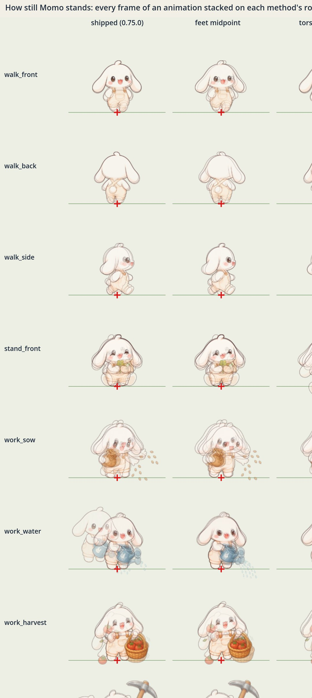

# 모모가 서 있는 점 (Step 76)

모모의 모든 그림(5×5 시트의 칸, 일하는 아틀라스의 장)은 **루트(root)** 하나로 섬에 선다. 루트는 **두 발 사이, 땅에 닿는 점**이다. 리그는 그 점을 노드의 원점에 놓는다. 노드의 원점은 시뮬레이션이 모모를 세우는 자리이고, 그림자·탭 영역·깊이 정렬이 기대는 자리이기도 하다. 그래서 장이 바뀌어도, 상태가 바뀌어도, 좌우가 뒤집혀도 발은 그 자리에 있다.

## 1. 증상과 원인

주인 보고: Step 67의 일하는 동작에서 **모모가 장이 바뀔 때마다 튀고, 미끄러지고, 날아다닌다.**

### 원인 — 피벗을 '가장 낮은 크림색 픽셀'로 잡았다

Step 66~67의 `build_momo_work.gd`는 장마다 피벗(발이 놓일 점)을 이렇게 정했다: **크림색 픽셀 중 가장 낮은 6% 띠의 가운데.** 크림색은 모모의 털과 멜빵바지 색이다. 그런데 그 띠에 모모가 아닌 것이 들어온다.

| 장 | 띠에 들어온 것 | 0.75에서 몸 전체가 옮겨진 거리(섬 픽셀, 줌 1) |
|---|---|---|
| `dig_2` 곡괭이가 땅에 박힘 | 튀는 돌가루(밝은 회색) | **56** |
| `water_2` 물줄기 | 물방울의 흰 하이라이트 | **33** |
| `chop_1`·`chop_2` 도끼질 | 도끼날의 밝은 면 | **31~41** |
| `hammer_2` 내려침 | 불꽃 | **34** |
| `replant_*` 다시 심기 | 모종삽, 흙더미 | 10~20 |

모모는 섬에서 키 72 px이다. 가장 심한 곡괭이 타격 장에서는 **자기 키의 3/4만큼 옆으로 순간이동**했다.

5×5 시트(Step 51)는 칸마다 **머리를 가운데에** 두었다. 서 있는 포즈는 발이 머리 아래 정가운데가 아니어서, 칸마다 발이 0.4~1.8 px 비켜 있었다. 일할 때는 왼쪽을 보며 그림을 거울로 뒤집는다(`scale.x = -1`). 그러면 그 어긋남이 두 배가 되어, 서기 ↔ 일하기 전환에서 2~4 px씩 밀렸다.

### 가른 방법

다섯 가지 원인 후보를 따로 쟀다(`tools/art/gen/momo_anchor_report.gd`, 보정 갤러리).

| 후보 | 확인 | 결론 |
|---|---|---|
| 그림이 칸 안에서 제각각 다른 자리에 있다 | 아틀라스는 장마다 다듬은 사각형에 자기 피벗을 가진다(Step 66) | 피벗이 맞으면 문제없다 |
| 시트 자르기·여백 | 다듬은 사각형이 그림과 같다(`test_momo_work`) | 아니다 |
| **피벗 메타데이터** | 출시 피벗과 측정한 루트의 거리: 일하는 장 최대 **56.4 px**, 시트 칸 1.9 px | **원인** |
| 배율 | 한 일의 네 장은 한 배율(`strip`). 리그는 장의 텍스처 밀도로 그린다 | 아니다 |
| 의도한 동작(루트 이동) | 허리 굽히기·뜀·던지기는 그림 속 몸의 움직임이다 | 남겨야 할 것(§5) |

## 2. 기준점 방식 비교

같은 그림에 다섯 가지 방식으로 루트를 정했다. 그런 다음 모든 애니메이션에서 연속한 두 장 사이에 무엇이 얼마나 움직이는지 쟀다. 단위는 섬 픽셀, 줌 1이다.

- **미끄러짐(slide)**: 덜 움직인 발이 얼마나 움직였나. 디딘 발은 0이어야 한다.
- **몸통(torso)**: 몸통이 얼마나 움직였나. 휘두르기·굽히기로 자연스럽게 움직인다.
- **머리(head)**: 눈이 얼마나 움직였나.
- **뜸(float)**: 땅에 닿는 줄이 루트의 줄에서 위아래로 얼마나 벗어났나. 0이어야 한다.
- **어긋남(off)**: 혼합 방식의 루트에서 얼마나 떨어졌나.

| 방식 | 루트 | 미끄러짐 | 몸통 | 머리 | 뜸 | 어긋남 |
|---|---|---|---|---|---|---|
| **0.75 출시** | 가장 낮은 크림 픽셀(일), 머리 가운데(시트) | **58.7** (12.8) | 56.5 (15.7) | 33.0 (10.7) | 10.4 (2.8) | 56.4 (13.6) |
| 두 발 가운데 | 두 발의 가운데, 발이 안 보이면 몸의 가장 낮은 줄 | 5.4 (1.2) | 14.2 (7.1) | 21.9 (8.0) | 0.0 | 10.3 (2.6) |
| 몸통 가운데 | 몸통을 한 점에 고정 | 10.9 (4.6) | 0.0 | 22.9 (6.5) | **13.1** (1.9) | 12.6 (5.4) |
| 외곽 사각형 가운데 | 사각형 중심을 한 점에 고정 | **29.3** (9.5) | 29.6 (11.4) | 22.9 (6.6) | 14.6 (4.6) | 29.5 (8.0) |
| **혼합(선택)** | 두 발 가운데 + 발이 말하지 않는 장은 적어 둔 루트 | 5.8 (1.4) | 14.1 (6.7) | 26.2 (7.3) | **0.0** | 0 |

각 칸은 애니메이션들 가운데 최댓값이고, 괄호 안은 평균이다. 원자료는 `design/step76/anchors_075.json`·`anchors_076.json`이다.

`design/step76/methods.jpg`는 애니메이션마다 모든 장을 각 방식의 루트(빨간 십자)에 겹쳐 그린 그림이다. 또렷하면 가만히 있는 것이고, 번지면 튀는 것이다.

- **외곽 사각형**: 사각형은 도구·물줄기·바구니를 따라 커지고 작아진다. 발이 30 px 미끄러진다. 다듬은 장(trimmed frame)을 가운데 정렬하면 흔들린다는, 잘 알려진 함정이다.
- **몸통 고정**: 몸통은 멈추지만, 휘두르는 동작마다 발이 땅 위를 미끄러진다(foot skating, 11 px). 또 쪼그리거나 앉는 장에서 몸이 뜨거나 땅에 박힌다(13 px). 이슈가 경고한 "모든 장의 가슴을 한 점에 고정하기"가 바로 이것이다.
- **두 발 가운데**: 두 발이 보이는 장에서는 거의 완벽하다(미끄러짐 ≤ 5.4, 뜸 0). 하지만 발이 가려지거나(바구니 뒤, 망치 머리 아래) 무릎을 꿇은 장에서는 엉뚱한 곳을 잡는다(어긋남 10 px).
- **혼합**: 두 발 가운데가 기본이다. 발이 말하지 않는 장은 사람이 루트를 적고 이유를 남긴다. 뜸 0, 어긋남 0이다. 남은 미끄러짐과 몸통 움직임은 그림 속 동작이다(§5).

2D 스프라이트 애니메이션에서 흔히 쓰는 규약과 같다.
- 제자리에서 하는 동작은 **땅을 디딘 발**이 기준이다.
- 제자리 걷기 사이클은 **무게 중심 아래**가 기준이고, 실제 이동은 노드가 한다.
- 장마다 다른 피벗(per-frame pivot/offset)은 그림 옆의 메타데이터에 둔다. 측정은 자동이지만, 그림만으로 판단할 수 없는 장은 사람이 정해 둔다.

## 3. 규약

### 루트

- **두 발이 모두 땅에 닿은 장**: 두 발 접점의 가운데, 가까운(낮은) 발의 줄 위다. 접점은 **발 바닥 가운데, 외곽선 아래**다.
  - 발은 이렇게 찾는다: 발 크기와 모양의 크림색 덩어리 가운데, 나란히 한 걸음 폭만큼 떨어진 **가장 낮고 가장 수평인 한 쌍**.
  - 씨앗·물방울은 작아서, 도끼날의 밝은 면은 가늘어서 걸러진다. 바짓단은 발 위에 있고, 꼬리는 높이 있다.
  - 높이 기준: 두 발 중 하나가 키의 3.5% 넘게 높으면 '높은 발'이다. 그 발이 든 것인지(뜀·걸음), 뒤로 빠져 있는 것인지(쪼그림)는 그림만으로 알 수 없다.
- **걷기**(시트의 걷기 칸): 머리를 그 방향의 서기 칸이 둔 자리(루트에서의 거리)에 두고, 가장 낮은 발의 줄에 선다. 걷기는 제자리 사이클이고, 실제 이동은 노드가 한다. 그래서 발이 번갈아 디디는 동안 몸이 흔들리지 않는다.
- **그 밖의 모든 장**은 원본 지도에 `root`를 적는다. 이유(`why`)도 함께 적는다. 둘 다 없으면 **빌드가 멈춘다.**

| `root` | 뜻 | 쓰는 장 |
|---|---|---|
| `{"feet": "both"}` | 두 발. 높은 발은 들린 것이 아니라 뒤에 있다 | `replant_0`·`replant_1`(쪼그림) |
| `{"foot": "left"\|"right"}` | 그 발이 디딘 발이고 다른 발은 가려졌다. 그 애니메이션의 두 발 장에서 그 발이 루트에서 떨어진 만큼을 쓴다 | `harvest_0`(바구니 뒤), `hammer_2`(망치 머리 아래), `replant_3`(모종삽 뒤) |
| `{"foot": "only"}` | 옆모습. 앞발이 뒷발을 가린다 | `side_idle` |
| `{"torso": …}` | 발이 숨었거나 땅에 없다. 몸통을 두 발 장에서처럼 루트 위에 두고, 몸의 가장 낮은 줄에 선다 | `replant_2`(무릎), `sit`, `sow_3`(작은 뜀) |
| `{"box": …}` | 누워 있다. 그림 아래 가장자리의 가운데 | `sleep` |
| `{"at": [x, y]}` | 원본 그림의 픽셀 한 점 | (지금은 없음) |

`sow_3`은 이슈가 말한 '디딘 발 고정'을 쓰지 않았다. 이 장은 마무리의 작은 뜀이다. 오른발을 그 자리에 고정하면 몸 전체가 4.7 px 옆으로 튄다. 뜀에는 디딘 발이 없으니 몸을 제자리에 둔다.

### 지도에 남는 것

- `assets/momo/momo_work.json`: 장마다 `pivot`(루트, 사각형의 왼쪽 위에서), `root`(찾은 방법), 측정한 `feet`·`torso`·`eyes`.
- `assets/momo/momo_sheet.json`: 25칸이 같은 피벗(128, 242)을 쓴다. 칸마다 그림을 루트가 그 점에 오게 놓는다. `root`·`feet`·`torso`·`eyes`는 칸 좌표다.
- 크기는 하나다. 리그는 장의 텍스처 밀도(`stand_height`: 시트 200, 아틀라스 160 텍셀 = 섬 72 px)로 그린다.
- 칸 크기는 바꾸지 않았다. 아틀라스는 이미 장마다 크기가 다른 사각형(가변 영역)이고 6 px 여백을 둔다. 곡괭이·도끼처럼 큰 장도 잘리지 않는다(`test_momo_anchors`).

## 4. 파이프라인

| 단계 | 도구 | Step 76 |
|---|---|---|
| 측정 | `tools/art/gen/momo_anchor.gd` | 발·몸·몸통·눈·머리를 재고, 애니메이션마다 루트를 정한다 |
| 일 아틀라스 | `tools/art/gen/build_momo_work.gd` | 장을 다듬은 뒤 재고, `frames.json`의 `root`와 함께 루트를 정한다. 정하지 못하면 멈춘다 |
| 5×5 시트 | `tools/art/gen/build_momo_sheet.gd` | 서기·기분·앉기·눕기는 방향별로, 걷기는 머리 규칙으로. 칸 안 자리를 루트로 정한다 |
| 초상화 | 같은 도구 | 패널의 `momo_front`는 새 앞 서기 칸에서 자른다. 두 발 가운데가 (100, 210)이다 |
| 비교·통계 | `tools/art/gen/momo_anchor_report.gd` | 다섯 방식의 흔들림 표와 겹침 그림(§2) |
| 보정 갤러리 | `scenes/dev/momo_calibration.tscn` | §6 |

- **그림을 다시 만들 때**: 키잉 → `split_frames` → `build_momo_work` 순서는 그대로다. 빌드가 "say where it stands"로 멈추면 그 장을 갤러리에서 보고 `root`와 `why`를 적는다.
- 그림 픽셀은 바꾸지 않았다. 아틀라스 PNG는 바이트 단위로 그대로이고, 피벗만 바뀌었다. 시트는 칸 안에서 그림의 자리만 옮겼다(가로 최대 17 px: 쓰이지 않는 옛 `dig` 칸. 쓰이는 칸은 5 px 이하). 자르거나 늘리거나 색을 바꾸지 않았다.

## 5. 남긴 움직임 — 그림 속 동작

루트가 고정된 뒤에도 남는 움직임이 있다. 이것은 동작의 일부라 남겼다.

| 애니메이션 | 움직임 | 크기(섬 px) |
|---|---|---|
| 거두기 | 토마토를 주우러 왼쪽 아래로 허리를 굽힌다(`harvest_0`) | 머리 26, 몸통 14 |
| 씨 뿌리기 | 마무리 뜀에서 오른발이 몸 아래로 들어온다 | 발 5.8 |
| 불 때기 | 장작을 던질 때 왼발을 내딛는다 | 발 5.4, 몸통 14 |
| 베기·캐기 | 휘두르는 동안 몸이 앞뒤로 기운다 | 몸통 6~11 |
| 다시 심기 | 쪼그림 → 무릎 꿇기 → 쪼그림 | 몸통 10, 머리 13 |
| 앉기·잠 | 앉는다, 눕는다 | 자세가 바뀜 |

**도구는 그림 안에 있다.** 그래서 모든 장에서 손에 붙어 있고 따로 정렬할 것이 없다(Step 66). 일할 때 보이는 방향은 하나(앞 3/4, 거울로 좌우)다. 일 ↔ 기다리기(등 돌린 서기)는 그림이 바뀌지만 서 있는 점은 같다.

## 6. 보정 갤러리

`scenes/dev/momo_calibration.tscn`: 실제 `MomoRig`이 실제 섬 칸(`IslandRenderer`) 위에 루트를 칸 가운데에 두고 선다.
- 빨간 십자는 루트다. 흰 점은 발, 파란 점은 몸통, 보라 점은 눈이다(지도의 측정값).
- 조작: ←/→ 장, ↑/↓ 애니메이션, Space 재생/멈춤, M 표시, O 모든 장 겹치기, F 좌우, Z/X 확대·축소.
- 상태 23가지(서기 셋·걷기 셋·앉기·잠·기분 셋·나르기·등 돌린 일·일 열 가지)를 모두 돈다.
- 대조표 캡처: `MOMO_CAL=work|states MOMO_CAL_LABEL=… xvfb-run -a godot --path momonium --script res://tools/capture.gd -- --scene res://scenes/dev/momo_calibration.tscn --size 1180x2446 --out /abs/x.png`
  - 리그의 자기 시계로 장을 고르고 지도는 파일로 읽는다. 그래서 같은 장면을 옛 빌드에 넣으면 그 빌드의 모모를 그대로 보여 준다(이전/이후 비교).

## 7. 검사

- `tests/unit/art/test_momo_anchors.gd`
  - 리그가 그리는 모든 장(68)이 있고 텍스처 안에 있으며, 피벗이 그 안 바닥 근처에 있다.
  - 모든 피벗이 지금 그림에서 잰 루트와 0.75 텍셀 안에서 같고, 찾은 방법도 같다.
  - 두 발이 말하지 않는 장은 모두 `root`와 이유가 있고, 그것이 없으면 측정이 추측하지 않는다(오류).
  - Step 66이 속았던 장(`dig_2`·`water_2`·`chop_1`·`chop_2`·`hammer_3`·`stoke_2`)에서 두 발을 몸 아래에서 찾는다.
  - 애니메이션 안에서 디딘 발 ≤ 6.5, 몸통 ≤ 16, 뜸 ≤ 0.5, 루트 어긋남 ≤ 0.5 px(섬, 줌 1). 시트는 서기 ↔ 깜빡임·기분·나르기·앉기·눕기 전환마다 같은 검사를 한다(앉기·눕기는 몸통 제외).
  - **Step 66의 측정(가장 낮은 크림 픽셀)이면 캐기·물 주기·베기·망치질이 실패한다.** 이 검사가 그 버그를 잡는다는 증명이다. 0.75의 지도 파일을 넣으면 실제로 셋이 실패한다(확인함).
- `tests/integration/actors/test_momo_anchor_rig.gd`
  - 실제 리그가 23가지 상태의 모든 장을 좌우 두 방향, 배율 1·2.2·0.6으로 그릴 때 발이 노드 원점에 있다.
  - 발의 위치는 그림 픽셀에서 잰 것이다. 리그가 쓰는 피벗이 아니다.
  - 일 열 가지의 4초 루프에서 매 틱 발이 원점에 있다.
  - 걷기 → 등 돌린 기다리기 → 캐기 → … 같은 하루의 전환마다 발이 원점에 있다.
  - 모모 8명이 각자 자기 자리를 지킨다. 0.75 지도면 `water_2`에서 31 px로 실패한다(확인함).
- `tests/e2e/specs/anchor76.spec.mjs`(폰·데스크톱): 실제 웹 빌드에서 광산(캐기)·벌목장(베기)의 모든 장과 서 있는 모모를 확대한다. 장을 하나씩 고정(`dev_hold_momo`)하고, 스크린샷에서 두 발을 찾아(`lib/momo_feet.mjs`) 게임이 알려 주는 발 자리와 비교한다(≤ 2.5 px).
  - 밭은 앞 울타리가 일하는 모모의 발을 가린다(깊이 정렬, 의도한 것). 그래서 밭은 위의 단위·통합 검사가 맡는다.
- 회귀: `test_momo_work`(피벗은 이제 이 문서의 루트), 모모 리그·뷰·깊이·도구·기분, 탭·끌기, 스케줄, 세이브, 렌더 벤치(예산 OK), 시뮬레이션 벤치(해시 3962098388 그대로).

## 8. 증거

| 무엇 | 파일 |
|---|---|
| 일 열 가지 × 장, 실제 리그, 0.75.0 \| 0.76.0 나란히 | `step76/calibration_work_before_after.jpg` |
| 보정 갤러리 화면(실제 섬 칸 위) | `step76/calibration_scene.jpg` |
| 서기·걷기·앉기·잠·기분 | `step76/calibration_states_075.jpg`, `step76/calibration_states_076.jpg` |
| 다섯 방식 겹침 비교 | `step76/methods.jpg` |
| 장마다 측정값·루트·흔들림(0.75 / 0.76) | `step76/anchors_075.json`, `step76/anchors_076.json` |
| 웹 빌드에서 일하는 모모(움직이는 PNG, 1.8초, 빨간 십자 = 게임의 발 자리) | `step76/live_dig_075.png`(공개 0.75.0), `step76/live_dig_076.png`(0.76.0) |
| 같은 장면의 처음 12장(위 0.75.0, 아래 0.76.0) | `step76/live_dig_strips_075_076.jpg` |
| 웹 E2E의 장별 측정 | `step76/e2e_anchor76.json` |

## 9. 남은 것

- 적어 둔 루트 10개(일하는 장 7, 시트 칸 3)는 사람이 정한 것이다. 근거는 `why`에 있고, 갤러리에서 다시 볼 수 있다.
- 밭에서 일하는 모모의 발은 울타리 뒤에 있어 화면 측정이 볼 수 없다. 단위·통합 검사가 대신한다.
- 시트의 옛 일 칸 넷(거두기·물 주기·캐기·공부하기)은 리그가 쓰지 않는다. 다른 칸과 같은 규약으로 다시 놓기만 했다.
