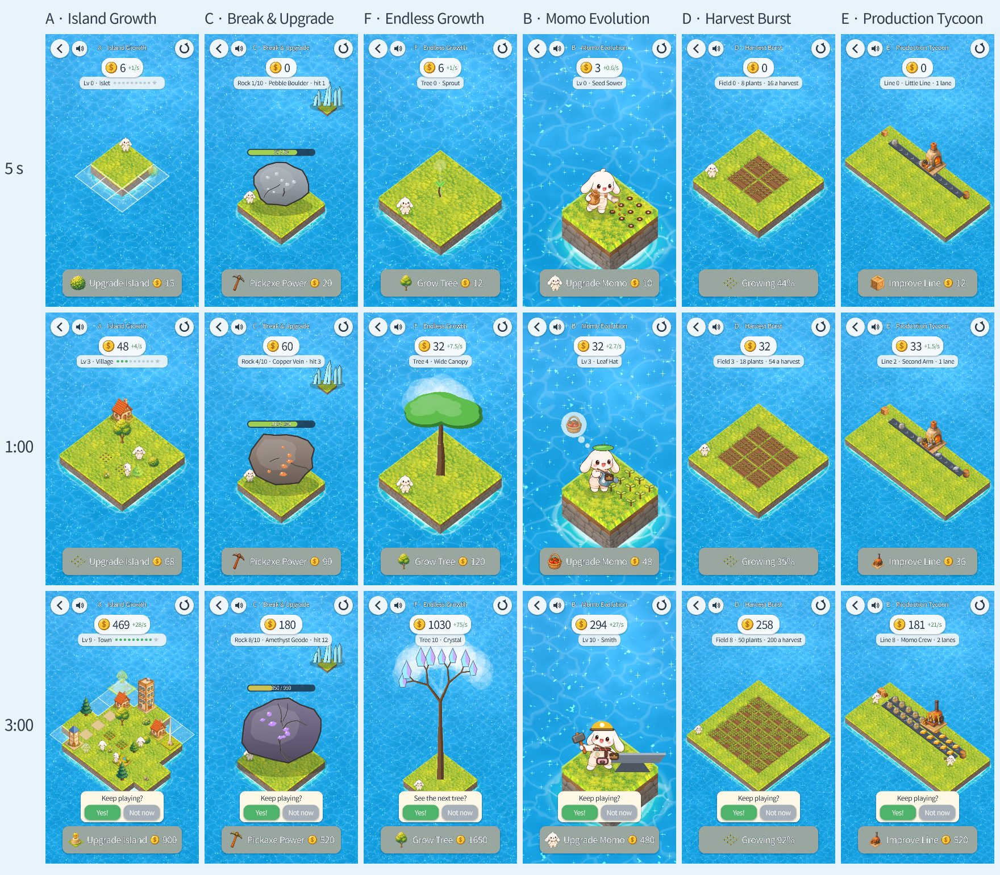

# Fun Lab 결과와 다음 실험 추천 (Step 93) — **잠정**

> **이 판정은 잠정이다.** 사람이 매긴 점수가 아직 없다. 아래의 숫자는 모두 자동 시험(스크립트 플레이어와 브라우저 E2E)에서 나온 **객관 수치**다.
> 사람이 즐거웠는지는 말하지 않는다. 비교 페이지에서 직접 해 보고 점수를 매기면, 그 점수가 이 문서보다 우선한다.
>
> - 비교 페이지: https://7bvcxz.github.io/gamo/momonium-experiments/compare.html
> - 실험실: https://7bvcxz.github.io/gamo/momonium-experiments/

## 여섯 가설

| | 실험 | 키우는 것 | 사람이 하는 일 | 확인하려던 것 |
|---|---|---|---|---|
| A | Island Growth | 섬 전체 | 버튼 하나(업그레이드) | 섬이 눈에 보이게 커지는 것 자체가 보상인가 |
| B | Momo Evolution | 모모 한 마리 | 버튼 하나(업그레이드) | 한 캐릭터의 성장에 정이 드는가 |
| C | Break & Upgrade | 바위·곡괭이 | **바위 탭** + 업그레이드 | 치는 손맛과 깨는 보상 |
| D | Harvest Burst | 밭 하나 | **수확(익었을 때)** + 업그레이드 | 기다렸다 한 번에 터뜨리는 기대감 |
| E | Production Tycoon | 생산 라인 | 버튼 하나(업그레이드) | 살아 움직이는 공정을 보는 즐거움 |
| F | Endless Growth | 나무 한 그루 | 버튼 하나(업그레이드) | 다음 모양이 궁금해서 계속하는가 |

## 같은 조건의 자동 측정 (3분, 객관 수치)

스크립트 플레이어(`tools/selftest.gd`)의 기록이다. 살 수 있으면 1.5초 뒤에 사고, C는 초당 2.5번 탭하고, D는 익으면 1초 뒤 수확한다. 같은 결과가 `compare/selftest.json`에 있다.

| | 입력(3분) | 업그레이드 | 첫 업그레이드 | 업그레이드 간격 | 5초 이상 무입력 | 가장 긴 무입력 | 3분에 도달한 곳 | 3분 동안 번 코인 |
|---|---|---|---|---|---|---|---|---|
| A | 9 | 9 | 16.5초 | 16.5–22.3초 | 180.2초 | 22.3초 | Lv9 Town(Village 51초, Town 107초) | 1,736 |
| C | 454(타격 442) | 5 | 21.7초 | 16.9–56.4초 | 0초 | 0초 | 바위 7개 깸(20·37·55·82·107·130·163초), 곡괭이 5 | 805 |
| F | 10 | 10 | 13.5초 | 13.5–21.6초 | 180.1초 | 21.6초 | 10단계 Crystal | 3,654 |
| B | 10 | 10 | 18.6초 | 14.8–18.8초 | 175.4초 | 18.8초 | Lv10 Smith(도구·동작 5번 바뀜) | 1,492 |
| D | 19 | 8 | 17.7초 | 15.5–31.2초 | 162.7초 | 15.6초 | 밭 8, 수확 11번(16 → 160) | 878 |
| E | 8 | 8 | 20.1초 | 17.6–25.9초 | 176.5초 | 25.9초 | Lv8 Momo Crew, 배달 182 | 1,021 |

'5초 이상 무입력'은 입력 사이가 5초 넘게 빈 구간의 합이다. 코인은 실험마다 단위가 달라 서로 비교하지 않는다(실험 안의 커지는 속도만 본다).
같은 기록을 실제 브라우저에서 처음부터 3분씩 찍은 그림(5초·1:00·3:00)은 비교 페이지에 있다.

비교 페이지의 그림을 찍은 실제 브라우저 3분(배포 빌드, 720×1280, 같은 스크립트 플레이어, `compare/browser.json`).
FPS는 헤드리스 Chromium의 소프트웨어 렌더 값이라 실험끼리만 비교한다.

| | 업그레이드 | 입력 | FPS 5초 | FPS 1:00 | FPS 3:00 | 3분 |
|---|---|---|---|---|---|---|
| A | 9 | 9 | 33.8 | 31.7 | 28.7 | Lv9 Town, 초당 28 |
| C | 5 | 455 | 31.4 | 31.1 | 29.1 | 바위 7개, 곡괭이 5 |
| F | 10 | 10 | 31.8 | 28.0 | 27.1 | Crystal, 초당 75 |
| B | 10 | 10 | 32.3 | 32.6 | 30.1 | Smith, 초당 27 |
| D | 8 | 20 | 32.1 | 30.2 | 26.4 | 밭 8, 수확 12번(마지막 200) |
| E | 8 | 8 | 30.3 | 29.1 | 27.5 | Lv8, 배달 191 |

각 step에서 진짜 탭으로 3분(각 step의 E2E, 폰·720·데스크톱이 서로 거의 같음):

| | 3분에 도달한 곳 | 주요 기록 |
|---|---|---|
| A | Lv9 Town | 업그레이드 9번(약 16·33·51·68·86·106·125·145·167초), Village 51초 · Town 106초 |
| B | Lv10 Smith | 업그레이드 10번, 도구·동작 6가지, 작업 149번 |
| C | 바위 8번째, 곡괭이 5단계 | 탭 449 → 타격 442, 바위 7개(20·36·54·82·106·129·162초) |
| D | 밭 8단계 | 수확 11번(16 → 160), 익은 채 기다림 20–25초 |
| E | Lv8 Momo Crew | 업그레이드 8번, 배달 ~178, 끝의 분당 배달 ~145 |
| F | 10단계 Crystal | 모양 11가지, 변화 10번(약 13·28·43·59·75·92·110·129·150·172초) |

## 기술 확인

- **여섯 직접 링크가 모두 열리고 처음부터 시작하며, 3분 동안 플레이된다**: E2E `compare93`이 비교 페이지의 여섯 '처음부터 플레이' 링크를 각각 새 페이지로 열어 그 실험이 행동 0·업그레이드 0에서 시작하는지 확인했다(폰·데스크톱).
  같은 스펙이 여섯 실험을 배포 빌드에서 처음부터 720×1280으로 3분씩 플레이했다(업그레이드 A 9·C 5·F 10·B 10·D 8·E 8, 입력 9·455·10·10·20·8). 로컬 배포 빌드 기준이며, 공개 URL 결과는 아래 '공개 확인'에 적는다.
- **비교 페이지**: 폰·데스크톱에서 다음을 확인했다.
  - 카드 순서(A·C·F 먼저, '먼저' 표시 셋), 그림 18장, 자동 측정 표 여섯 줄, 페이지 오류 0.
  - 점수: C에 넷, F에 둘을 매기면 순위에 그 둘만 평균순(F 4.50, C 4.00)으로 들어가고, 나머지는 '안 해 봄'으로 적힌다. 새로고침해도 유지된다. localStorage에 `funlab.` 밖의 키가 없다.
  - JSON(안 해 봄 = null, 자동 측정 포함)과 CSV 머리줄.
- 프레임 속도(위 표): 3분 동안 여섯 모두 처음의 75% 위에 머문다(스펙이 검사한다, 떨어짐 7–18%). 3:00의 값은 26.4–30.1fps로 서로 비슷하다. D는 아래 '공정하게 하려고 고친 것'을 고친 뒤의 값이다.
- 게임 세이브 불변: 같은 브라우저에서 게임을 먼저 저장한 뒤 실험실을 써도 게임의 IndexedDB 항목과 localStorage 사본이 그대로였다(Step 86 E2E, 매 step 회귀).
  비교 페이지의 점수는 `funlab.compare.v1` 키 하나에만 저장된다.
- 게임 전체 E2E(Step 90 체크포인트): 290 통과·32 건너뜀·2 실패. 실패 둘은 `tools66`이었고 스펙을 고쳐 4/4가 되었다. 게임은 0.85.0 그대로다.

## 비교를 공정하게 하려고 고친 것

- **소리**: A는 Village부터, C는 처음부터 음악이 없었다. 여섯 모두 같은 잔잔한 음악으로 시작하게 했다(테스트로 묶음). 소리가 비교를 기울이지 않게 하기 위해서다.
- **3분 카드**: 여섯 모두 같은 자리(버튼 위)에 같은 질문이 뜬다(F만 "See the next tree?"). 답은 `continue_intent`로 기록한다.
- **같은 틀**: 뒤로·다시 시작·소리·자원 칸·버튼 하나·기록·숨김 정지가 여섯 모두 같다. 실험끼리 상태를 나누지 않는다.
- **D의 프레임 속도**: 3분 비교 플레이에서 D만 30.4 → 20.8fps(−32%)로 떨어졌다(다른 다섯은 −19% 안). 밭이 넓어질수록 느려졌고, 그림은 그대로였다.
  재 보니 원인은 작물이 아니라 흙의 고랑이었다(작물을 숨기면 21.8, 흙을 숨기면 29.6fps). 칸마다 안티에일리어스 선 넷이라 5×5 밭에서 렌더 객체가 약 1,900개였다.
  고랑을 한 번의 `draw_multiline`으로 그리게 고쳤다(객체 2,473 → 873, 21.6 → 27.4fps, 모습은 같음). 느린 화면이 D의 점수를 깎지 않게 하기 위해서다.

## 발견한 UI 문제와 기술적 약점 (고치지 않은 것)

- **A**: Lv2(나무·꽃)와 Lv4(길·소나무)의 변화가 작다.
- **B**: 입을 것이 쌓이면 몸 앞쪽이 붐빈다.
- **C**: 곡괭이 업그레이드 간격이 뒤로 갈수록 길어진다(45·56초).
- **D**: 수확 사이 14초는 기다림이다.
- **E**: 폰 세로 화면에서 라인이 작다.
- **F**: 9단계부터 나무가 화면을 채워 '커지는 느낌'이 줄고, 수정 단계의 왕관이 성기다.

봇 점수를 올리려고 실험을 다듬지는 않았다.

## 자동 에이전트의 블라인드 플레이테스트 — 하지 않음

이슈는 '실제로 가능할 때만'이라고 했다. 하지 않은 이유는 셋이다.

1. 이 저장소의 원칙(사람 플레이테스트 결과를 지어내지 않음)과, 이슈의 '스크립트 관찰과 사람 의견을 구분'을 지키면서 에이전트의 '재미'를 쓸 방법이 없다. 에이전트의 감상은 결국 지어낸 의견과 구별되지 않는다.
2. 이 작업의 규칙상 하위 에이전트를 기본으로 쓰지 않는다.
3. 에이전트가 도울 수 있는 '조작이 이해되는가'는 이미 객관적으로 쟀다(첫 행동 시각, 조기 누름, 빗나감, 쉰 구간).

대신 같은 조건의 **스크립트 플레이**(위 표)와 **실제 탭 E2E**만 썼다.

## 추천 (잠정)

### 다음 실험으로: **D Harvest Burst** (잠정 1순위)

이유(측정과 구조에서만):

1. **보는 시간과 사람의 행동이 번갈아 온다.** A·B·E·F는 3분 동안 입력이 8–10번이고 나머지는 모두 기다림이다(5초 이상 입력 없음 175–180초).
   C는 쉴 틈이 없다(입력 450번 남짓, 무입력 0초). D만 약 15초마다 사람이 직접 누르는 큰 사건(수확)이 오고, 그 사이에는 자라는 밭을 본다(입력 19번, 무입력 163초).
2. **보상이 커지는 것이 '한 번의 숫자'로 보인다.** 한 번의 수확이 3분 동안 16 → 160(10배)이 된다. 다른 실험의 업그레이드는 대부분 수입률을 올린다.
3. **잴 수 있는 기대감 지표가 있다.** 익은 채 사람이 누르지 않은 시간(`ready_wait_s`)이 짧으면 기다리고 있었다는 뜻이고, 길어지면 흥미가 식었다는 신호다. 사람 시험에서 바로 비교할 수 있다.
4. **본 게임과 가장 가깝다.** 밭·수확·모모·코인은 Momonium의 원래 재료다. 다음 단계가 재작성이 아니라 기존 그림·규칙을 쓰는 작은 수직 슬라이스가 될 수 있다.

### 2순위: **F Endless Growth**

업그레이드마다 대상 전체의 실루엣이 바뀌고, 다음 모양이 실루엣으로 먼저 보인다. 여섯 중 '다음이 궁금하다'를 가장 직접 겨냥한 구조다. 그러나 3분 내내 입력은 10번뿐이다(A와 같은 기다림).

### 분명하지 않은 맞바꿈

- **기다림은 기대감인가, 지루함인가**: A·B·E·F·D 모두 기다림의 비중이 크다. 사람의 '3분 뒤 계속' 점수와 3분 카드의 답이 이것을 가른다.
- **C의 손맛 대 피로**: C는 유일하게 3분 내내 손을 쓴다. 손맛이 크면 C가 1순위가 될 수 있다. 449번의 탭이 피곤하면 반대다.
- **B의 애착**: 3분 안에서는 측정할 수 없다. 더 긴 세션에서 드러날 수 있다.
- **E의 화면**: 폰에서 라인이 작아 손해를 보고 있을 수 있다(고치면 점수가 달라질 수 있음).

### 제안하는 다음 단계 (재작성 아님)

실험실 안에 **"D+" 수직 슬라이스 하나**를 10분짜리로 만든다. Momonium 본 게임은 바꾸지 않는다.

- D의 '익음 → 수확 → 다시 자람' 고리를 그대로 두고, 업그레이드가 밭의 모습을 F처럼 크게 바꾸게 한다(밭 → 과수원 → 온실…). 다음 모습은 실루엣으로 보인다.
- 10분 동안의 리듬을 잰다: 수확 간격, 익은 채 기다린 시간, 업그레이드 간격, 3분·10분 카드의 답.
- 성공 기준(사람 시험): '3분 뒤 계속' 평균 4 이상, 익은 채 기다린 시간이 3분과 10분에서 늘지 않음.
- 사람 점수에서 C나 F가 D보다 분명히 높게 나오면, 이 제안 대신 그 실험을 같은 방식으로 늘린다.

## 결정을 위해 남은 일

1. 비교 페이지에서 A·C·F를 먼저, 이어서 B·D·E를 같은 조건(세로 폰, 같은 소리, 설명 없음)으로 3분씩 해 보고 점수를 매긴다.
2. 내보낸 JSON을 이 저장소에 두거나 이슈에 붙이면, 이 문서의 추천을 그 점수로 다시 쓴다.
