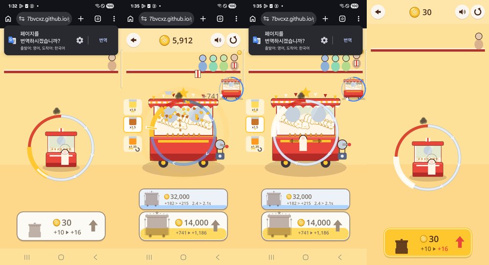
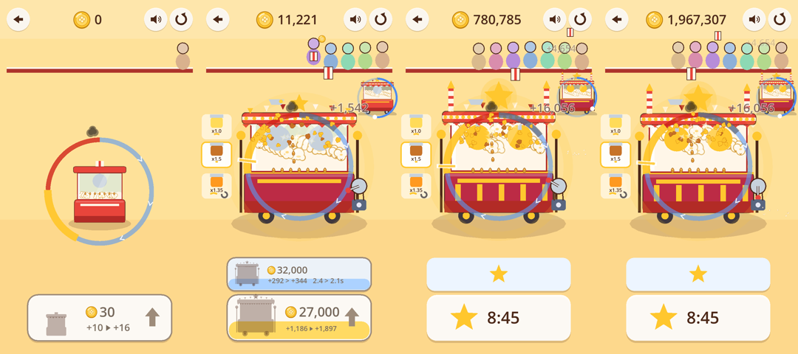

# 출시 후보 체크리스트 — Popcorn & Glory 0.12.2 (Step 12, #117)

> **상태: 출시 후보(Release Candidate) — 소유자의 Go를 기다림.**
> 외부 스토어 출시, 결제, 광고, HeyDive 등록은 하지 않았다. 웹 빌드는 지금까지의 모든 step처럼 Pages 주소에서 열리지만, 알리거나 목록에 올리지는 않았다.
> 이 문서의 '재미'에 관한 말은 블라인드 AI의 대리 관찰이다. **사람의 점수는 아직 하나도 없다.**

## 1. 무엇을 내놓는가

| | |
|---|---|
| 게임 | 팝콘 가게(`#stand`). 선택 화면에는 비교의 기준선인 실험 A·B·C도 남아 있다 |
| 버전 | **0.12.2** (`project.godot`의 `config/version`). 같은 날 0.12.0(저장·끝) → 0.12.1(지글 소리 메모리 누수) → 0.12.2(소리가 넘침)로 이어졌다(6절) |
| 소스 | 게임 `f2941053`(0.12.2; 0.12.1 `c30bf694`, 0.12.0 `13fba9a6`), 페이지 `8ea2e94f`(about)·`05b1d372`(번역 막기). 배포 커밋 `ed0bd718`(0.12.0)·`c54458a7`(about 페이지, 사이트)·`6f67e4be`(0.12.1)·`835b0d1e`(0.12.2)·`e7f6ed5e`(0.12.2 페이지) |
| Web 주소 | https://7bvcxz.github.io/gamo/popcorn-glory/#stand · 선택 화면 https://7bvcxz.github.io/gamo/popcorn-glory/ |
| 팩·엔진 | `game-f1c8f83af3c5.pck`(273,544바이트; 이전 팩들은 git 기록에 있다, 8절) · 공유 엔진 `docs/engine/engine-7eda98958eb0.*`(바뀌지 않음) · Godot `4.7.stable.official.5b4e0cb0f` |
| 함께 있는 페이지 | [정보·개인정보·라이선스](https://7bvcxz.github.io/gamo/popcorn-glory/about.html) · [3분 점수표](https://7bvcxz.github.io/gamo/popcorn-glory/scorecard.html) · [문서](https://7bvcxz.github.io/gamo/popcorn-glory/doc/) |
| 설치 | 필요 없다. 브라우저로 주소를 연다. 휴대폰은 세로가 가장 좋다 |
| 개인정보 | 계정·결제·광고·분석 없음. 게임 파일을 받는 것 말고는 요청을 보내지 않는다. 진행은 이 브라우저의 localStorage `popcorn-glory.stand.v1`에만(`about.html`) |
| 문의 | https://github.com/7bvcxz/gamo/issues |

## 2. 다시 만드는 법 (재현 가능한 빌드)

```bash
git checkout f2941053            # 또는 그 뒤의 main
godot --headless --path popcorn-glory --import
popcorn-glory/tools/deploy.sh    # docs/popcorn-glory/ 에 해시 이름 팩 + index.html + version.json + 페이지
popcorn-glory/tools/test_all.sh  # 헤드리스 -> 배포 -> 브라우저 -> 보고서
```

확인한 것(2026-11-04):
- 배포와 **같은 파일시스템에 만든 깨끗한 체크아웃**은 배포와 바이트까지 같은 팩을 냈다 — 0.12.0(`13fba9a6`) `634c754f0c92…`, 0.12.1(`c30bf694`) `76976cf5b40d…`, 0.12.2(`f2941053`) `f1c8f83af3c5…`.
- 다른 파일시스템(스크래치)의 깨끗한 체크아웃 둘(0.12.0)은 서로 같은 팩(`5d279680…`)이었다. 108개 파일은 배포와 바이트까지 같고, 팩 안의 파일 순서와 uid 캐시의 항목 순서만 달랐다. Godot이 디스크의 디렉터리 읽기 순서로 팩을 채우기 때문이다(AGENTS.md 2026-11-04 교훈).

## 3. 플랫폼별 상태 (사실대로)

| 대상 | 상태 |
|---|---|
| **Web (GitHub Pages)** | **출시 후보.** 공개 주소에서 아래 매트릭스로 검증했다 |
| Android | **디버그 APK만 만들었다.** S23에 설치해 실행했다(4절의 '실제 폰'): Godot 4.7, Adreno 740 OpenGL ES 3.2, 선택 화면·가게·실제 누름 셋 = 완벽 셋(30 동전)·강제 종료 뒤 다시 열면 30 그대로(앱 폴더의 `popcorn_glory_stand.v1.json`)·logcat 오류 0, 그 뒤 지웠다. `com.heydive.popcornglory`, versionName 0.12.2(소스 `f2941053`), versionCode 1, minSdk 24, targetSdk 36, arm64-v8a, 28,644,248바이트, sha256 `dee22e8ef81bf5c1563d095d3f8ad65291bb97059d9c1fb3231ecaafff7a3d85`. Godot 디버그 인증서(CN=Godot)로 서명했으며 배포용이 아니다. 저장소에 넣지 않았다(다시 만들기: `godot --headless --path popcorn-glory --export-debug "Android (debug)" <파일>.apk`). **릴리스 빌드는 없다** — 출시 서명 키와 스토어 계정은 소유자의 것이다 |
| PC (Windows·Linux·macOS) | **없음.** 이 머신의 Godot export 템플릿은 Web과 Android뿐이다 |
| iOS | **없음.** macOS·Xcode 없음 |

## 4. 출시 매트릭스 (공개 빌드, 2026-11-04)

환경: Playwright Chromium 156(`HeadlessChrome/156.0.8078.4`), Linux x86_64, 소프트웨어 렌더. 이 머신은 다른 세션의 작업으로 부하 평균 6–24, 스왑이 가득 찬 상태였다(`tests/results/step12/*/load.txt`). 실제 폰은 아래 따로.
화면: p720(720×1280 터치), phone(390×844 DPR2 터치), desktop(1280×800 마우스와 키보드), 그리고 `responsive07`의 1920×1080·360×640 DPR3·768×1024 DPR2·844×390 DPR3 가로.

| 확인 | 어떻게 | 결과 (최종 0.12.2, `tests/results/step12/public/`) |
|---|---|---|
| **전체 묶음** | `test_all.sh --public` | 헤드리스 99/99(2,435 checks). **브라우저 115 통과·0 실패·18 건너뜀, 재시도 0**(18은 화면별로 일부러 한 곳에서만 재는 것). 그 뒤 번역 막기를 넣은 페이지로 그 검사 하나를 다시 통과 |
| (0.12.1 때) | 같은 묶음 | 112 통과·0 실패·18 건너뜀(`public_0.12.1/`). 하나는 첫 시도에서 `net::ERR_NETWORK_CHANGED`(다른 세션의 네트워크 변동)로 페이지가 열리지 않았고 재시도에서 통과 |
| (0.12.0 때) | 같은 묶음 | 110 통과·1 실패·16 건너뜀(`public_0.12.0/`). 실패 1은 `perf07`이 가게의 다시 시작을 한 번만 누른 것(스펙을 고침). 재시도 둘은 모두 `ERR_NETWORK_CHANGED` |
| 새로 처음 열기 | 깨끗한 브라우저 컨텍스트 | 세 화면 모두 처음은 B의 누르기·떼기(`stand10`) |
| 업그레이드·흔들기·양념·자동화 | 실제 터치·마우스 | 통과(`stand10`, 세 화면) |
| **저장과 이어하기** | 사고 양념을 고른 뒤 새로고침 | 단계·돈·양념·모터가 그대로, 기록에 `restored`(세 화면). 웹 저장소가 쓰기를 성공으로 답한다 |
| 숨은 탭 | 숨기는 순간 | 저장이 먼저 써진다(세 화면). 숨은 5초 동안 조수의 판 0(`perf07`) |
| 다시 시작 | 실제 탭 | 첫 탭은 아무것도 잃지 않음, 두 번째에 새 가게 + 저장 지움(세 화면) |
| 저장소 격리 | localStorage 키 목록 | `popcorn-glory.*` 밖의 키 없음 |
| 오프라인 | 로딩 뒤 네트워크 끊기 | 완벽한 판을 계속 튀긴다(p720) |
| 동작 줄이기 | 시스템 설정 `reduce` | 게임이 따른다(p720). 0.12.0 첫 로컬 빌드에서는 따르지 않았다 — 고침 |
| 소리 | 출력 신호(RMS와 피크) | 흔들기·지글·조수의 팝이 실제로 들린다(`sound05`, 세 화면). **넘치지 않는다**: 완벽한 팝과 꼭대기 가게의 피크 0.76–0.84(0.12.1: 2.15). 사람의 귀로 듣지 않았다 |
| 화면 모양 | 다섯 모양 | 카드·양념·조수가 겹치지 않음(`responsive07`) |
| 첫 로딩 | 데스크톱, 일반 회선 | 첫 그림까지 2.5초(0.12.0–0.12.1: 2.0–2.5초) |
| **느린 연결** | Chrome 'Fast 3G' 흉내(1.44Mbit/s, 562ms) | 첫 그림까지 **약 61초**(네 번: 60,896·60,905·60,896·60,996ms). 거의 전부 Godot 엔진(약 10MB 압축 전송)이다 — 팩은 273KB |
| **최고 부하** | 14단계 + 사다리 일곱 칸 + 카라멜, 1분 실제 누름 | 그리기 호출 최대 177(예산 200), 날던 조각 44(상한 400), FPS 중앙값 32 — 이 측정 때 머신의 부하 평균이 23.5였다(0.12.1 때 48, 부하 13.8; 실제 폰은 59–60). **남는 메모리**(강제 GC 뒤 JS 힙 + 버퍼): 11.5 → 16.6MB(+5.1MB; 0.12.1 +7.4MB). 0.12.0은 같은 1분에 **+580MB**였다. 지글 시작 = 누름 수(0.12.0: 1분에 1,408번) |
| 1분 플레이(A) | 탭과 구매 | 남는 메모리 9.9 → 11.5MB |
| C의 최악 폭발 | 최고 단계 | 그리기 117, FPS 32(부하 23.9), 조각 151(상한 400) |
| 긴 플레이 | 공개 주소, 터치, 12분 | 5절(0.12.1로 했다 — 0.12.2는 소리 크기만 바꿨다) |
| 정보 페이지 | `about.html` | 게임 링크, 저장 키, MIT 고지, 빌드 버전, 다른 출처 요청 0, 가로 스크롤 없음 |
| 번역 막기 | 게임 페이지 머리 | `translate="no"`·`notranslate`가 공개 페이지에 있다(`release12`). S23에서 7초 뒤 화면에 번역 제안이 없다(`evidence/step12/s23/s23_04_notranslate_7s.png`) |
| 되돌리기 | 같은 출처에서 0.12.0 → 0.11.1 → 0.12.0 | 9절 |
| **실제 폰** | Galaxy S23(SM-S911N), Android 15, Chrome 156.0.8078.79, 휴대폰 Wi-Fi. 손은 안드로이드의 실제 터치(`adb shell input`), 상태는 그 탭 하나에 붙인 DevTools | 아래 '실제 폰' 표 |
| 다른 게임 보존 | `docs/` 변경 목록, 공개 주소 | 다른 게임 폴더에서 바뀐 것은 사이트가 다시 만든 문서 페이지뿐, 게임 파일은 그대로. motorio·momonium·windup·gunslinger·looproom의 `index.html` 모두 200 |

### 실제 폰 (S23, 공개 빌드, 2026-11-04 04:22–04:48 UTC)

| 확인 | 결과 |
|---|---|
| 첫 로딩(이 탭의 캐시만 끄고, 휴대폰 Wi-Fi) | 이동 시작부터 게임이 답할 때까지 **3.5초** |
| 실제 누름 | 금색에 떼어 완벽. 실제 손가락 움직임(모션 이벤트)으로 세 번 흔들어 고르게 팝 |
| 3분 플레이(실제 터치 79번 누름·12번 구매) | 8단계, 사다리 네 칸, 카라멜, 완벽 80·덜 익음 2(하나는 위치를 재는 탭). **FPS 59–60**. JS 힙(GC 뒤) 17 → 36MB, 버퍼 2–11MB |
| 새로고침 | 8단계·카라멜·사다리 네 칸 그대로 |
| 홈 버튼(탭이 숨음) → 돌아옴 | 숨는 순간 저장, 돌아와서 계속 |
| 소리(페이지 출력 신호) | 컨텍스트 running. 0.12.1: 실제 누름 하나에 RMS 0.57·**피크 1.94**(넘침) → 0.12.2: 세 번 누름 RMS 0.20–0.23·**피크 0.68–0.77** |
| 페이지 오류 | 게임에서 0(처음 본 'Uncaught' 둘은 시험 도구가 넣은 스크립트의 문법 오류였다 — 도구 없이 다시 열어 0을 확인) |
| **휴대폰에서만 보인 것** | 한국어 휴대폰의 Chrome이 '페이지를 번역하시겠습니까?'를 띄워 뒤로 버튼과 동전을 처음 몇 초 가렸다(페이지가 `lang="en"`). 게임에는 번역할 글이 없다 → 페이지에 `translate="no"`와 `notranslate`를 넣었고, 같은 폰에서 제안이 사라진 것을 확인했다 |
| Android 디버그 APK | 3절 |
| 뒷정리 | 연 탭을 닫고, 게임 키를 지우고, 앱을 지우고, 화면 켜짐·회전 설정을 되돌렸다. 조정 파일로 빌리고 돌려줬다 |

화면(왼쪽부터 Chrome 첫 화면·3분 뒤·새로고침 뒤, 그리고 APK를 다시 연 화면): 

## 5. 긴 플레이 (공개 주소, 12분)

스크립트 플레이어(사람이 아니다): 금색의 1/4 지점을 노리고, 해금되면 누른 채 세 번 흔들고, 카라멜을 쓰고, 더 싼 카드부터 산다. 실제 터치 입력.

| | 0.12.1 (p720 720×1280, `evidence/step12/play_stand_public/`) | 0.12.0 (phone 390×844, `play_stand_public_0.12.0/`) |
|---|---|---|
| 다 산 시각(놀이 시간) | **8:45** — 14단계, 사다리 일곱 칸 | 8:55 |
| 판 | 완벽 309, 그 밖 0 | 완벽 302 |
| 조수의 몫 | 29% | 29% |
| 버퍼(`backingStorageSize`, 분마다) | **2.6–12.7MB** | (3분 따로 잰 것) 559 → 1,087 → 1,557MB |
| JS 힙(GC 없이, 분마다) | 14 → 80MB(9분에 122, 그 뒤 77로 내려옴) — 6절 | 잴 수 없었다(버킷 값 553 고정) |
| 끝난 뒤 저장 | 저장된 단계 = 화면의 단계 | 같음 |
| 페이지 오류 | 0 | 0 |

처음·3분·10분·12분(720×1280): 

## 6. 알려진 문제와 위험

| 등급 | 무엇 | 상태 |
|---|---|---|
| 높음(고침) | **긴 플레이의 메모리 누수**: 누를 때마다 지글 소리를 새로 복사해 다시 틀었고, 웹에서는 그 복사본마다 디코드한 샘플이 남았다(누름 하나에 약 27 MB, 꼭대기 1분에 +580 MB). Step 05부터 있던 `app/audio.gd`의 버그. 12분 플레이가 탭을 죽이지는 않았지만 휴대폰에서는 위험했다 | **0.12.1 고침.** 헤드리스 시험(한 번 누름 = 한 번 시작)과 브라우저 시험(강제 GC 뒤 JS 힙 + 버퍼, 1분 30 MB 미만)이 0.12.0에서 실패하고 0.12.1에서 통과한다 |
| 중간(알려짐) | **화면을 켜 둔 채 오래 두면 JS 힙이 조금씩 는다.** 강제 GC 뒤에도 남는다: 선택 화면 0.04MB/분, 가게 0단계에서 가만히 1.5MB/분, 꼭대기 가게에서 조수만 팝 할 때 약 5.5MB/분. 20분이면 30–110MB, 한 시간이면 최대 약 330MB. 새로고침하면 처음으로 돌아간다(저장은 남는다). 숨은 탭은 그리지 않으므로 늘지 않을 것으로 보지만 숨긴 동안의 힙은 재지 않았다. 원인은 엔진 쪽이다: 힙 샘플링에서 남은 할당이 `glGenBuffers`·`glGenVertexArrays`·`glFenceSync`(Emscripten)였다. Emscripten은 GL 객체 번호를 다시 쓰지 않고, Godot 호환 렌더러는 다각형을 다시 그릴 때마다 버퍼를 새로 만든다. 놀이 화면은 두 그리기 층을 매 프레임 다시 그린다(`app/play_view.gd`) | 10–20분 판에는 문제가 되지 않는다고 본다(재서 확인한 것은 12분까지). 고치는 길: 움직이지 않는 그림(양념통·계산대·손님·카드)을 따로 떼어 바뀔 때만 다시 그리기. 출시 뒤 첫 다듬기 후보다. 증거 `evidence/step12/jsheap_probe*.txt` |
| 높음 | **사람의 점수가 없다.** 재미의 판단은 블라인드 AI의 대리 관찰뿐이다 | 소유자 점수표에 ★ 가게 줄을 더했다(`?trial=1`은 저장을 건드리지 않고 처음부터 시작) |
| 높음(고침) | **소리가 넘쳤다**: 완벽한 팝은 팝·띵·동전을 한꺼번에 틀고, 저마다 약 -2 dBFS로 만든 소리의 합이 1.91–2.15(S23 1.94)였다. 브라우저는 1.0 위를 잘라 낸다. 완벽한 팝마다, Step 05부터 | **0.12.2 고침**: 모든 소리에 -8 dB 여유. 잰 피크: 데스크톱 0.76–0.84(세 화면), S23 0.68–0.77. `sound05`의 피크 검사가 0.12.1에서 실패, 0.12.2에서 통과 |
| 중간 | 실제 폰은 S23 한 대만, 3분만 해 봤다. iPhone(Safari)·저사양 Android는 해 보지 않았다 | 다른 기기가 생기면 |
| 중간 | 느린 연결의 첫 로딩 약 61초 | 엔진 크기는 Godot 템플릿의 값이라 이 저장소에서 줄일 수 없다. 두 번째부터는 캐시 |
| 중간 | 20분 근처에서 끝나고 그 뒤에 할 일이 없다 | 의도된 slice의 끝. 끝이 보이게 했다(축하 + 걸린 시간) |
| 낮음 | 저장은 브라우저마다 따로다. 사이트 데이터를 지우거나 시크릿 창을 닫으면 사라진다. 가열 중이던 한 판은 저장하지 않는다 | 설계 |
| 낮음 | 조수나 손님을 탭해도 누름이 된다 | 설계(화면 전체가 버튼, B와 같다) |
| 낮음 | 가로 화면에서 양념통의 숫자가 작다 | 세로 게임 |
| 정해야 함 | 게임 자체의 라이선스가 없다(저장소에 LICENSE 파일 없음) | 소유자 결정 |

## 7. 그림·소리·권리 목록

- 원본과 변환은 [`design/ART_AUDIO.md`](design/ART_AUDIO.md)에 한 줄씩 있다. 그림은 이 저장소에서 손으로 쓴 도형과 SVG, 소리는 스크립트 합성이다. 생성 이미지·녹음·외부 그림·외부 소리·워터마크가 있는 참고 그림·생성 프롬프트가 없다.
- 엔진: Godot 4.7(MIT). 엔진 안의 기본 글꼴 Open Sans(OFL 1.1). 고지는 `about.html`에 있다.
- 팩에는 게임이 쓰는 것만 들어간다(`deploy.sh`가 `design`·`tests`·`tools`·`evidence`가 들어 있으면 멈춘다).

## 8. 되돌리는 법 (rollback)

한 단계 앞(0.12.1, 소리가 넘친다; 그 팩은 git 기록 `6f67e4be`에 있다):

```bash
git checkout 6f67e4be -- docs/popcorn-glory/index.html docs/popcorn-glory/version.json docs/popcorn-glory/game-76976cf5b40d.pck
git commit -m "popcorn-glory: roll back the web build to 0.12.1" -- docs/popcorn-glory && git push origin main
```

저장이 없던 0.11.1로(그 팩은 git 기록 `d81784d4`에 있다):

```bash
git checkout d81784d4 -- docs/popcorn-glory/index.html docs/popcorn-glory/version.json docs/popcorn-glory/game-c69017d0353e.pck
git commit -m "popcorn-glory: roll back the web build to 0.11.1" -- docs/popcorn-glory
git push origin main             # Pages가 1–3분 뒤 반영, 브라우저 캐시는 최대 10분
```

- 0.11.1은 저장을 읽지도 지우지도 않는다. 되돌린 동안 플레이어의 저장은 그대로 남고, 0.12.x로 다시 올리면 이어진다.
- 어느 0.12.x 팩이든 git에 있다(0.12.0 `ed0bd718`, 0.12.1 `6f67e4be`, 0.12.2 `835b0d1e`). 같은 방법으로 앞으로도 돌릴 수 있다.
- 자체 호스팅 nginx를 쓰는 중이면 그 뒤에 `./deploy/publish.sh`.
- 9절에서 실제로 되돌려 보았다.

## 9. 되돌리기 시험

같은 출처(로컬 서버 하나, 서빙 폴더를 심볼릭 링크로 바꿔 가며)에서 실제 브라우저로 했다(`evidence/step12/rollback_test.log`, 스펙 사본 `rollback_test.spec.mjs.txt`).

1. 0.12.0: 가게를 6단계로 두고 저장 → localStorage에 단계 6.
2. **0.11.1로 되돌림**(8절의 세 파일): 0.11.1이 열리고 가게는 0단계(저장을 읽지 않는다). 6초 놀고 선택 화면으로 나간 뒤에도 저장은 **바이트까지 그대로**.
3. 다시 0.12.0: 단계 6으로 이어진다.

시험 도구의 함정 하나: 파이썬 서버는 파일 수정 시각으로 304를 답하는데, 되돌린 파일이 더 새것이라 3단계에서 브라우저가 0.11.1의 캐시를 썼다. Pages는 내용으로 답하므로 해당하지 않는다. 시험은 새 주소(`?rb=2`)로 열었다.
0.12.1·0.12.2는 0.12.0과 같은 저장 형식(schema 1)이므로 같은 결과다.

## 10. 승인 대기 (소유자)

- [ ] **공개 출시 Go / No-go** — 알리기, HeyDive 목록에 올리기. 지금은 출시 후보다.
- [ ] HeyDive 등록 — 다른 저장소(`heydive-server`) 변경과 운영 서버 재빌드가 필요하다. 값: 이름 `Popcorn & Glory`, 설명(아래 출시 노트 첫 줄), 태그(소유자 결정), 상태 `Release` 여부(소유자 결정), embedUrl `https://7bvcxz.github.io/gamo/popcorn-glory/index.html`.
- [ ] 사람의 3분 점수(★ 가게 포함, `scorecard.html`).
- [ ] 사람의 귀로 소리 듣기(0.12.2에서 전체가 8 dB 작아졌다 — 넘치지 않게 하려고 잰 값으로 정했고 귀로 고르지 않았다).
- [ ] Android 출시 — 출시 서명 키와 스토어 계정이 필요하다. 그 전에는 디버그 APK뿐이다.
- [ ] 게임의 라이선스.
- 결제·광고·멀티플레이·계정·프레스티지·계절은 넣지 않았다. 플레이어의 수요가 확인되기 전에는 제안하지도 않는다.

## 11. 출시 노트 — 0.12.0 – 0.12.2

**팝콘 가게.** 누르고 있다가 금색에서 떼면 팝콘이 터집니다. 가게가 자라면 흔들기, 양념 셋, 모터와 조수 냄비가 하나씩 열립니다.

- 이제 진행이 이 브라우저에 저장됩니다. 새로고침하거나 탭을 닫았다 열어도 이어집니다.
- 다시 시작은 두 번 눌러야 합니다. 첫 번째는 버튼이 빨개지기만 합니다.
- 모든 기계와 조수를 다 사면 축하가 한 번 더 나오고, 카드에 걸린 시간이 남습니다.
- 휴대폰의 '동작 줄이기' 설정을 따릅니다.
- 치즈 양념통의 시계 그림이, 식는 동안 기계 위에 나타나는 회색 고리로 바뀌었습니다.
- 정보·개인정보·라이선스 페이지(`about.html`)가 생겼습니다.
- (0.12.1) 오래 하면 메모리가 계속 늘던 문제를 고쳤습니다. 누를 때마다 지글 소리를 처음부터 다시 틀던 것도 함께 고쳐, 이제 지글 소리가 끊기지 않고 이어집니다.
- (0.12.2) 완벽한 팝에서 소리가 찢어지던 것을 고쳤습니다(여러 소리가 겹쳐 최대치를 넘었습니다). 전체 소리가 조금 작아졌습니다.
- (0.12.2) 휴대폰 Chrome이 '번역하시겠습니까?'로 화면 위쪽을 가리지 않습니다.

이전 버전의 기록은 `PROGRESS.md`와 각 Step 이슈에 있다.

## 12. 증거

- 공개 보고서: `tests/results/step12/public/`(0.12.2), `public_0.12.1/`, `public_0.12.0/`(그 안의 `rerun.json`·`rerun.log`는 고친 스펙과 출시 검사의 재실행). 각 폴더의 `load.txt`가 그때의 부하다
- 긴 플레이: `evidence/step12/play_stand_public/`(0.12.1, 720×1280), `play_stand_public_0.12.0/`, `heap3min_0.12.0/`
- 실제 폰: `evidence/step12/s23/`(README, 로그, 화면, 스크립트 사본)
- 메모리: `evidence/step12/MEMORY.md`와 탐침 스펙 사본. 되돌리기: `rollback_test.log`
- 그림: `evidence/step12/grid_0_3_10_12min_0.12.1.png`, `s23_strip.png`
- 준비도(Step 11): `qa/READINESS.md`
