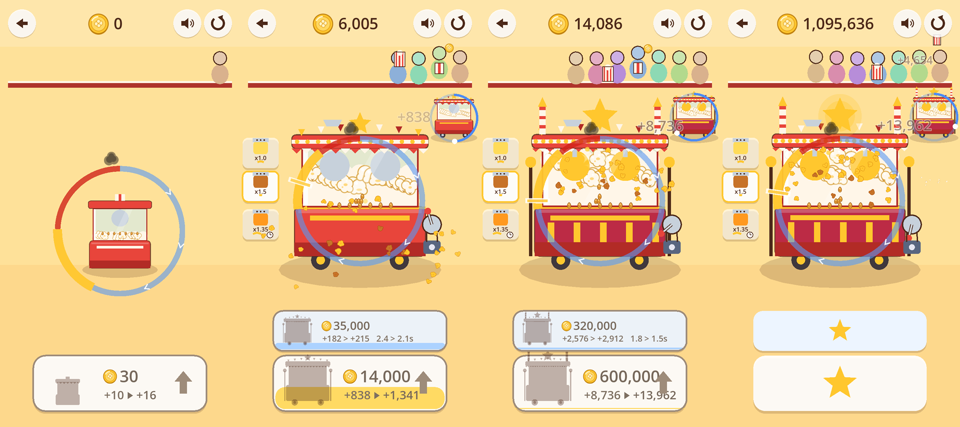

# Step 10 — 팝콘 가게 vertical slice (#115, 2026-11-03 – 11-04)

> 승인: #114의 소유자 결정(선택지 1 — B 승인 + 최소 범위). 설계는 `design/SLICE.md`, 수치는 `data/economy.json`의 `"stand"`.
> 아래의 'AI가 말한 것'은 블라인드 AI 플레이어의 대리 관찰이다. 사람의 즐거움이 아니다.

## 1. 무엇이 생겼나

주소 `#stand`(선택 화면 맨 위의 별 타일). A·B·C 실험은 비교 기준선으로 그대로 둔다(B의 시뮬레이션 21줄 중 B 8줄이 바이트 단위로 같다).

| 순간 | 형태 | 언제 |
|---|---|---|
| 1 낟알 넣기 · 2 기름 | 팝 직후 애니메이션(국자, 기름 한 방울) | 처음부터 |
| 3 가열 · 5 판단 | B의 누르기·떼기 그대로 | 처음부터 |
| 4 흔들기 | 누른 채 좌우로 세 번 → 고르게 팝 ×1.3. 손잡이가 돈다 | 3단계 |
| 6 양념 | 양념통 셋. 고르면 계속 적용(맞바꿈) | 5단계 |
| 7 담기·내주기 | 봉지가 손님에게 날아가고, 손님이 받아 동전을 든다. 손님은 가게와 함께 는다 | 처음부터 |
| 자동화 | 파란 카드: 모터(흔들기를 대신함) → 조수 냄비 6칸(가열·판단을 대신함, 3.0→1.5초) | 4단계 |

돈은 하나, 저장은 없다(실험 빌드). 넣지 않은 것의 목록은 `design/SLICE.md` 7절에 있다: 두 번째 돈, 연구, 상점, 광고, 프레스티지, 물류, 손님 주문, 반복 클릭 단계, 양념 해금 비용.

## 2. 첫 3분은 그대로인가

- 규칙: 0–3단계의 가격·금색·팝·미리보기가 B와 같다(`test_stand::test_the_first_minutes_are_b`).
- 블라인드 3분(u1, 0.10.0):
  - 첫 완벽은 0:40. 같은 프롬프트의 B(t4, 0.9.0)는 0:47이었다.
  - 업그레이드 3번. 세 번째에 "the best moment of the session"이라고 했다.
  - 새로 생긴 계산대·손님·국자는 첫 행동을 방해하지 않았다. 처음 본 화면에서 '기계를 누른다'를 맞혔다.

## 3. 10–20분

| 증거 | 무엇 | 결과 |
|---|---|---|
| 스크립트 15분 플레이 | 실제 브라우저, 실제 입력. 금색 1/4 지점을 노리고, 흔들고, 카라멜을 쓰고, 싼 카드부터 산다(로컬 서버, 공개 0.10.1과 같은 팩 `game-f0aa6ef16ff6.pck`) | 약 12:30에 다 삼(Lv14, 7칸). 357판(완벽 351, 아까움 6). 조수가 번 몫 32%. 오류 0 |
| 시뮬레이션 | 진짜 규칙으로 13개 플레이어 × 20분(`tests/results/step10/stand_sim.md`) | 숙련(카라멜)은 11:32에 끝. 중간은 10분에 Lv10과 사다리 4칸. 손을 거의 쓰지 않아도 멈추지 않음(수입의 94%가 조수). 자동화를 먼저 사도 회복함 |
| 블라인드 10분(u2, 0.10.0) | 새 에이전트, 실제 화면과 터치 | Lv7. 모터(4:46)와 조수(8:34)를 샀다. 양념 셋을 다 써 봤다 |
| 블라인드 10분(v1, 0.10.1) | 새 에이전트, 고친 빌드 | Lv7, 사다리 2칸(조수 7:48). 치즈를 골랐다. 9:09에 A도 열어 봤다 |

처음·3분·10분·15분(스크립트 플레이): 

이전(B 실험 0.9.1의 처음·60초·180초)은 `experiments/grid_0.9.1.png`의 가운데 줄이다. 가게는 같은 기계가 계산대·손님·조수·양념과 함께 '장사'가 되어 간다.

## 4. 무엇이 재미를 더했고, 무엇이 기능만 더했나 (블라인드 AI의 말과 기록으로)

| 결정 | AI 플레이어가 한 말과 한 행동 | 판단 |
|---|---|---|
| **양념 맞바꿈** | 양념에 닿은 2/2가 썼다. "each jar changing the timing, which made me re-learn it"(u2). "brought back a real choice (risk against speed against payout) just as the game was getting repetitive, and I could read all of it from the ring alone"(v1) | **재미를 더함**. 반복을 깨는 첫 장치였다 |
| **조수 냄비** | 산 2/2가 '손을 놓고 버는 것'을 봤다. "My coins went from 18 to 268 while I just watched"(u2). "234 to 484 while I waited hands-off"(v1) | **재미를 더함**. 위임이 보였다. 다만 "earnings easy to miss"(v1) |
| **모터 카드(×1.3)** | 2/2가 사서 배수로 이해했다 | 기능은 이해됨. 즐거움은 말하지 않았다 |
| **카드 미리보기·채워지는 카드** | 3/3이 좋다고 했다 | 유지 |
| **손으로 흔들기** | **0/3이 찾음**. 손잡이를 끌어 봤지만 짧은 누름이 됐다("decoration"). 손잡이 옆 화살표는 누르는 동안에만 보이는데, 이 도구는 누르는 동안의 화면을 주지 않는다. 대기 힌트는 플레이어가 8초 넘게 멈추지 않아 보지 못했을 수 있다 | **모름**. 사람의 손으로 다시 볼 것(Step 11) |
| **손님·계산대** | 3/3이 "decoration", "never reacted"(0.10.0). 0.10.1에서 봉지를 받고 동전을 들게 했지만 v1도 "decoration"이라고 했다 | **기능만 더함**(성장의 그림으로는 보였다: "a second customer") |
| 국자·기름 애니메이션 | u1만 언급("gray dish shape ... unclear") | 거의 보이지 않음 |

공통으로 남은 불만: 처음 몇 분(AI의 느린 손으로는 1–5분)에 "same hold over and over"(u2·v1). AI의 손은 사람보다 약 3배 느려서, 시뮬레이션의 중간 플레이어라면 0:43–1:36 사이의 구간이다.

## 5. 플레이어가 부딪힌 것 → 0.10.1

| 0.10.0에서 본 것 | 0.10.1 |
|---|---|
| 금색 끝에서 4ms 일찍 뗐는데(고리 위 0.5°) 아까움으로 판정되어 반만 받음(u2) | 가게는 그려진 금색 밖 40ms까지 완벽으로 친다(`edge_grace_ms`). B는 비교한 그대로 둔다 |
| 살 수 없는 카드를 눌렀는데 "탭이 안 먹었다"(u2, 62원 모자랐다) | 그 카드가 옆으로 흔들리고 낮은 소리가 나며 기록에 남는다('denied'). A·B·C는 그대로 |
| 봉지가 계산대에서 멈추고 손님은 반응이 없다(u1·u2) | 봉지가 손님에게 차례로 가고, 받은 손님이 뛰며 동전을 든다 |
| 흔들기를 못 찾음(u1·u2) | 해금 뒤 첫 흔들기 전까지 대기 힌트가 '누른 채 좌우로 미는 손가락과 양쪽 화살표'가 된다 |
| (평가 도구가 찾음) 게임 시계가 벽시계의 1.04배로 갔다 | 0.9.1의 프레임 보정이 매 프레임 두 값 중 큰 쪽을 골랐기 때문이다. 이제 50ms 넘는 멈춤에만 벽시계를 쓴다. 고친 뒤 브라우저 20초 측정: 1.0007·0.9993. AGENTS.md 교훈 |

0.10.1에서 다시 본 것(v1):
- 금색 끝 불만: 한 번("cut too close to the edge"). 4/45가 아까움이었고, 얼마나 가까웠는지는 기록이 사라져 모른다. 이 세션이 끝에 A를 열어 마지막 기록만 남았다. 이제 세션 도구가 실험별 기록을 남긴다.
- 흔들기: 여전히 0.
- 손님: 여전히 장식으로 읽혔다.

## 6. 숫자 (`tests/results/step10/stand_sim.md`)

- 조수 칸의 회수 시간: 72–195초(숙련 플레이어가 사는 단계 기준).
- 양념의 10분 수입:
  - 숙련: 카라멜 1.13M, 버터 0.48M, 치즈 0.44M.
  - 초보: 치즈 247k, 카라멜 173k, 버터 135k.
  - 중간: 카라멜이 조금 앞서지만 탄 판이 2.8배다.
- 3분 뒤 가장 긴 '살 것 없음': 숙련 103초, 중간 191초(10분 이후).

## 7. 검사

- 헤드리스 85/85(2,337 checks).
- 로컬 전체(배포 포함): 브라우저 105 통과·0 실패·10 건너뜀.
- 공개 0.10.1: 브라우저 105 통과·0 실패·10 건너뜀(`tests/results/step07/public/report.md`). 하나는 재시도에서 통과했다 — 첫 시도에서 `net::ERR_NETWORK_CHANGED`로 페이지가 열리지 않았다(다른 세션의 네트워크 변동).
- 새 검사:
  - `test_stand`(9): 첫 몇 분 = B, 잠금, ×1.3, 양념, 사다리, 정확한 밀리초, 미리보기 = 실제, 경제표, 금색 끝의 관용(가게만).
  - 통합 `test_the_stand_with_real_input`: 실제 마우스 이벤트로 흔들기, 양념 탭은 누름이 아님, 살 수 없는 카드의 'denied', 자동화, 조수.
  - `stand10`: p720·폰은 터치, 데스크톱은 마우스.
  - `responsive07` 'stand': 다섯 화면 모양.
  - `sound05` 'stand': 흔들기의 소리, 손을 대지 않은 동안 조수의 팝이 출력 신호로 들린다(RMS).
  - `play_stand`: 느림, N분.
  - `tools/sim/stand.gd`.
- 블라인드 감사: 세 플레이어(u1·u2·v1) 모두 화면 밖 호출 0.

## 8. 한계

- AI는 사람이 아니다. AI의 손은 느리고, 누르는 동안의 화면(흔들기 화살표)을 보지 못한다.
- 15분 스크립트 플레이는 로컬 서버에서 했다. 공개와 같은 파일이지만 공개 URL은 아니다. 공개 URL에서는 블라인드 10분과 브라우저 전체 검사를 했다.
- 가로 화면에서 양념통의 숫자가 작아 읽기 어렵다(세로가 이 게임의 방향이다).
- 저장이 없다. 10–20분을 한 번에 해야 한다.
- 사람 점수가 없다(#114와 같다). 점수표 페이지에 '가게' 줄은 아직 없다.
