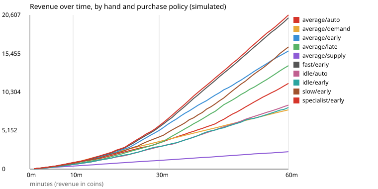
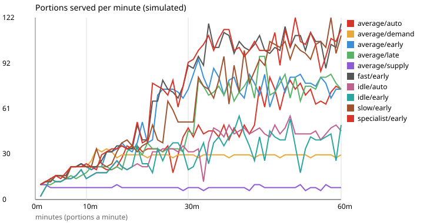
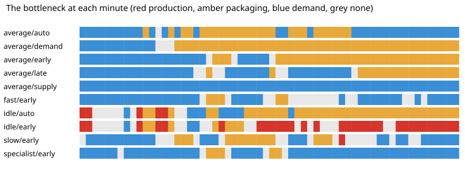

# Step 25 — 공장 경제 보고 (시뮬레이션)

**이것은 시뮬레이션의 목표치이지 플레이어의 재미가 아니다.** 같은 규칙 코드(`variants/factory/factory_rules.gd`)를 손 모델과 구매 정책이 돌렸다(`tools/sim/economy.gd`, 시드 20261116). 매 분 보존을 단언했다: 모든 인분이 어딘가에 있고, 돈 = 매출 − 구매 − 유지비, 돈은 음수가 되지 않는다.

손: fast(반응 0.3초, 완벽 80%), average(1초, 50%), slow(8초, 30%·탐 5%), specialist(0.3초, 95%), idle(30초). 정책: early(지금 병목을 푸는 것을 살 수 있으면 바로), late(값의 두 배가 모이면), supply(간판을 사지 않음), demand(간판만), auto(자동 냄비 위주).

## 3·10·30·60분

| 판 | 분 | 매출 | 판매 | 놓친 손님 | 냄비 | 포장대 | 간판 | 자동 냄비 | 유지비 | 첫 구매 |
|---|---|---|---|---|---|---|---|---|---|---|
| average/auto | 3 | 165 | 17 | 0 | 0 | 0 | 2 | 0 | 0 | 51초 |
| average/auto | 10 | 818 | 85 | 0 | 0 | 0 | 3 | 1 | 0 | 51초 |
| average/auto | 30 | 3,508 | 369 | 12 | 0 | 2 | 4 | 3 | 98 | 51초 |
| average/auto | 60 | 11,462 | 1052 | 12 | 0 | 2 | 5 | 9 | 279 | 51초 |
| average/demand | 3 | 165 | 17 | 0 | 0 | 0 | 2 | 0 | 0 | 51초 |
| average/demand | 10 | 818 | 85 | 0 | 0 | 0 | 3 | 0 | 0 | 51초 |
| average/demand | 30 | 3,677 | 386 | 145 | 0 | 0 | 5 | 0 | 0 | 51초 |
| average/demand | 60 | 7,927 | 830 | 824 | 0 | 0 | 6 | 0 | 0 | 51초 |
| average/early | 3 | 165 | 17 | 0 | 0 | 0 | 2 | 0 | 0 | 51초 |
| average/early | 10 | 818 | 85 | 0 | 0 | 0 | 3 | 0 | 0 | 51초 |
| average/early | 30 | 5,169 | 493 | 10 | 0 | 2 | 5 | 0 | 0 | 51초 |
| average/early | 60 | 15,792 | 1373 | 301 | 0 | 3 | 6 | 0 | 0 | 51초 |
| average/late | 3 | 145 | 15 | 0 | 0 | 0 | 1 | 0 | 0 | 106초 |
| average/late | 10 | 634 | 66 | 0 | 0 | 0 | 3 | 0 | 0 | 106초 |
| average/late | 30 | 3,488 | 366 | 0 | 0 | 1 | 5 | 0 | 0 | 106초 |
| average/late | 60 | 13,826 | 1230 | 153 | 0 | 3 | 6 | 0 | 0 | 106초 |
| average/supply | 3 | 135 | 14 | 0 | 2 | 0 | 0 | 0 | 0 | 39초 |
| average/supply | 10 | 406 | 42 | 0 | 4 | 0 | 0 | 0 | 0 | 39초 |
| average/supply | 30 | 1,159 | 122 | 0 | 5 | 0 | 0 | 0 | 0 | 39초 |
| average/supply | 60 | 2,321 | 242 | 0 | 6 | 0 | 0 | 0 | 0 | 39초 |
| fast/early | 3 | 169 | 17 | 0 | 0 | 0 | 2 | 0 | 0 | 37초 |
| fast/early | 10 | 852 | 86 | 0 | 0 | 1 | 3 | 0 | 0 | 37초 |
| fast/early | 30 | 5,626 | 514 | 9 | 0 | 2 | 6 | 0 | 0 | 37초 |
| fast/early | 60 | 20,221 | 1683 | 23 | 0 | 3 | 6 | 0 | 0 | 37초 |
| idle/auto | 3 | 117 | 12 | 1 | 2 | 0 | 0 | 0 | 0 | 102초 |
| idle/auto | 10 | 612 | 63 | 1 | 3 | 0 | 3 | 0 | 0 | 102초 |
| idle/auto | 30 | 2,987 | 321 | 11 | 4 | 1 | 4 | 3 | 57 | 102초 |
| idle/auto | 60 | 8,555 | 821 | 23 | 4 | 3 | 4 | 7 | 317 | 102초 |
| idle/early | 3 | 117 | 12 | 1 | 2 | 0 | 0 | 0 | 0 | 102초 |
| idle/early | 10 | 612 | 63 | 1 | 3 | 0 | 3 | 0 | 0 | 102초 |
| idle/early | 30 | 3,012 | 305 | 40 | 5 | 2 | 4 | 0 | 0 | 102초 |
| idle/early | 60 | 8,228 | 730 | 324 | 6 | 3 | 5 | 0 | 0 | 102초 |
| slow/early | 3 | 158 | 17 | 0 | 0 | 0 | 2 | 0 | 0 | 51초 |
| slow/early | 10 | 760 | 84 | 0 | 0 | 0 | 3 | 0 | 0 | 51초 |
| slow/early | 30 | 4,301 | 444 | 45 | 3 | 2 | 5 | 0 | 0 | 51초 |
| slow/early | 60 | 16,332 | 1479 | 129 | 7 | 3 | 6 | 0 | 0 | 51초 |
| specialist/early | 3 | 180 | 18 | 0 | 0 | 0 | 2 | 0 | 0 | 37초 |
| specialist/early | 10 | 870 | 87 | 0 | 0 | 1 | 3 | 0 | 0 | 37초 |
| specialist/early | 30 | 5,793 | 522 | 8 | 0 | 2 | 6 | 0 | 0 | 37초 |
| specialist/early | 60 | 20,607 | 1696 | 21 | 0 | 3 | 6 | 0 | 0 | 37초 |

## 병목이 차지한 시간 (60분)

| 판 | 생산 | 포장 | 수요 |
|---|---|---|---|
| average/auto | 0% | 39% | 41% |
| average/demand | 0% | 58% | 16% |
| average/early | 0% | 23% | 31% |
| average/late | 0% | 12% | 42% |
| average/supply | 0% | 0% | 97% |
| fast/early | 0% | 5% | 38% |
| idle/auto | 8% | 63% | 11% |
| idle/early | 45% | 15% | 4% |
| slow/early | 2% | 23% | 36% |
| specialist/early | 0% | 5% | 46% |

## 구매가 본전을 찾는 시간 (전 2분 대비 후 2분의 분당 매출 증가로 추정)

| 무엇 | 횟수 | 중앙 값 | 본전(분) 중앙 | 본전을 못 찾은 구매 |
|---|---|---|---|---|
| buy — 제 병목일 때 산 것 | 17 | 97 | 1.5 | 2 |
| buy_packer — 제 병목일 때 산 것 | 23 | 700 | 17.0 | 7 |
| buy_sign — 제 병목일 때 산 것 | 48 | 220 | 7.8 | 1 |
| buy | 23 | 97 | 3.3 | 4 |
| buy_auto | 16 | 570 | 247.7 | 10 |
| buy_packer | 23 | 700 | 17.0 | 7 |
| buy_sign | 50 | 220 | 8.3 | 1 |

## 경계 상황

| 상황 | 분 | 만든 인분 | 판매 | 매출 | 놓친 손님 | 유지비 | 남은 재고(인분) | 미납 정지(초) | 막힘(냄비·초) | 분당 순이익 |
|---|---|---|---|---|---|---|---|---|---|---|
| cookers_10 | 30.0 | 3206 | 1181 | 13,358 | 0 | 640 | 52 | 0 | 8,366 | 423.9 |
| cookers_20 | 30.0 | 3226 | 1181 | 13,360 | 0 | 635 | 72 | 0 | 26,306 | 424.2 |
| cookers_40 | 30.0 | 3266 | 1181 | 13,358 | 0 | 633 | 112 | 0 | 62,186 | 424.2 |
| max_customers | 10.9 | 1206 | 425 | 5,394 | 0 | 0 | 70 | 0 | 0 | 494.9 |
| overproduction | 10.3 | 44 | 0 | 0 | 0 | 0 | 44 | 0 | 0 | 0.0 |
| sales_burst | 12.2 | 368 | 162 | 1,620 | 0 | 0 | 44 | 0 | 0 | 132.6 |
| zero_customers | 10.3 | 44 | 0 | 0 | 0 | 0 | 44 | 0 | 0 | 0.0 |
