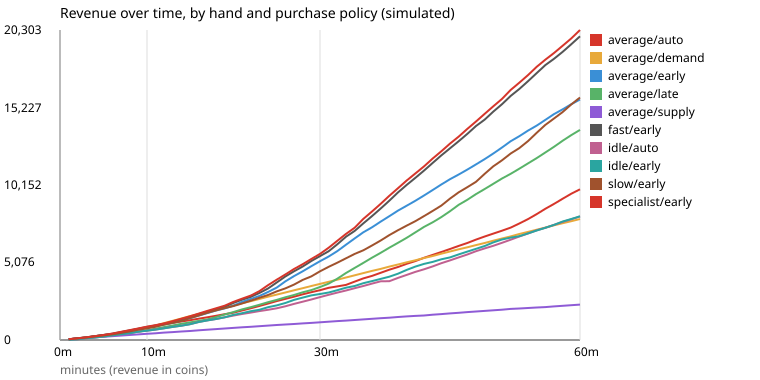
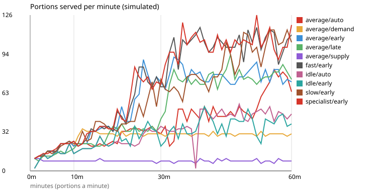
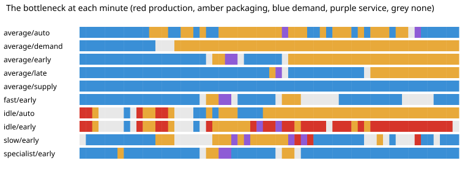

# Step 25 — 공장 경제 보고 (시뮬레이션)

**이것은 시뮬레이션의 목표치이지 플레이어의 재미가 아니다.** 같은 규칙 코드(`variants/factory/factory_rules.gd`)를 손 모델과 구매 정책이 돌렸다(`tools/sim/economy.gd`, 시드 20261116). 매 분 보존을 단언했다: 모든 인분이 어딘가에 있고, 돈 = 매출 − 구매 − 유지비, 돈은 음수가 되지 않는다.

손: fast(반응 0.3초, 완벽 80%), average(1초, 50%), slow(8초, 30%·탐 5%), specialist(0.3초, 95%), idle(30초). 정책: early(지금 병목을 푸는 것을 살 수 있으면 바로), late(값의 두 배가 모이면), supply(간판을 사지 않음), demand(간판만), auto(자동 냄비 위주).

## 3·10·30·60분

| 판 | 분 | 매출 | 판매 | 놓친 손님 | 냄비 | 포장대 | 간판 | 자동 냄비 | 유지비 | 첫 구매 |
|---|---|---|---|---|---|---|---|---|---|---|
| average/auto | 3 | 165 | 17 | 0 | 0 | 0 | 2 | 0 | 0 | 53초 |
| average/auto | 10 | 808 | 84 | 0 | 0 | 0 | 3 | 0 | 0 | 53초 |
| average/auto | 30 | 3,264 | 357 | 0 | 0 | 1 | 4 | 3 | 91 | 53초 |
| average/auto | 60 | 9,870 | 938 | 12 | 0 | 2 | 5 | 6 | 313 | 53초 |
| average/demand | 3 | 165 | 17 | 0 | 0 | 0 | 2 | 0 | 0 | 53초 |
| average/demand | 10 | 808 | 84 | 0 | 0 | 0 | 3 | 0 | 0 | 53초 |
| average/demand | 30 | 3,677 | 386 | 145 | 0 | 0 | 5 | 0 | 0 | 53초 |
| average/demand | 60 | 7,927 | 830 | 823 | 0 | 0 | 6 | 0 | 0 | 53초 |
| average/early | 3 | 165 | 17 | 0 | 0 | 0 | 2 | 0 | 0 | 53초 |
| average/early | 10 | 808 | 84 | 0 | 0 | 0 | 3 | 0 | 0 | 53초 |
| average/early | 30 | 5,162 | 492 | 11 | 0 | 2 | 5 | 0 | 9 | 53초 |
| average/early | 60 | 15,751 | 1369 | 283 | 0 | 3 | 6 | 0 | 18 | 53초 |
| average/late | 3 | 145 | 15 | 0 | 0 | 0 | 1 | 0 | 0 | 106초 |
| average/late | 10 | 634 | 66 | 0 | 0 | 0 | 3 | 0 | 0 | 106초 |
| average/late | 30 | 3,469 | 364 | 0 | 0 | 1 | 5 | 0 | 0 | 106초 |
| average/late | 60 | 13,760 | 1225 | 139 | 0 | 3 | 6 | 0 | 25 | 106초 |
| average/supply | 3 | 135 | 14 | 0 | 2 | 0 | 0 | 0 | 0 | 39초 |
| average/supply | 10 | 406 | 42 | 0 | 4 | 0 | 0 | 0 | 0 | 39초 |
| average/supply | 30 | 1,159 | 122 | 0 | 5 | 0 | 0 | 0 | 0 | 39초 |
| average/supply | 60 | 2,321 | 242 | 0 | 6 | 0 | 0 | 0 | 0 | 39초 |
| fast/early | 3 | 169 | 17 | 0 | 0 | 0 | 2 | 0 | 0 | 39초 |
| fast/early | 10 | 852 | 86 | 0 | 0 | 1 | 3 | 0 | 0 | 39초 |
| fast/early | 30 | 5,492 | 502 | 11 | 0 | 2 | 5 | 0 | 10 | 39초 |
| fast/early | 60 | 19,889 | 1659 | 25 | 0 | 3 | 6 | 0 | 28 | 39초 |
| idle/auto | 3 | 117 | 12 | 1 | 2 | 0 | 0 | 0 | 0 | 104초 |
| idle/auto | 10 | 612 | 63 | 1 | 3 | 0 | 3 | 0 | 0 | 104초 |
| idle/auto | 30 | 2,811 | 302 | 10 | 4 | 1 | 4 | 2 | 46 | 104초 |
| idle/auto | 60 | 8,098 | 801 | 22 | 4 | 2 | 4 | 6 | 322 | 104초 |
| idle/early | 3 | 117 | 12 | 1 | 2 | 0 | 0 | 0 | 0 | 104초 |
| idle/early | 10 | 612 | 63 | 1 | 3 | 0 | 3 | 0 | 0 | 104초 |
| idle/early | 30 | 3,010 | 306 | 38 | 5 | 2 | 4 | 0 | 0 | 104초 |
| idle/early | 60 | 8,103 | 721 | 139 | 6 | 3 | 5 | 0 | 29 | 104초 |
| slow/early | 3 | 158 | 17 | 0 | 0 | 0 | 2 | 0 | 0 | 53초 |
| slow/early | 10 | 760 | 84 | 0 | 0 | 0 | 3 | 0 | 0 | 53초 |
| slow/early | 30 | 4,502 | 459 | 45 | 4 | 2 | 5 | 0 | 4 | 53초 |
| slow/early | 60 | 15,883 | 1441 | 74 | 7 | 3 | 6 | 0 | 43 | 53초 |
| specialist/early | 3 | 180 | 18 | 0 | 0 | 0 | 2 | 0 | 0 | 38초 |
| specialist/early | 10 | 870 | 87 | 0 | 0 | 1 | 3 | 0 | 0 | 38초 |
| specialist/early | 30 | 5,638 | 509 | 10 | 0 | 2 | 5 | 0 | 12 | 38초 |
| specialist/early | 60 | 20,303 | 1672 | 23 | 0 | 3 | 6 | 0 | 19 | 38초 |

## 병목이 차지한 시간 (60분)

| 판 | 생산 | 포장 | 수요 |
|---|---|---|---|
| average/auto | 0% | 52% | 34% |
| average/demand | 0% | 58% | 17% |
| average/early | 0% | 22% | 32% |
| average/late | 0% | 10% | 49% |
| average/supply | 0% | 0% | 97% |
| fast/early | 0% | 4% | 39% |
| idle/auto | 9% | 62% | 14% |
| idle/early | 53% | 20% | 4% |
| slow/early | 4% | 20% | 35% |
| specialist/early | 0% | 4% | 46% |

## 구매가 본전을 찾는 시간 (전 2분 대비 후 2분의 분당 매출 증가로 추정)

| 무엇 | 횟수 | 중앙 값 | 본전(분) 중앙 | 본전을 못 찾은 구매 |
|---|---|---|---|---|
| build_hopper — 제 병목일 때 산 것 | 4 | 282 | 34.8 | 3 |
| build_kiosk — 제 병목일 때 산 것 | 9 | 500 | 5.0 | 2 |
| buy — 제 병목일 때 산 것 | 17 | 97 | 3.4 | 2 |
| buy_packer — 제 병목일 때 산 것 | 22 | 700 | 19.2 | 4 |
| buy_sign — 제 병목일 때 산 것 | 48 | 220 | 7.5 | 3 |
| build_hopper | 4 | 282 | 34.8 | 3 |
| build_kiosk | 9 | 500 | 5.0 | 2 |
| buy | 23 | 97 | 3.4 | 4 |
| buy_auto | 12 | 475 | 44.3 | 6 |
| buy_packer | 22 | 700 | 19.2 | 4 |
| buy_sign | 50 | 220 | 7.5 | 5 |

## 경계 상황

| 상황 | 분 | 만든 인분 | 판매 | 매출 | 놓친 손님 | 유지비 | 남은 재고(인분) | 미납 정지(초) | 막힘(냄비·초) | 분당 순이익 |
|---|---|---|---|---|---|---|---|---|---|---|
| advanced_kitchen | 30.0 | 3199 | 1180 | 13,252 | 0 | 622 | 49 | 0 | 3,446 | 365.5 |
| cookers_10 | 30.0 | 2734 | 1025 | 11,347 | 148 | 593 | 18 | 0 | 0 | 310.7 |
| cookers_20 | 30.0 | 2734 | 1025 | 11,347 | 148 | 593 | 18 | 0 | 0 | 310.7 |
| cookers_40 | 30.0 | 2734 | 1025 | 11,347 | 148 | 593 | 18 | 0 | 0 | 310.7 |
| flavor_hour | 60.0 | 6347 | 2257 | 34,653 | 97 | 2011 | 75 | 0 | 1,088 | 464.0 |
| flavor_hour_paused | 60.0 | 6636 | 2356 | 27,775 | 0 | 1856 | 66 | 0 | 409 | 390.1 |
| flavor_only_caramel | 60.0 | 6691 | 2355 | 30,978 | 1 | 1947 | 74 | 0 | 672 | 430.4 |
| flavor_only_cheese | 60.0 | 6689 | 2357 | 29,308 | 0 | 1848 | 72 | 0 | 548 | 408.6 |
| flavor_only_cocoa | 60.0 | 6434 | 2266 | 29,377 | 91 | 1897 | 76 | 0 | 962 | 405.3 |
| flavor_only_spicy | 60.0 | 6518 | 2293 | 28,423 | 64 | 1816 | 79 | 0 | 883 | 398.5 |
| forty_hour | 60.0 | 5569 | 2357 | 25,407 | 0 | 2367 | 104 | 0 | 27,541 | 292.4 |
| forty_hour_no_u08 | 60.0 | 5571 | 2357 | 25,354 | 0 | 2489 | 104 | 0 | 27,536 | 289.4 |
| hour_utility | 60.0 | 6301 | 2286 | 26,708 | 71 | 1747 | 86 | 0 | 991 | 375.7 |
| max_customers | 10.9 | 1206 | 424 | 5,376 | 0 | 0 | 74 | 0 | 0 | 493.2 |
| overproduction | 10.3 | 44 | 0 | 0 | 0 | 0 | 44 | 0 | 0 | 0.0 |
| sales_burst | 12.2 | 368 | 162 | 1,620 | 0 | 0 | 44 | 0 | 0 | 132.6 |
| zero_customers | 10.3 | 44 | 0 | 0 | 0 | 0 | 44 | 0 | 0 | 0.0 |
