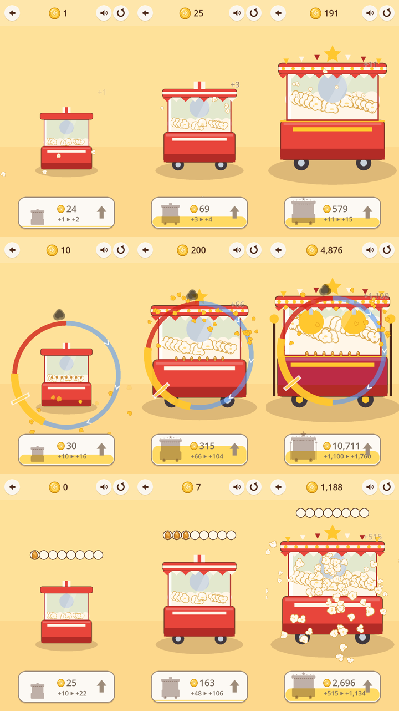

# 소유자 결정 메모 — Popcorn & Glory (Step 09)

**상태: 결정 대기.** Step 10–12는 계획일 뿐 승인되지 않았습니다. 아래 선택지 중 하나를 #114에 댓글로(또는 이 대화에서) 명시해 주실 때까지 넓히는 작업은 시작하지 않습니다.

## 10분이면 됩니다 — 직접 해 보기

| 순서 예 | 열기 |
|---|---|
| A 클릭 & 팝 | https://7bvcxz.github.io/gamo/popcorn-glory/?trial=1#click |
| B 완벽한 팝 | https://7bvcxz.github.io/gamo/popcorn-glory/?trial=1#perfect |
| C 팝콘 폭발 | https://7bvcxz.github.io/gamo/popcorn-glory/?trial=1#explosion |
| 점수표 | https://7bvcxz.github.io/gamo/popcorn-glory/scorecard.html |

1. 휴대폰 세로 화면, 소리는 셋 다 같게. 설명은 읽지 않고 시작합니다.
2. 순서는 B→C→A처럼 섞어 주세요. 처음 한 것이 가장 새롭게 느껴지기 때문입니다.
3. 위에 3:00 시계가 나타나면 3분입니다. 더 하고 싶으면 계속하셔도 되고, 그 사실이 4번 질문의 답입니다.
4. 하나가 끝날 때마다 점수표에서 네 질문에 1–5로 답합니다. 내보내기를 누른 뒤 #114에 붙여 주세요.

## 비교 (자세한 근거: [`RESULTS.md`](RESULTS.md))

| | A 클릭 & 팝 | **B 완벽한 팝** | C 팝콘 폭발 |
|---|---|---|---|
| 손동작 | 누르면 팝 | 누르고 금색에서 떼기 | 8번 눌러 폭발 |
| 처음 보는 AI가 첫 동작을 찾음 | 3/3 즉시 | 첫 완벽까지 114 → 93 → 35–62초(빌드마다 줄어듦) | 3/3 즉시 |
| 3분 뒤 더 하겠냐는 물음에 AI의 답 | 3/3 "몇 분 더 — 같은 탭뿐이면 곧 그만둠" | **3/3 "그렇다, 당분간"** | 3/3 "몇 분 더 — 8탭뿐이면 곧 내려놓음" |
| AI가 가장 좋다고 한 것 | 기계가 자라는 것 | 금빛 완벽 팝, 실력이 느는 것 | 두 배가 되는 한 판, 기계 변화 |
| 공통 불만 | 같은 탭 반복 | 같은 누름 반복 | 8탭이 일처럼 |
| 시뮬레이션 3분(꾸준한 손) | Lv9 | Lv12 (탭만 하면 Lv3) | Lv9 |
| **소유자 점수** | — | — | — |

AI 점수는 사람의 즐거움이 아닙니다. 소유자 칸이 이 비교에서 가장 중요한 칸이고, 아직 비어 있습니다.

위에서부터 A·B·C, 왼쪽부터 처음·1분·3분입니다. 셋 다 3분이면 기계가 확연히 바뀝니다(스크립트 플레이어, 사람의 손이 아님).

## 잠정 추천

- **1위 B, 2위 C, 3위 A.**
- **추천**: 직접 해 보신 점수가 B를 A·C보다 낮게 보지 않으면, **B를 핵심 동작으로 작은 vertical slice(Step 10)** 를 엽니다.
  - 조건 없이 '그렇다'고 답한 것은 B뿐입니다.
  - 셋 모두에서 나온 가장 큰 불만(한 동작의 반복, 저절로 되는 것이 없음)이 바로 Step 10의 범위입니다.

**승인하실 production 가설(1번을 고르실 때)**
- B의 '누르고 금색에서 떼기'를 손맛의 중심에 둡니다.
- Step 10의 요리 동작 중 '가열 → 터지는 순간 판단'이 이 링입니다. 나머지(낟알 넣기·기름·흔들기·양념·담기)는 한 번에 하나씩 엽니다.
- 직접 하던 동작부터 자동화를 삽니다.
- 첫 3분은 지금의 B 그대로 지킵니다.
- 10–20분 플레이에서 '반복' 불만이 줄어드는지로 판정합니다.
- 두 번째 돈·연구·상점·광고·프레스티지는 넣지 않습니다.

## 선택지 — 하나를 골라 주세요

1. **B 승인 + 최소 범위**: 위 가설로 Step 10을 시작합니다.
2. **실험 하나 더**: 'B 위에 C의 칸'(완벽한 팝이 칸을 채우고 8칸이면 폭발)을 짧게 만듭니다.
   - 판정: 새 블라인드 AI 3명과 소유자 3분.
   - 기준: 첫 완벽 ≤45초가 2/3 이상, AI의 '계속' 2/3 이상, '반복' 불만 1/3 이하, 소유자 점수가 B보다 낮지 않음.
   - 판정한 뒤 다시 결정합니다.
3. **다른 승자**: A 또는 C를 핵심으로 합니다(이유를 적어 주시면 그 가설로 다시 씁니다).
4. **보류**: 0.9.1을 그대로 두고 넓히지 않습니다.
