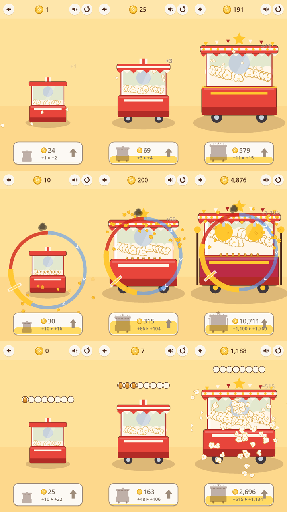

# 세 실험의 비교와 추천 (Step 09, #114)

> **상태: 소유자 결정 대기.** 아래의 1위·2위는 **잠정**이다. 사람의 점수는 아직 하나도 없다.
> Step 10–12(#115–#117)는 **계획일 뿐 승인되지 않았다.** 소유자가 이 문서의 선택지 중 하나를 명시적으로 고르기 전에는 시작하지 않는다.
> 이슈가 닫히거나 테스트가 통과하는 것은 승인이 아니다.

소유자용 한 쪽 요약은 [`DECISION.md`](DECISION.md)에 있다. 이 문서는 그 근거다.

## 1. 무엇을, 어떻게 비교했나 (다시 할 수 있게)

| | A 클릭 & 팝 | B 완벽한 팝 | C 팝콘 폭발 |
|---|---|---|---|
| 손동작 | 누르면 바로 팝 | 누르고 있다가 금색에서 뗀다 | 8번 눌러 칸을 채우면 폭발 |
| 3분 시험 주소 | [`?trial=1#click`](https://7bvcxz.github.io/gamo/popcorn-glory/?trial=1#click) | [`?trial=1#perfect`](https://7bvcxz.github.io/gamo/popcorn-glory/?trial=1#perfect) | [`?trial=1#explosion`](https://7bvcxz.github.io/gamo/popcorn-glory/?trial=1#explosion) |

- **빌드**: 공개 0.9.1 (`version.json`: pack `game-9223413bb2d4.pck`, source `908e25b61dab`). 세 실험은 같은 빌드, 같은 기계 그림, 같은 돈 하나, 같은 업그레이드 버튼 하나다.
- **리셋**: 저장이 없다. 주소를 새로 열거나 위의 다시 시작 버튼을 누르면 돈 0·단계 0에서 시작한다.
- **3분**: `?trial=1`로 열면 활동 시계가 3:00을 지날 때 위에 시계가 나타난다(숨은 탭에서는 멈춘다). 그 전에는 시계가 없다 — Step 08의 플레이어 셋이 모두 시계를 마감으로 읽었다.
- **사람의 절차와 점수표**: [`scorecard.html`](https://7bvcxz.github.io/gamo/popcorn-glory/scorecard.html) — 세로 화면, 같은 소리, 순서 돌리기(A→B→C, B→C→A, C→A→B), 끝날 때마다 네 질문 1–5. 그 브라우저에만 저장되고, Markdown으로 내보내 #114에 붙인다.
- **기계로 다시 하기**: 헤드리스 `popcorn-glory/tools/test.sh`, 전체(배포 포함) `popcorn-glory/tools/test_all.sh [--public] [--slow]`, 시뮬레이션 `godot --headless --path popcorn-glory --script res://tools/sim/runner.gd -- --out <폴더>`, 블라인드 AI `popcorn-glory/tools/blind/README.md`.

## 2. 같은 기계, 처음 → 1분 → 3분 (스크립트 플레이어, 공개 0.9.1)

행은 위에서부터 A·B·C, 열은 첫 행동·60초·180초다. 720×1280 세로 터치이고, 공개 URL에서 `play180.spec.mjs`로 찍었다. 스크립트는 A·C를 약 2.5탭/초로 누르고, B는 금색의 1/4 지점을 노리며, 살 수 있으면 산다. **사람의 손도, 재미의 판단도 아니다.** 3분이면 셋 다 기계의 실루엣이 확연히 바뀐다(가격만 바뀌는 업그레이드는 없다).

| 공개 0.9.1, 720×1280 | A | B | C |
|---|---|---|---|
| 3분 동안의 입력 | 191탭 | 60번 누름 | 168탭 |
| 첫 업그레이드(활동 시계) | 30.5초 | 18.1초 | 31.3초 |
| 60초 · 180초의 단계 | Lv2 · **Lv6** | Lv4 · **Lv10** | Lv2 · **Lv5** |
| 3:00의 돈 | 191 | 4,876 | 1,188 |
| 가장 긴 무입력 | 5.7초 | 10.5초 | 5.8초 |
| 180초의 그리기 호출 · 날던 조각 | 109 · 83 | 137 · 98 | 122 · 168 |
| 그때의 부하 평균 · FPS | 47.0 · 18.9 | 38.2 · 17.3 | 44.6 · 13.7 |

이 실행에서 머신의 부하 평균이 38–47이었다(다른 세션의 작업). 그래서 '2.5탭/초' 스크립트가 실제로는 약 1탭/초였다. 위 숫자는 **느린 손** 쪽의 값이고, 의도한 속도의 값은 3절의 시뮬레이션에 있다. FPS는 소프트웨어 렌더의 이 머신을 잰 것이라 판단에 쓰지 않는다. 판단은 그리기 예산(200)으로 한다. 원본: `evidence/step09/play180/`(스크린샷 다섯 장씩과 기록 JSON).

## 3. 세 줄 — 사실 · AI 대리 판단 · 사람(비어 있음)

### (a) 사실과 기술 지표

**규칙 시뮬레이션**(실제 규칙, 180초 활동 시간, 시드 7 — `tests/results/step06/sim.md`, 0.9.1 규칙으로 다시 돌려 같은 표를 확인했다):

| 행동 모델 | A | B | C |
|---|---|---|---|
| 꾸준함(A·C 2.5탭/초, B 숙련) | Lv9 · 첫 구매 12.6초 · 최장 무업그레이드 33초 | Lv12 · 9.2초 · 24초 | Lv9 · 12.6초 · 30초 |
| 새로 온 사람(첫 탭 8초, 1.2탭/초 / B 초보) | Lv6 · 30.1초 · 37초 | Lv7 · 28.0초 · 36초 | Lv6 · 30.1초 · 33초 |
| B를 탭만 하는 사람(누르기를 모름) | — | **Lv3 · 최장 77초** | — |
| 새 외형(Lv3/6/9)에 닿는 시각, 꾸준함 | 30.8 / 74.6 / 155.6초 | 25.6 / 57.3 / 103.2초 | 34.7 / 79.9 / 149.6초 (연쇄 34.7, 분수 79.9) |

- **B의 위험이 숫자로 보인다**: 누르기를 발견하지 못하면 3분에 Lv3이고 77초 동안 아무것도 못 산다. 발견하면 셋 중 가장 빠르다.
- **기술**: 헤드리스 75/75 통과(2,194 검사). 공개 빌드의 브라우저 검사 91 통과·0 실패·10 건너뜀(`tests/results/step07/public/report.md`). 둘은 재시도에서 통과했다 — 첫 시도에서 `net::ERR_NETWORK_CHANGED`(다른 세션의 컨테이너가 네트워크 인터페이스를 바꿈)로 페이지가 열리지 않았다. 공개 빌드에서 세 실험 모두 열리고 3분을 막힘 없이 플레이했다(위 표). 최고 단계 C 폭발의 그리기 호출은 예산(200) 안이다(`perf07`).
- **Step 09에서 고친 결함**: 브라우저가 0.8초 멈춘 동안 누른 B는 0.9.0에서 손가락 1,552–1,561ms를 **526–880ms**로 판정했다(`stall09`). Godot가 `_process`의 `delta`를 프레임당 약 0.133초로 자르기 때문이다. 0.9.1은 프레임을 벽시계로 잰다 → 공개 0.9.1에서 손가락 1,550–1,553ms를 1,555–1,706ms로 판정(p720·폰·데스크톱 모두 통과).

**블라인드 AI 플레이의 관찰**(실행마다 새 에이전트, 실제 화면·터치 3분 — `evidence/step08/`, `evidence/step09/round3/`):

| 실행 | 빌드 | 실험 | 첫 명령 | 첫 돈 | 첫 업그레이드 | 업그레이드 | 입력 | B 결과 | 게임 시계 배속 |
|---|---|---|---|---|---|---|---|---|---|
| r1 | 0.7.0 | A | 10.0초 | 10.6초 | 85.5초 | 2 | 49 | | 0.97 |
| s1 | 0.8.0 | A | 10.4초 | 10.5초 | 71.7초 | 2 | 64 | | 1.00 |
| t1 | 0.9.0 | A | 11.2초 | 11.4초 | 126.8초 | 1 | 36 | | 0.73 |
| r2 | 0.7.0 | B | 12.5초 | 12.8초 | 157.4초 | 1 | 12 | 덜 익음 6·탐 2·완벽 3·늦음 1 | 0.96 |
| s2 | 0.8.0 | B | 11.8초 | 12.1초 | 123.7초 | 2 | 12 | 덜 익음 1·늦음 2·탐 3·완벽 6 | 0.99 |
| t2† | 0.9.0 | B | 10.2초 | 11.5초 | 111.5초 | 2 | 12 | 덜 익음 1·아까움 2·늦음 1·완벽 8 | 0.72 |
| t4 | 0.9.0 | B | 10.8초 | 10.9초 | 72.2초 | 2 | 14 | 덜 익음 2·아까움 2·탐 1·늦음 1·완벽 8 | 0.99 |
| r3 | 0.7.0 | C | 9.1초 | 25.8초 | 79.1초 | 2 | 64 | | 0.96 |
| s3 | 0.8.0 | C | 9.7초 | 28.7초 | 89.2초 | 2 | 58 | | 1.00 |
| t3 | 0.9.0 | C | 12.5초 | 33.8초 | 108.8초 | 1 | 40 | | 0.74 |

- † t2는 **타이밍 관찰이 오염되었다**: 이 실행에만 쓴 하네스(누르는 동안의 스크린샷)가 페이지를 멈춰 누름이 +240–500ms 흩어졌다. 발견에 관한 관찰은 쓰고 타이밍에 관한 말은 쓰지 않는다. 같은 빌드에서 새 에이전트로 다시 한 것이 t4다.
- **B의 첫 누름 → 첫 완벽**: 0.7.0 114초(우연한 스와이프) → 0.8.0 93초 → 0.9.0 **62초(t2) · 35초(t4)**.
- 3차(0.9.0)의 t1·t2·t3은 머신이 굶주려 게임 시계가 벽시계의 0.72–0.74배로 갔다(부하 평균 33–50). 그 표의 시각은 벽시계(플레이어의 시계)다.
- AI의 손은 초당 0.07–0.36 입력이다(설계의 '느린 손'은 1.2탭/초). **시간 기준(60초에 첫 업그레이드 등)은 이 표로 판단하지 않는다** — 위 시뮬레이션과 스크립트 표가 그 몫이다.
- 블라인드 조건: 지시 + 사후 감사(샌드박스 아님). 열 명 모두 화면 명령과 자기 스크린샷 밖의 도구 호출 0(`evidence/step09/blind_audit.txt`, 가짜 기록 대조군 넷은 모두 걸림).

### (b) 블라인드 AI 대리 판단 (1–5, 사람의 즐거움이 아니다)

| 실행 | Q1 설명 없이 | Q2 업그레이드 | Q3 다음이 궁금 | Q4 계속 | 근거(플레이어 보고 원문에서) | 신뢰도 |
|---|---|---|---|---|---|---|
| r1 A 0.7.0 | 5 | 4 | 4 | 3 | 0:00에 맞힘 / 수레의 금빛 폭발 "가장 좋았다" / "69짜리가 보고 싶다" / "계속 탭뿐이면 흥미를 잃을 것" | 낮음 |
| s1 A 0.8.0 | 5 | 4 | 3 | 2 | 0:00에 맞힘 / 기계가 자라는 것 "가장 좋았다" / "1–2분 더" / "곧 그만둘 것" | 낮음 |
| t1 A 0.9.0 | 5 | 4 | 3 | 2 | "+1 ▸ +2"까지 읽고 맞힘 / 업그레이드가 "좋은 보상" / "수레가 보고 싶어 조금 더" / "같은 탭이면 곧 그만둘 것" | 낮음 |
| r2 B 0.7.0 | 2 | 4 | 4 | 4 | 2분 동안 규칙을 모름 / 업그레이드 "보람" / "새 기술을 배우게 된다" / "그렇다 — 발견 못 하면 그만둘 것" | 낮음 |
| s2 B 0.8.0 | 3 | 5 | 4 | 4 | 1분 반을 태우고 추측 / 완벽한 팝 "아주 좋았다" / "97 다음이 보고 싶다" / "당분간은 그렇다" | 낮음 |
| t2† B 0.9.0 | 3 | 5 | 4 | 3 | 0:32에 누르기를 스스로 추측 / "혼자 발견해서 아주 좋았다", 미리보기로 무엇을 사는지 앎 / "다음 모양이 보고 싶다" / "몇 분 더, 같은 링뿐이면 곧" | 낮음(타이밍 오염) |
| t4 B 0.9.0 | 4 | 4 | 4 | 4 | "글 없이도 화면만으로 알아냈다"(0:34) / 금빛 팝·기계 변화, 다만 "업그레이드 뒤 벌받는 느낌"(→ 결함, 0.9.1에서 고침) / "카트 다음이 보고 싶다" / "그렇다, 당분간" | 낮음 |
| r3 C 0.7.0 | 5 | 4 | 4 | 3 | 10초 안에 이해 / 기계가 바뀌는 것이 "갈고리" / "163짜리가 보고 싶다" / "몇 분 더" | 낮음 |
| s3 C 0.8.0 | 5 | 4 | 4 | 3 | 0:00에 맞힘 / 업그레이드 "가장 좋았다" / "다음 모양이 진짜 당김" / "순수한 탭은 곧 닳을 것" | 낮음 |
| t3 C 0.9.0 | 5 | 4 | 4 | 3 | 0:01에 맞힘, "약속(+10 ▸ +22)이 맞았다" / "진짜 보상" / "64짜리 수레가 보고 싶다" / "몇 분 안에 내려놓을 것" | 낮음 |

실험별로 모으면(† 제외, 평균이 아니라 범위로): **A** Q1 5·5·5, Q4 3·2·2 — **B** Q1 2·3·4(빌드마다 오름), Q4 4·4·4 — **C** Q1 5·5·5, Q4 3·3·3.
이 숫자는 사람 점수와 섞지 않고, 평균을 내어 '만족도'라고 부르지 않는다.

### (c) 사람(소유자) — 비어 있음

| 실험 | Q1 | Q2 | Q3 | Q4 | 순서 | 메모 |
|---|---|---|---|---|---|---|
| A | — | — | — | — | — | |
| B | — | — | — | — | — | |
| C | — | — | — | — | — | |

[`scorecard.html`](https://7bvcxz.github.io/gamo/popcorn-glory/scorecard.html)에서 채워 #114에 붙이면 이 표에 옮긴다. **사람이 해 보기 전까지 이 비교의 가장 중요한 칸이 비어 있다.**

## 4. 네 질문을 실제 관찰로 (평가자의 설명)

1. **설명 없이 첫 행동을 찾는가** — A·C의 여섯 명 모두 첫 화면에서 '기계를 누른다'를 맞혔다. B는 첫 탭이 +1만 주므로 탭이 전부인 줄 안다. 0.7.0에서는 2분, 0.9.0에서는 35–62초 만에 누르기를 찾았다. 링의 색(파랑 → 금 → 빨강)과 방향 표시, 연기를 보고 t4는 0:12에 "열은 시계 방향으로 간다"고 추측했다.
2. **업그레이드가 화면의 기계를 바꾸었나** — 열 명 모두 "기계가 눈에 띄게 바뀐다"(차양 → 바퀴)를 좋은 점으로 꼽았다. 0.9.0의 '+지금 ▸ +다음' 미리보기는 네 명 모두 읽었고 "약속이 맞았다"고 했다(t3·t4). B의 둘은 업그레이드보다 **금빛 완벽 팝**을 더 좋다고 했다.
3. **다음 단계를 기대하나** — 셋 다 "다음 기계 모양이 보고 싶다"가 공통이다. B만 기계 말고 **기술**(금색을 더 잘 맞추기, 팝콘 색으로 판정 읽기 — t4)에 대한 기대를 말했다.
4. **3분 뒤에도 하고 싶은가(대리)** — B 셋은 모두 "그렇다(당분간)"였다. A·C 여섯은 "몇 분 더, 같은 동작뿐이면 곧"이었다. **열 명 중 아홉이 '같은 동작의 반복'을 말했다.** 원하는 것으로는 저절로 버는 것·자동화(여섯 명), 두 번째로 살 것(세 명), 손님(두 명), 움직이는 금색·콤보(두 명)를 들었다. AI의 '계속하고 싶다'는 실제로 더 하는 행동이 아니다. 실험은 3분에 끝났고, 이것은 말일 뿐이다.

## 5. Step 09에서 고친 마찰 (증거 → 수정 → 다시 본 것)

| 마찰(증거) | 수정 | 그 뒤 |
|---|---|---|
| 업그레이드가 무엇을 주는지 모른다(Step 08: r3·s1) | 0.9.0: 카드에 '+지금 ▸ +다음'(한 번의 행동이 실제로 버는 값, 매 단계 실제로 해 보는 테스트로 묶음 — 틀린 미리보기를 넣으면 실패) | 0.9.0의 네 명 모두 미리보기를 읽고 맞다고 확인했다 |
| B 링의 색과 방향을 거꾸로 읽음(s2: 주황을 '데우는 중'으로 읽고 네 번 더 길게 누름) | 0.9.0: 진한 파랑·빨강, 시계 방향 표시 셋, 타는 자리에 연기 | t2·t4가 첫 화면이나 첫 탭에서 방향과 '빨강 = 탐'을 맞혔다. 첫 완벽 93초 → 62·35초 |
| B를 누른 동안 브라우저가 멈추면 그 시간이 열에서 사라짐(t4: 1.98초 → 1.16초 '덜 익음', "업그레이드 뒤 벌받는 느낌") | 0.9.1: 프레임을 벽시계로 잰다(Godot의 `delta` 상한 우회), 한 프레임 최대 1초 | `stall09`: 0.9.0에서 실패(526–880ms), 0.9.1에서 통과. **0.9.1로 다시 한 블라인드는 없다** — 측정으로 확인했다 |

**고치지 않은 것**: A·C의 반복, B의 반복. 이것은 UI 장애가 아니라 각 실험의 성질이며, 바로 이 비교가 묻는 것이다. 후보를 몰래 고쳐 결과를 바꾸지 않았다.
측정 도구도 두 번 고쳤다. (1) 3차의 '누르는 동안 스크린샷'은 시간을 왜곡해서 되돌렸다. (2) 게임 시각을 플레이어 시각으로 옮기는 방법을 보간으로 바꿨다(Step 08 보고서의 시각이 1–6초 바뀌었고, 결론은 그대로다).

## 6. 잠정 1위·2위

**잠정 1위: B 완벽한 팝**
- 강점: '3분 뒤에도 더 하겠다'에 조건 없이 '그렇다'고 답한 것은 B 셋뿐이다(A·C 여섯은 '몇 분 더, 같은 동작뿐이면 곧'). 가장 큰 순간(금빛 완벽 팝)이 있다. 세 실험 중 유일하게 **실력이 늘어나는** 루프다: 뗀 눈금이 남아 다음 누름을 고치고, 팝콘의 색이 판정을 말한다. 숙련자의 3분 진행은 시뮬레이션에서 가장 빠르다(Lv12).
- 약점: 첫 10초. 탭이 +1을 주므로 누르기를 찾아야 한다(빌드마다 줄어 35–62초). 한 동작의 반복이라는 불만이 B에도 있다(s2·t2·t4).
- 위험: (1) 누르기를 못 찾은 사람은 Lv3에서 77초씩 막힌다(시뮬레이션). (2) 손맛이 기기의 지연에 달려 있다 — 멈춤 하나는 고쳤지만 저사양 폰의 입력 지연은 재지 않았다. (3) 사람이 아직 해 보지 않았다.

**잠정 2위: C 팝콘 폭발**
- 강점: 이해가 즉시다(칸 8개 = 다음 폭발까지 남은 것). 업그레이드마다 한 판이 두 배가 되는 것이 분명하다. 볼거리가 클 수 있다(Lv3 연쇄, Lv6 분수).
- 약점: "8탭이 일처럼". AI 플레이어는 손이 느려 3분 안에 Lv2를 넘지 못해 **연쇄·분수를 아무도 보지 못했다** — 이 실험의 가장 큰 무기를 시험하지 못한 것이다(모르는 것).

**3위: A 클릭 & 팝** — 이해는 가장 빠르고 손맛도 분명하지만, 3분 뒤의 당김이 가장 약하다(Q4 3·2·2). 다음 게임의 '첫 동작'으로는 좋다. 핵심 루프로 삼기에는 근거가 없다.

## 7. 싸게 해 볼 하이브리드 하나 (반증 가능)

**"B 위에 C의 칸"**: 동작은 B 그대로 하나다(누르고 금색에서 뗀다). 완벽한 팝마다 C의 낟알 칸이 하나 차고, 8칸이 차면 C의 폭발(단계가 오르면 연쇄·분수)이 터져 큰 보상을 준다. 새 동작도 새 돈도 없다.
- 가설: B의 숙련에 **중기 목표와 볼거리**를 얹으면 '같은 누름의 반복'이 줄고, 첫 10초는 나빠지지 않는다.
- 반증 기준(새 블라인드 AI 3명 + 소유자 3분):
  - (i) 첫 완벽 ≤ 45초인 사람이 2/3 이상이다.
  - (ii) AI Q4 ≥ 4가 2/3 이상이고, '반복' 불만은 1/3 이하다(B만일 때는 3명 중 2명 이상).
  - (iii) 소유자의 Q4가 B만일 때보다 낮지 않다.
  - 하나라도 어기면 하이브리드를 버리고 B를 그대로 둔다.
- 비용: 규칙은 둘 다 이미 있다. 연결, 칸 그림의 위치, 테스트만 더하면 되는 짧은 실험 하나다.

## 8. 모르는 것

- **사람이 재미있어하는가**: 소유자 점수가 없다. 지금 손에 있는 것은 AI의 말과 숫자뿐이다.
- C의 연쇄·분수를 처음 보는 사람의 반응: 아무도 거기까지 가지 못했다.
- 실제 폰(저사양, 터치 지연)에서 B의 손맛: 이 머신의 헤드리스 Chromium만 썼다.
- 10–20분 뒤: 셋 다 3분까지만 봤다. 반복에 대한 불만이 몇 분에 '그만둔다'가 되는지는 모른다.
- 소리: AI는 듣지 못한다(소리 신호는 `sound05`가 재지만 즐거움은 아니다).

## 9. 추천과 소유자 결정

**추천: (b) 작은 production vertical slice로 가되, 그 전에 소유자가 세 실험을 3분씩 해 본다.** 사람의 점수가 B를 A·C보다 낮게 보지 않으면, B를 핵심 동작으로 Step 10을 연다.
'3분 뒤에도 더 하겠다'에 조건 없이 '그렇다'고 답한 것은 B뿐이다. 그리고 셋 모두에서 나온 가장 큰 불만(한 동작의 반복, 저절로 되는 것이 없음)이 바로 Step 10의 범위(단계를 하나씩 여는 요리 동작과 선택적 자동화)다.
하이브리드(7절)는 소유자가 반복을 B 안에서 먼저 줄여 보고 싶을 때의 대안이다.

**승인을 요청하는 production 가설**:
- B의 '누르고 금색에서 떼기'를 게임의 손맛(핵심 동작)으로 삼는다.
- Step 10의 일곱 동작 중 '가열 → 터지는 순간 판단'이 이 링이고, 나머지(낟알 넣기·기름·흔들기·양념·담기)는 한 번에 하나씩 연다.
- 플레이어가 직접 하던 동작부터 자동화를 산다.
- 첫 3분은 지금의 B를 지킨다(첫 완벽 ≤ 45초, 3분에 업그레이드 ≥ 3 — 사람의 손으로 재서).
- 10–20분 플레이에서 '같은 동작 반복' 불만이 줄어드는지로 판정한다.
- 하지 않는 것: 두 번째 돈, 연구 트리, 상점, 광고, 프레스티지, 계절 초기화.

**선택지**(소유자가 하나를 명시적으로 고른다 — 고르기 전까지 Step 10–12는 시작하지 않는다):
1. **B 승인 + 최소 범위**: 위 가설로 Step 10을 연다.
2. **실험 하나 더**: 7절의 하이브리드를 짧게 만들고 반증 기준으로 판정한 뒤 다시 결정한다.
3. **다른 승자**: A 또는 C를 핵심으로 한다(이유를 함께 적어 주면 그 가설로 다시 쓴다).
4. **보류**: 지금의 0.9.1을 그대로 두고 아무것도 넓히지 않는다.

## 10. 증거

- 블라인드: `evidence/step08/`(1·2차, `REPORT.md`), `evidence/step09/round3/`(3차, t2 오염 표시), `evidence/step09/blind_audit.txt`.
- 스크립트 3분: `evidence/step09/play180/`(공개 0.9.1, 스크린샷·기록 JSON).
- 시뮬레이션: `tests/results/step06/sim.md`.
- 시험 보고서: `tests/results/step07/report.md`(로컬), `tests/results/step07/public/`(공개).
- 수정 캡처: `evidence/step09/fixes_0.9.0.png`.
