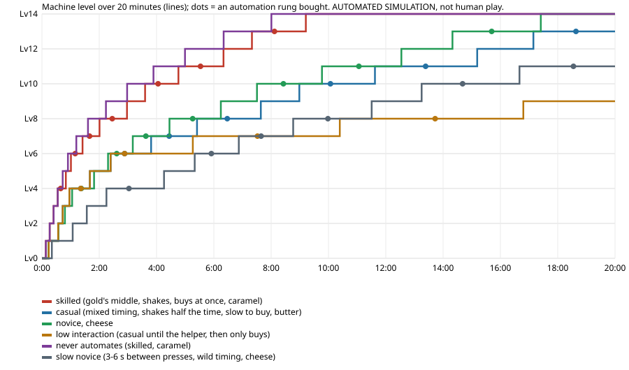

# 출시 준비도 — 팝콘 가게 (Step 11, #116)

> 이 문서의 '재미'에 관한 말은 블라인드 AI 플레이어의 대리 관찰이다. 사람의 점수는 아직 하나도 없다.
> 테스트가 통과했다는 것은 재미있다는 뜻이 아니다.

## 결론 — 조건부 Go (Step 12로), 지금 그대로의 공개 출시는 No-go

- **Step 12(다듬기·출시 후보)로 가도 된다.** 지금 빌드에 남은 블로커(플레이할 수 없게 만드는 결함)는 없다. 블라인드 AI 여섯 명이 실제 화면과 터치로 3–15분을 플레이했다(0.10.0–0.11.0).
  - 여섯 명 모두 첫 행동을 스스로 찾았다.
  - 업그레이드·자동화·양념을 겪었다(3분 플레이어 u1은 업그레이드만 겪었다).
  - 목표를 물은 두 명(w1·x1)은 정확히 설명했다.
  - 이 단계에서 찾은 높음·중간 결함은 고쳤다.
- **그대로 출시하지는 않는다.** 남은 높은 위험 하나: **저장이 없다.**
  - 15–20분짜리 판이 새로고침·탭 종료(모바일 브라우저가 백그라운드 탭을 죽인다)에 사라진다. 같은 페이지 안에서 뒤로 갔다 오는 것은 0.11.0에서 이어진다.
  - 저장은 Step 12의 범위('game state persistence')다.
- **Step 12는 소유자 승인 뒤에 시작한다**(#117의 전제: Step 09 방향, Step 10 slice, Step 11 품질 게이트의 승인).

## 1. 시험한 빌드와 환경

| | |
|---|---|
| 빌드 | **0.11.1** · `game-c69017d0353e.pck` · https://7bvcxz.github.io/gamo/popcorn-glory/#stand (블라인드 재시험은 0.11.0에서 했다) |
| 브라우저 | Playwright Chromium 156, 헤드리스, Linux x86_64(소프트웨어 렌더). 이 머신의 부하 평균 8–47(다른 세션의 작업) |
| 화면(기기 매트릭스) | 720×1280 터치(p720), 390×844 DPR2 터치(phone), 1280×800 마우스(desktop), 1920×1080, 360×640 DPR3, 768×1024 DPR2, 844×390 DPR3 가로 |
| 실제 기기 | **없음.** 공용 S23은 다른 세션이 쓰는 중이었다(조정 파일 `resources/s23.md`, 2026-11-04 01:23~). 실제 폰 시험은 Step 12의 몫 |
| 소리 | 출력 신호(RMS)를 오디오 스레드에서 잰다(`sound05`). 사람의 귀로 듣지 않았다 |

## 2. 진행과 난이도 (진짜 규칙의 시뮬레이션, `tests/results/step11/stand_sim.md`)

플레이어 모델(가정)과 결과를 나눠 적는다. 가정은 그 파일의 'Assumptions' 절에 있다: 18개 플레이어, 20분, 시드 7.

| 플레이어 | 단계 @3·5·10·15·20분 | 다 산 시각 | 3분 뒤 가장 긴 '살 것 없음' | 조수의 몫(20분) |
|---|---|---|---|---|
| 숙련(카라멜) | 9 · 11 · 14 · 14 · 14 | **8:19** | 61초 | 29% |
| 중간(버터) | 6 · 8 · 10 · 12 · 14 | **19:32** | 125초 | 53% |
| 초보(버터) | 6 · 8 · 10 · 12 · 14 | **19:15** | 117초 | 51% |
| 초보(치즈) | 6 · 8 · 11 · 13 · 14 | **17:24** | 107초 | 49% |
| 손을 거의 쓰지 않음 | 6 · 6 · 7 · 8 · 9 | — | 200초 | 94% |
| 아주 느린 초보(3–6초 간격) | 4 · 5 · 8 · 10 · 11 | — | 119초 | 52% |
| 자동화를 먼저 삼 | 6 · 7 · 10 · 12 · 14 | **19:41** | 123초 | 52% |
| 5–8분에 3분 쉼 | 6 · 8 · 9 · 11 · 13 | — | 170초 | 50% |
| 3분에 멈춤(조수 없이) | 7 그대로 | — | — | 0% — **조수 없이 손을 놓으면 아무 일도 없다**(설계대로: 오프라인 진행 없음) |

**이전(0.10.1 가격·모터)과 비교**:
- 중간 플레이어는 20분 안에 끝내지 못하다가 이제 끝낸다. 가장 긴 '살 것 없음'은 195초에서 125초로 줄었다.
- 초보(치즈)는 19:18에서 17:24로 끝났다.
- 숙련은 11:29에서 8:19로 끝났다(모터와 손 흔들기가 이제 겹친다).
- 이전 표는 `tests/results/step11/before_0.10.1/`에 있다.

- **조수 칸의 회수 시간**: 72–160초(숙련이 그 칸을 사는 단계 기준).
- **양념의 수익**:
  - 숙련: 카라멜이 가장 높다.
  - 흔들리는 손: 치즈가 가장 높다.
  - 중간: 카라멜이 앞서지만 탄 판이 많다.
- **이상한 순서로 산 경우**: 자동화를 먼저 산 플레이어(6·7·10·12·14, 19:41에 끝)는 중간 플레이어(6·8·10·12·14, 19:32)와 같은 곳에 간다. 공정한 회복이다.
- **막힌 상태·폭주**: 18명 모두 불변식 위반 0(돈 ≥ 0, 돈 = 번 돈 − 쓴 돈, 살 수 있을 때만 구매). 막다른 길도 없다(언제나 누를 수 있다).
  - 단계 사이 시간은 끝으로 갈수록 늘지만(13단계: 숙련 103초, 중간 218초), 폭주(급가속)는 없다.
- **남은 사각(dead zone)**: 중간·초보 플레이어의 10–13단계는 단계마다 130–220초가 걸린다. 그 사이에도 사다리 칸이 끼어 산다. 중간(medium)으로 남긴다.

## 3. 실제 화면으로 플레이

| 실행 | 빌드 | 길이 | 결과 |
|---|---|---|---|
| u1 블라인드 AI | 0.10.0 | 3분 | 첫 완벽 0:40, 업그레이드 3 |
| u2 블라인드 AI | 0.10.0 | 10분 | Lv7, 모터·조수, 양념 셋 |
| v1 블라인드 AI | 0.10.1 | 10분 | Lv7, 조수, 치즈 |
| **w1 블라인드 AI** | 0.10.1 | **15분** | Lv9, 사다리 2칸, 카라멜. **흔들기를 처음으로 찾음**(새 `path` 손짓 + 대기 힌트). **목표를 정확히 말함**. 13:20에 뒤로 갔다 오니 판이 사라짐 → 0.11.0에서 고침 |
| x1 블라인드 AI(재시험) | 0.11.0 | 10분 | Lv8, 사다리 3칸, 카라멜(9:01 기준). 50판 완벽·1 아까움. **손 흔들기 37번**(도구와 힌트로 다시 찾음). 뒤로 가기 문제 없음(뒤로는 9:03에 처음 눌렀다). 새로 찾은 것: 흔드는 플레이어에게 모터가 '아무것도 주지 않음', 식는 동안 누름이 '말없이 버려짐'(기록 err.cooling 3번), 카드 'x1.15'의 뜻 → 0.11.1에서 셋 다 고침(새 에이전트로 다시 시험하지는 않았다 — 결정적 시험과 캡처로 확인) |
| 스크립트 15분 | 0.10.1(로컬, 같은 팩) | 15분 | 12:30에 다 삼. 357판, 조수 32% |

- 블라인드 조건: 새 에이전트, 화면 명령만 썼다. 사후 감사로 여섯 명 모두 화면 밖 도구 호출 0. 샌드박스는 아니다(지시 + 감사).
- w1에게 목표를 물었다(질문 6). 답: "Run a growing popcorn stand. Pop each batch perfectly by releasing in the yellow window, earn coins from a growing queue of customers, and upgrade the machine into a bigger and fancier cart, adding automation and flavours as you go."

## 4. 성능 (`perf07` 'stand', 데스크톱, 레벨 14 + 사다리 일곱 칸 + 카라멜, 1분 동안 실제로 누름)

| | 0.11.0 이전 | 0.11.1 |
|---|---|---|
| 그리기 호출(최대, 예산 200) | **269**(실패) | **180** |
| 프레임(중앙값, 소프트웨어 렌더, 그때 부하 11.9 / 13.0) | 43 | 46 |
| JS 힙, 1분 | 18.2 → 18.2MB | 17.1 → 17.1MB |
| 날던 조각(상한 400) | 44 | 44 |
| 숨은 탭 5초 동안 조수의 판 | 0 | 0 |
| 다시 시작 | 돈 0, 칸 0, 버터 | 같음 |
| 소리(1분) | 지글 1,406, 동전 61, 팝 62, 띵 22 | 비슷함. 같은 소리는 45ms 안에 다시 울리지 않는다(플레이어 10개) |

- 고친 방법: 층별 측정(Xvfb)으로 기계 노드 둘이 약 158을 쓰는 것을 찾았다. 화면에서 작은 조수 냄비를 한 번 그린 텍스처로 바꿨다(약 −65). 양념통의 그림자·구멍, 봉지 줄무늬도 줄였다.
- 첫 화면까지: 블라인드 세션에서 3.4–8.4초(공개 URL, 엔진 39MB, 캐시 없음).

## 5. 결함 목록 (플레이어 영향순)

| 등급 | 결함 | 근거 | 상태 |
|---|---|---|---|
| 높음 | **저장 없음**: 새로고침·탭 종료에 판이 사라짐 | 설계(Step 10, 실험 빌드) | **열림 → Step 12** |
| 높음 | 뒤로 갔다 오면 판이 사라짐(경고 없음) | w1 "the worst moment" | 0.11.0 고침(메모리 안에서 이어짐), 통합 시험 |
| 중간 | 그리기 호출이 최고 단계에서 예산 초과(269) | `perf07` | 0.11.0 고침(178) |
| 중간 | 모터가 손 흔들기의 의미를 없앰 | w1 "quietly removed the crank skill" | 0.11.0: 모터 ×1.15, 손 ×1.3(겹치지 않음) → x1 재시험에서 반대 문제 |
| 중간 | 흔드는 플레이어에게 모터가 아무것도 주지 않음 | x1 "the gear upgrade gave me nothing... a wasted 260" | 0.11.1 고침: 둘이 겹친다(모터 ×1.15, 손 ×1.3 위에 곱함). `test_the_hand_and_the_motor_stack` |
| 중간 | 식는 동안의 누름이 아무 말 없이 버려짐 | x1 "presses were silently dropped... lost several cooks"(기록: err.cooling 3번) | 0.11.1 고침: 식는 동안 고리 위에 회색 호가 줄어들고, 그때 누르면 연기·소리·흔들림, 기록. 통합 시험 |
| 중간 | 긴 가격이 카드의 화살표를 덮음 | w1 "14,000 overlapped" | 0.11.0 고침(글자 맞춤), 캡처 |
| 중간 | 늦은 단계의 긴 기다림(중간 플레이어 195초, 20분 안에 못 끝냄) | 시뮬레이션 | 0.11.0 완화(117초). 10–13단계는 여전히 130–200초 |
| 중간 | 흔들기를 찾기 어려움 | 0.10.x 블라인드 0/3 → 0.10.1 w1 1/1(`path` 손짓) | 대기 힌트 추가. 사람의 손으로 확인할 것 |
| 중간 | 게임 시계가 4% 빨리 감(0.10.0) | 평가 도구의 배속 열 | 0.10.1 고침(1.000) |
| 낮음 | 금색 끝이 너무 엄격함(4ms 차이로 반값) | u2 | 0.10.1 고침(40ms 관용) |
| 낮음 | 살 수 없는 카드 탭이 '안 먹은' 것처럼 보임 | u2 | 0.10.1 고침(흔들림, 소리, 기록) |
| 낮음 | 손님이 장식처럼 읽힘 | u1·u2·v1·w1 | 0.10.1·0.11.0 완화(봉지를 받고, 동전이 손님에게서 날아감). 사람 확인 |
| 낮음 | ×1.15 카드의 뜻이 불분명 | w1·x1 | 0.11.1 고침: 모터 카드도 '+지금 > +다음'(돈)으로 보인다 |
| 낮음 | 양념통 시계 아이콘의 뜻이 불분명 | w1·x1 | 열림. 식는 회색 호가 그 뜻을 화면에 보여 준다(0.11.1). Step 12 다듬기 |
| 낮음 | 조수나 손님을 탭해도 누름이 됨 | w1 | 열림(화면 전체가 버튼인 설계 — B와 같다) |
| 낮음 | 가로 화면에서 양념통 숫자가 작음 | 캡처 | 열림(세로 게임) |

## 6. 모르는 것

- **사람이 재미있어하는가.** 소유자를 포함해 사람의 점수가 없다(#114부터 같다).
- 실제 폰(저사양 Android, iOS Safari)의 성능·터치 지연·소리.
- 나쁜 연결(오프라인, 느린 3G)에서의 첫 로딩. 엔진 39MB.
- 20분 뒤: 내용이 9–20분에 끝난다. 그 뒤에 할 일이 없다(의도된 slice의 끝).
- 흔들기를 사람이 찾는가. AI는 도구가 생긴 뒤 한 명이 찾았다.

## 7. Step 12 전에 반드시 바꿀 것 (짧은 목록)

1. **저장과 이어하기**(접두어 `popcorn_glory_`, 버전, 고장 난 세이브는 새로 시작). 새로고침·탭 종료 뒤에 이어지는지 브라우저로 시험한다.
2. 실제 폰 한 대 이상에서 첫 3분 + 10분(S23이 비면).
3. 끝을 보여 주기: 다 샀을 때의 상태(지금은 카드 두 장이 별). '끝났다'가 보이게 할지 소유자와 정한다.
4. 사람의 3분 점수(소유자 점수표) — 출시 판단의 가장 큰 빈칸.

## 8. 증거

- 시뮬레이션: `tests/results/step11/stand_sim.md`·`.json`·`stand_progress.svg`, 이전 `before_0.10.1/`
- 블라인드: `evidence/step10/blind_0.10.0/`, `blind_0.10.1/`, `evidence/step11/blind_0.10.1/w1_15min/`, `evidence/step11/blind_0.11.0/x1_10min/`
- 스크립트 15분: `evidence/step10/play_stand_15min_local/`
- 시험 보고서: `tests/results/step07/report.md`(로컬), `tests/results/step07/public/report.md`(공개 0.11.1: 헤드리스 92/92, 브라우저 106 통과·0 실패·12 건너뜀. 셋은 재시도에서 통과했고, 셋 모두 첫 시도가 `net::ERR_NETWORK_CHANGED`로 페이지를 열지 못한 것이다 — 다른 세션의 네트워크 변동)
- 카드 글자 맞춤: `evidence/step11/cards_fit_0.11.0.png`
