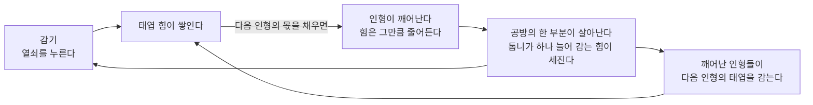

# 태엽 공방 (The Wind-Up Atelier) — 핵심 루프

> Step 01(#94)에서 정했다. 게임 코드는 아직 없다. **이 문서는 무엇을 만들지 정할 뿐이고, 숫자는 모두 가설이다** —
> 측정은 `PLAYTEST_3MIN.md`의 절차로 하고, 측정이 이 문서를 이긴다.

## 한 문장

잊힌 양복점의 먼지 쌓인 공방에서 작은 정령이 커다란 놋쇠 태엽을 감는다. 감은 힘이 잠든 태엽 인형을
하나씩 깨우고, 깨어난 인형은 다음 인형의 태엽을 함께 감는다. 공방 전체가 조금씩 살아난다.

**즐거움의 원천은 죽은 공방을 살려 내는 것이다.** 공장 효율표를 최대화하는 즐거움이 아니다.

## 정한 것 (V2 — 결정과 가설을 나눈다)

| 결정 | 무엇 | 이유 |
|---|---|---|
| 시점 | **한 방, 정면에서 본 고정 2D 무대**(16:9, PC 먼저, 1280×720 기준이 어떤 창이든 채움) | 공방 전체가 자라는 대상이므로 전체가 늘 한 화면에 보여야 한다. 스크롤·줌은 '어디를 봐야 하나'를 더한다 |
| 감기 제스처 | **열쇠를 누른다**(마우스·터치·스페이스). 누르고 있으면 같은 누름이 반복될 뿐 | 버튼처럼 보이는 것은 누른다 — 가장 발견하기 쉽다. 끌기(돌리기)는 정밀함을 요구하고 터치·접근성에 불리하며, 연타는 피로하다(Fun Lab의 450번). 누르고 있기는 피로를 없애고 상한(초당 6)이 연타의 이득을 없앤다 |
| 인형의 상태 | `DORMANT → WINDING → AWAKENING → WORKING` 하나뿐, 앞으로만, 한 번씩 | 인형은 개체이지 기계가 아니다 — 깨어나서 걸어가 다른 인형을 감는다 |
| 통화 | 태엽 힘 하나 | — |
| 첫 마일스톤 셋 | `FIRST_3_MINUTES.md` | — |
| 자동화 뒤의 플레이어 | 톱니 보너스(+25%/인형), 감기 몫 ≥30% | `FUN_HYPOTHESES.md` F6 |
| 성격 | 행동의 버릇만(호기심·수줍음·뽐냄) | 수치·메뉴 없음 |

가설과 수락 사건은 `FUN_HYPOTHESES.md`, 3분 스토리보드는 `FIRST_3_MINUTES.md`(실제 화면 8장).

## 셋뿐이다

| | 하나 | 뜻 |
|---|---|---|
| 행동 | **감기 (wind)** | 큰 놋쇠 태엽 열쇠를 누른다. 한 번 누르면 4분의 1바퀴, 누르고 있으면 계속 감긴다. 스페이스도 같다 |
| 통화 | **태엽 힘 (wind-up energy)** | 화면 위의 태엽 게이지 하나와 숫자 하나 |
| 자라는 것 | **공방 전체** | 인형이 깨어날 때마다 공방의 한 부분이 살아난다(등불·재봉틀·커튼·오르골·샹들리에·큰 시계) |

**인형은 두 번째 경제가 아니다.** 인형은 공방이 자라는 단계를 눈에 보이게 만드는 것이다. 인형을 사고, 고르고,
배치하고, 강화하고, 먹이는 일은 없다. 깨어나는 순서도 정해져 있다.

## 루프



```
플레이어   ──누름──▶ 열쇠(4분의 1바퀴, 딸깍) ──▶ 태엽 힘 +W
깨어난 인형 ──매초──────────────────────────▶ 태엽 힘 +r(인형마다)
태엽 힘 ≥ 다음 인형의 몫 C ──▶ 깨어남 연출(약 1.5초) ──▶ 힘 −C, 공방 +1단, 톱니 +1, 그 인형이 일을 시작
```

- **쓰는 버튼이 없다.** 깨어남은 힘이 다음 인형의 몫을 채우는 순간 저절로 일어난다. 플레이어가 하는 일은 감기 하나다.
- 다음 인형은 늘 하나이고 늘 보인다. 그 인형 등의 작은 태엽 둘레에 고리가 있고, 힘이 몫을 채워 갈수록 고리가 찬다.
  힘은 열쇠에서 놋쇠 관을 따라 그 인형에게 흘러가는 빛으로 보인다. 숫자를 읽지 않아도 무엇이 무엇을 채우는지 보인다.
- **깨어난 인형은 다음 인형을 함께 감는다.** 첫 인형은 일어나자마자 다음 인형에게 걸어가 그 등의 태엽을 돌린다.
  인형이 늘면 다음 인형 곁에 모이는 인형이 늘고, 나머지는 공방의 자기 자리(재봉틀·단추 상자·다리미대)에서 일한다.
  이것이 자동화의 전부다. 일정·배치·경로는 없다.
- **톱니(gear train)**: 열쇠는 벽의 톱니 줄에 물려 있다. 깨어남마다 그 줄에 톱니가 하나 늘어나고(보인다),
  플레이어가 한 번 감을 때의 힘이 조금 커진다(`W = W0 × (1 + g × 깨어난 수)`). 인형이 늘어도 감기가 의미를 잃지 않게 하려는
  장치이며, 같은 루프의 수치이지 두 번째 시스템이 아니다(업그레이드 버튼·선택이 없다). 효과가 있는지는 Step 08이 잰다(가설 H6).

## 이 저장소의 다른 게임에서 가져온 것

- **Momonium Fun Lab(`momonium/experiments/RESULTS.md`)**: 업그레이드 버튼 하나짜리 실험 넷은 3분 중 175–180초가
  '5초 이상 입력 없음'(기다림)이었고, 탭 실험 하나는 3분에 450번을 눌러 피로가 걱정이었다. 그래서 감기는
  **누르고 있어도 되는 행동**이고(연타가 필요 없다), 속도에 상한이 있어(H2) 연타가 이기지 않으며,
  기다림은 '깨어난 인형이 대신 감는 모습'을 보는 시간이 된다.
- 같은 결과의 '익음 → 직접 누르는 큰 사건' 리듬은 여기서 '몫이 참 → 깨어남'이다. 다만 깨어남은 버튼이 아니라 저절로다.
- 저장소 원칙(`AGENTS.md`): 글로 설명하지 않는다, 20초 이상 헤맬 때만 추가 안내.

## 시간표 (목표 — 측정할 가설)

| 시각 | 플레이어가 보는 것 | 성공의 모습 |
|---|---|---|
| **0–10초** | 어두운 공방, 달빛. 한가운데 큰 놋쇠 열쇠가 살짝 흔들리고, 작은 정령이 열쇠 손잡이를 밀다가 혼자는 못 돌려 고개를 갸웃한다. 가장 가까운 잠든 인형 등의 태엽에 희미한 빛 고리가 있다 | 글 없이 첫 누름이 10초 안에 온다. 누르면 딸깍 소리와 함께 열쇠가 4분의 1바퀴 돌고, 빛이 관을 따라 인형에게 가며 고리가 조금 찬다 |
| **~30초** | 첫 인형의 고리가 차고, 인형이 고개를 들고 기지개를 켜며 깨어난다. 책상 등불이 켜져 공방에 따뜻한 빛 웅덩이가 생긴다 | 의미 있는 첫 보상. 깨어난 인형이 다음 인형에게 걸어가 그 태엽을 감기 시작한다 — **두 번째 감는 손이 생긴 것이 보인다** |
| **~60초** | 둘째 인형이 깨어나고 재봉틀이 돈다. 천장의 큰 톱니가 천천히 움직이기 시작한다 | 눈에 띄는 변화. 처음 화면과 나란히 놓으면 다른 방이다 |
| **~180초** | 인형 5–6. 커튼이 열리고 마네킹이 옷을 입고 오르골이 운다. 아직 어둡고 먼지 덮인 샹들리에와 멈춘 큰 시계가 다음 목표로 보인다 | 다음 깨어남이 멀지 않고(30초 안팎), 다음 큰 변화(샹들리에)가 무엇인지 그림으로 안다. 계속하고 싶다 |

글로 된 안내는 없다. 20초 동안 아무 입력이 없을 때만 정령이 열쇠를 더 크게 밀며 쳐다보게 한다(저장소 원칙: 20초 이상
헤매면 그때 추가 안내).

## 공방의 단계 (깨어난 인형 수 → 살아나는 부분)

| 단 | 인형 | 살아나는 것 | 처음부터 보이는가 |
|---|---|---|---|
| 0 잠든 공방 | 0 | 달빛, 먼지, 멈춘 열쇠 | — |
| 1 첫 불빛 | 1 | 책상 등불 | 꺼진 등불이 보인다 |
| 2 웅웅거림 | 2–3 | 재봉틀, 천장 톱니 | 덮개 씌운 재봉틀 |
| 3 북적임 | 4–6 | 커튼, 마네킹의 옷, 오르골 | 닫힌 커튼 |
| 4 잔치 | 7–9 | 샹들리에, 깃발 줄, 춤추는 인형 | 먼지 덮인 샹들리에 |
| 5 큰 시계 | 10–12 | 큰 시계가 다시 울린다 | 멈춘 큰 시계 (MVP의 끝) |

다음 단의 물건은 처음부터 잠든 모습으로 보인다. 그래서 다음 목표를 글로 말할 필요가 없다.

## 초기 수치 가설 (사실이 아니다)

| id | 가설 | 처음 값 | 확인하는 곳 |
|---|---|---|---|
| H1 | 한 번 감기(4분의 1바퀴)의 힘 `W0` | 1 | Step 04 |
| H2 | 감는 속도 상한(누름이든 누르고 있기든) | 초당 6번. 누르고 있으면 초당 5번 | Step 04·07(연타) |
| H3 | 인형별 몫 `C` (12명) | 90, 170, 280, 430, 640, 920, 1300, 1800, 2500, 3400, 4600, 6200 | Step 08 |
| H4 | 인형별 초당 힘 `r` | 1.0, 1.4, 1.8, 2.3, 2.8, 3.4, 4.0, 4.7, 5.4, 6.2, 7.0, 8.0 | Step 08 |
| H5 | 사람이 감는 실제 속도 | 열중 4/초, 처음 해 보는 사람 2/초 | 실제 플레이 |
| H6 | 톱니 계수 `g` | 0.25 | Step 08 |
| H7 | 깨어남 연출 길이 | 1.5초(그동안에도 감기는 받는다) | Step 05 |

H1–H6을 넣은 손 계산(게임이 아니다, `0.1초` 단계의 단순 적분, `node windup/design/hand_pace.mjs`) — 게임 시작 기준
(열중은 2초, 처음 해 보는 사람은 5초에 감기 시작, 쉬지 않음):

| 전략 | 깨어난 시각(초) | 3분 안 | 감기 몫 |
|---|---|---|---|
| 열중 4/초 | 25 · 53 · 86 · 125 · 169 · 219 · 276 · 341 … 712 | 5 | 35% |
| 첫 인형까지 4/초, 그 뒤 손 놓음 | 25 · 195 · 311 · … | 1 | 0% |
| 처음 해 보는 사람 2/초 | 50 · 99 · 151 · 206 · … | 3 | 22% |

손 계산만으로도 보이는 위험: 처음 해 보는 사람은 30초 목표에 못 미친다(50초). 손을 놓으면 두 번째 인형까지 170초를 기다린다.
둘 다 Step 04·08에서 실제 규칙으로 다시 재고 조정한다. 숫자는 `windup/data/`(Step 04)에만 둔다.

## Step 04에서 정한 것 (실제 규칙, `src/game/atelier.gd` + `data/balance.json`)

- 깨어남은 버튼 없이 저절로: 힘이 다음 인형의 몫을 채우는 순간 몫을 내고 1.6초 깨어남이 시작된다(`doll_awake`). 끝나면
  일을 시작한다(`doll_ready`). 한 번에 한 명. 그동안에도 감기는 받고 힘은 다음 인형 쪽으로 쌓인다.
- 감기: 누르면 한 번, **누르고 있으면 0.25초 뒤부터 초당 5번**. 어떤 경로든 **초당 6번을 넘는 누름은 거부**(H2 — 연타가 이기지 않음).
- 깨어난 인형 중 다음 인형에 가장 가까운 셋이 걸어가 그 등의 태엽을 돌리고, 나머지는 제자리에서 일한다(보이는 자동화).
- 공방이 자라는 것: 단계마다 따뜻한 빛(책상 등불 → 열쇠 → 재봉틀 → 마네킹 → 샹들리에 → 큰 시계)과 방의 색이 달빛에서 등불로.
- 글 없는 안내: 20초 동안 입력이 없으면 정령이 열쇠로 가서 민다(`hint`).
- 저장: 10초마다·멈출 때 `user://windup_save.json`. `?fresh=1`이나 다시 시작(오른쪽 위 둥근 화살표, 두 번 눌러야)으로 새 게임.
- **H3 첫 몫 90 → 75**: 실제 규칙으로 돌린 `tools/pace.gd`에서 처음 해 보는 사람(2/초, 15초마다 3초 쉼)의 첫 깨어남이 58.5초였다.
  75로 51.0초(목표 50초에 1초 못 미침 — Step 08에서 다시 본다). 열중 4/초는 20.5초.

`godot --headless --path windup --script res://tools/pace.gd` (실제 규칙, 1/60초 단계, 0.4.0):

| 전략 | 깨어난 시각(초) | 30/60/180/600초의 인형 | 180초 감기 몫 | 180초 안 가장 긴 간격 |
|---|---|---|---|---|
| engaged 4/초 | 20.5 · 49.5 · 83.3 · 122.0 · 166.5 · 217.2 … | 1 / 2 / 5 / 11 | 63% | 44.5초 |
| holder(누르고 있음) | 17.0 · 41.3 · 70.7 · 104.9 · 144.3 · 189.4 … | 1 / 2 / 5 / 11 | 65% | 39.4초 |
| novice 2/초+쉼 | 51.0 · 107.1 · 166.0 · 228.4 … | 0 / 1 / 3 / 8 | 60% | 58.9초 |
| idle(첫 인형 뒤 손 놓음) | 20.5 · 192.1 · 309.7 … | 1 / 1 / 1 / 5 | 32% | — (두 번째까지 172초) |

## Step 05: 같은 루프, 더 만족스럽게 (새 시스템 없음)

규칙·수치는 그대로다(같은 입력에서 Step 04와 같은 상태 — before/after 캡처의 힘·인형 수가 같다). 바뀐 것은 그림과 소리뿐이다.

- **톱니(약속했던 것)**: 열쇠 뒤 큰 톱니가 실제로 돈다(감을 때마다 툭, 인형의 초당 힘만큼 계속). 깨어남마다 작은 톱니가 하나씩
  맞물려 끼어든다(첫 바퀴 6, 바깥 바퀴 6). 블라인드 AI가 "가장 읽기 쉬운 진행 표시"로 꼽았다.
- **손맛**: 열쇠가 스프링처럼 4분의 1바퀴를 지나쳤다 돌아오고, 래칫 멈춤쇠가 딸깍 튄다. 딸깍 소리는 다음 인형이 찰수록 높아진다(팽팽해짐).
- **열쇠와 다음 인형의 관계**: 둘 사이에 희미한 놋쇠 실(첫인상 테스트에서 "고리 달린 인형을 눌러야 하나?"가 나왔다).
- **깨어남의 기대**: 다음 인형이 몫의 55%를 넘으면 떨기 시작하고 80%부터 눈을 깜빡인다. 깨어나는 순간 짧은 불꽃과 빛 고리(V2: 섬광·흔들림은 뺐다).
- **방이 답한다**(블라인드 AI가 "방은 하나도 안 변한다"고 해서): 2단계에 재봉틀 덮개가 벗겨지고(바퀴가 톱니와 함께 돎),
  3단계에 마네킹의 재킷이 완성되고, 5단계에 큰 시계가 다시 간다.
- **소리가 자란다**: 오르골이 잠든 동안 침묵, 1단계 한 줄, 2단계 가득, 3단계 저음, 4단계 대선율, 5단계 시계 똑딱.
- **접근성**(글 없음, 왼쪽 위 아이콘): 스피커 = 소리 크게/절반/끔, 별 = 섬광·흔들림 끄기. 다음 방문에도 유지.
  `?sound=off`, `?motion=reduce`, 시스템의 '동작 줄이기'도 따른다.

### Step 05 V2: 인형마다 정확히 무엇이 더해지나 (모두 규칙의 상태에서 그린다)

| 깨어난 인형 | 새로 생기는 것 | 상태의 출처 |
|---|---|---|
| 0 | 차가운 달빛, 먼지 낀 모서리, 잠든 인형 12(차갑고 어둡게), 고요한 방 소리(낮은 숨소리 같은 잡음), 시계는 처음 시각 | `awake = 0` |
| 다음 인형이 찰 때 | 놋쇠 실 위로 빛 알갱이, 그 인형의 채움 고리, 55%부터 떨림·80%부터 깜빡임, 딸깍 소리가 높아짐 | `target_fill()` |
| 1 | 그 인형이 온색으로 일어나 발밑에 작은 빛, 작은 톱니 1, 책상 등불, 방 색이 데워지기 시작, 오르골 한 줄, 기계 심장 소리 시작, 시계 바늘 한 시간, 먼지가 조금 걷힘, 그 인형이 걸어가 다음 인형을 감음 | `awake = 1`, 단계 1 |
| 2 | 톱니 2, 재봉틀 덮개가 벗겨지고 바퀴가 돎, 열쇠 둘레 빛, 오르골이 가득, 시계 두 시간 | 단계 2 |
| 3 | 톱니 3, 세 번째 도우미가 줄에 섬, 일하는 인형에게서 힘 알갱이가 열쇠로 | `awake = 3` |
| 4–6 | 재킷 완성, 마네킹 쪽 빛, 오르골 저음, 따뜻한 웅웅거림이 숨소리를 덮음, 먼지가 거의 걷힘(6에서 0) | 단계 3 |
| 7–9 | 샹들리에 쪽 빛, 오르골 대선율 | 단계 4 |
| 10–12 | 큰 시계가 다시 감(진자·분침), 시계 똑딱 | 단계 5 |

하지 않는 것(V2): 카메라 흔들림, 화면 섬광, 색종이, 알림, 반짝이는 안내, 연출 끼어들기. 아무 일도 안 하는 인형이 일하는 척하지 않는다 —
깨어난 인형은 모두 초당 힘을 더하며, 그것이 도우미의 손과 일하는 인형의 힘 알갱이로 보인다.

## 계측 (Step 02부터 게임이 내보낸다)

모든 사건은 `{t, ev, ...}` 한 줄(JSON)이다. `t`는 게임 시계의 초(멈춘 동안은 흐르지 않는다).

| 사건 | 필드 | 왜 |
|---|---|---|
| `session_start` | variant, build, seed | 비교의 기준 |
| `wind` | source(`click`·`hold`·`key`), energy_added, energy | 입력량, 감기 몫 |
| `doll_awake` | index, cost, energy_rate, awake_before (깨어남이 시작될 때) | 보상 시각과 간격 |
| `doll_ready` | index, energy_rate (깨어남이 끝나 일을 시작할 때) | 자동 힘이 붙는 시각 |
| `restart` | dolls | 다시 시작 |
| `stage` | stage | 공방이 자란 시각 |
| `idle` | seconds (5초 이상 입력 없음이 끝날 때) | 기다림의 벽 |
| `hint` | reason(`idle20`) | 글 없는 안내가 필요했는가 |
| `pause` / `resume` | why(`focus`·`hidden`) | 멈춤 정책 확인 |
| `session_end` | dolls, energy, inputs | 요약 |

파생 지표: 첫 입력 시각, 첫·둘째 깨어남 시각, 10·30·60·180초의 인형 수와 초당 힘, 입력 수, 5초 이상 무입력의 합과 최대,
깨어남 간격의 최대값과 이웃 간격의 비, 감기 몫(플레이어 / 전체).

## 멈춤과 저장

- **창이 포커스를 잃거나 탭이 숨으면 게임 시계가 멈춘다. 자리를 비운 동안은 아무것도 진행되지 않는다**(오프라인 진행 없음).
  돌아오면 그대로다. 입력이 적은 게임이라도 '기다리면 저절로'를 약속하지 않는다.
- 진행은 그 브라우저·기기(user://)에만 저장한다. 새 게임은 디버그 초기화와 같은 경로 하나로 만든다(Step 02).

## 넣지 않는 것

인벤토리, 연구 트리, 두 번째 통화, 상점, 업그레이드 버튼, 일정, 인형 배치·선택·강화, 가챠, Prestige, 오프라인 진행,
글로 된 튜토리얼, 퀘스트 목록, 일일 보상, 계정·서버. 재미가 모자랄 때 이 중 하나를 몰래 더해 해결하지 않는다 —
더해야 한다면 그것은 새 Step이고 사용자가 정한다.

## 재미가 어디서 오는가 — 셋을 가른다 (Step 06)

| | 가설 | 이 변형만 키우는 것 |
|---|---|---|
| A | **감는 손맛** | 열쇠의 저항, 딸깍, 감길수록 팽팽해지는 소리 |
| B | **깨어남의 기대** | 누가 깨어날지, 깨어나는 순간의 연출 |
| C | **서로 깨우는 연쇄** | 인형이 인형을 깨우는 것이 눈에 보이는 자동 연쇄 |

세 변형 모두 행동·통화·자라는 것은 같다. 다른 것은 어떤 보상이 주인공인가다.

## MVP의 끝

- **게임의 끝**: 열두 번째 인형이 깨어나면 큰 시계가 울리고 공방이 다 살아난다. 그 뒤로도 인형들은 일하고 감기는 받지만,
  새로 살아날 것은 없다. 열중 4/초 손 계산으로 약 12분(가설).
- **개발을 멈추는 조건**: 한 변형 이상이 실제 빌드에서 `PLAYTEST_3MIN.md`의 기준을 통과하고 사람 점수가 모일 때까지
  새 시스템을 더하지 않는다. 그다음 무엇을 할지는 사람의 점수를 보고 정한다.
