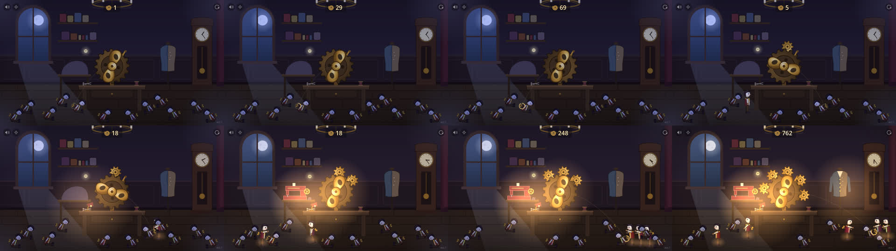

# 첫 3분 — 스토리보드와 수락 사건

> Step 01 V2(#94). 그림은 **실제 게임 화면**이다(0.5.1, `tools/capture.gd --hold`: 열쇠를 누르고 있는 한 가지 입력으로 재현 가능,
> 1280×720). 시각은 그 입력의 시각이고, 사람의 시각은 `PLAYTEST_3MIN.md`와 플레이 기록으로 잰다.

| # | 그림 | 시각 | 보이는 상태 | 플레이어가 아는 것 | 수락 사건(계측) |
|---|---|---|---|---|---|
| 1 | `storyboard/1_000s.jpg` | 0초 | 차갑고 고요한 공방. 달빛, 먼지 낀 모서리, 잠든 인형 12명(차갑고 어둡게), 가운데 큰 놋쇠 열쇠가 살짝 흔들림, 정령이 그 곁에 | "저 열쇠가 이 방의 손잡이다" | `session_start` |
| 2 | `2_008s.jpg` | 8초 | 누를 때마다 열쇠가 딸깍 돌고, 빛 알갱이가 놋쇠 실을 따라 가장 가까운 인형에게 흐른다. 그 인형 태엽의 고리가 찬다 | "감으면 저 인형이 찬다" | 첫 `wind` ≤10초 |
| 3 | `3_016s.jpg` | 16초 | 고리가 거의 참. 그 인형이 떨고 눈을 깜빡인다. 딸깍 소리가 팽팽해진다 | "곧 무언가 일어난다" | — |
| 4 | `4_016s_waking.jpg` | 16.7초 | 깨어남: 종소리, 빛 고리, 불꽃, 기지개. 열쇠 뒤에 첫 작은 톱니가 맞물려 끼어든다 | "깨웠다" | `doll_awake` 20–40초(사람) |
| 5 | `5_026s.jpg` | 26초 | 깨어난 인형이 걸어가 **다음 인형의 등 태엽을 돌린다**. 책상 등불이 켜지고 방이 따뜻해진다. 오르골이 한 줄 운다 | "이제 인형이 나를 돕는다" (첫 '와') | `help` (첫 도움) |
| 6 | `6_045s.jpg` | 45초 | 둘째 인형이 깨어남. 덮개가 벗겨진 재봉틀이 돌고, 톱니가 둘, 시계 바늘이 두 시간 나아감 | "방이 살아난다" | 60초에 인형 2, 단계 2 |
| 7 | `7_090s.jpg` | 90초 | 깨어난 인형 셋이 줄지어 다음 인형을 감고, 일하는 인형에게서 힘 알갱이가 열쇠로 날아간다(자동 기여가 보임) | "내가 안 감아도 굴러간다 — 그래도 내가 감으면 빨라진다" | 감기 몫 ≥30% |
| 8 | `8_180s.jpg` | 180초 | 인형 5, 톱니 5, 재킷 완성, 오르골에 저음. 아직 잠든 인형 7, 꺼진 샹들리에, 멈춘 진자가 다음 목표로 보임 | "다음은 저기다" | 180초 인형 4–7, 다음까지 ≤40초 |

## 첫 마일스톤 셋의 해금 규칙 (데이터 `data/balance.json`)

| 마일스톤 | 규칙 | 보이는 변화 |
|---|---|---|
| 1 첫 불빛 | 태엽 힘이 첫 인형의 몫 75에 닿으면 저절로 | 그 인형이 깨어나 일함, 톱니 1, 책상 등불, 방 색이 따뜻해지기 시작 |
| 2 웅웅거림 | 둘째 인형의 몫 170 | 재봉틀 덮개가 벗겨지고 돎, 열쇠 둘레의 빛, 오르골이 가득 |
| 3 북적임 | 넷째 인형까지(몫 280·430) | 재킷 완성, 마네킹 쪽 빛, 오르골 저음 |

## 자동화 뒤에도 남는 플레이어의 몫

- 감는 힘이 깨어난 인형마다 25%씩 커진다(톱니가 하나 늘 때마다 — 보이는 이유가 있다).
- 실제 규칙 페이스 표에서 열중한 플레이어의 감기 몫은 180초에 63%다. 손을 놓은 플레이어는 둘째 인형까지 172초를 기다린다 — 기다리면 오지만 감으면 훨씬 빨리 온다.

## 3분 너머 (설계하지 않고 그려만 본다)

- 열중 4/초 기준(실제 규칙): 10분에 인형 11, 열두 번째는 약 12분 — 큰 시계가 다시 가면 공방이 다 살아난다(MVP의 끝).
- 30분: 이미 끝난 공방. 새 시스템 없이는 할 일이 없다 — 그것이 MVP의 정직한 끝이고, 그다음은 Step 12의 확장 제안이 사용자 승인을 받은 뒤다.
